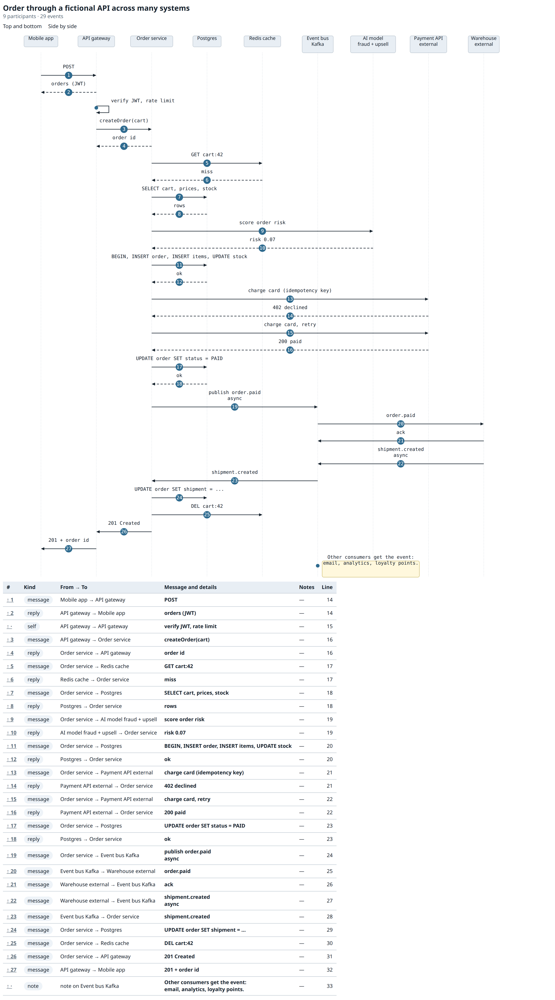
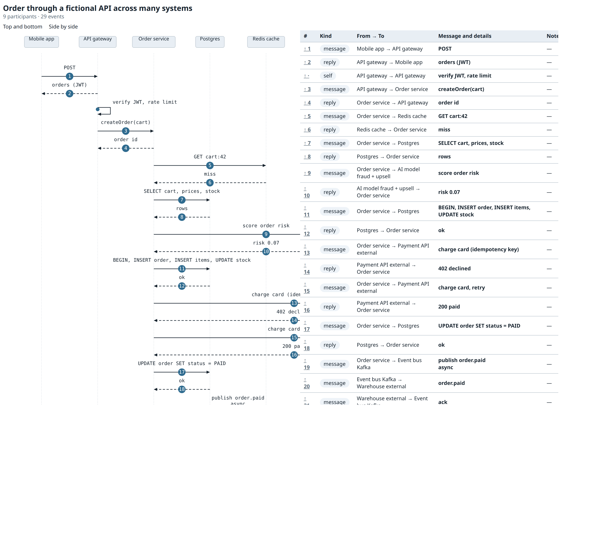
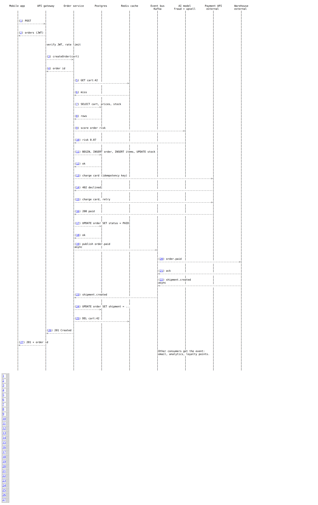
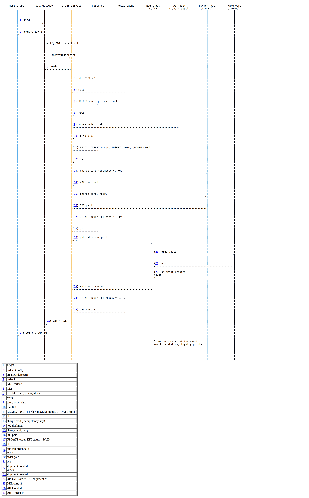
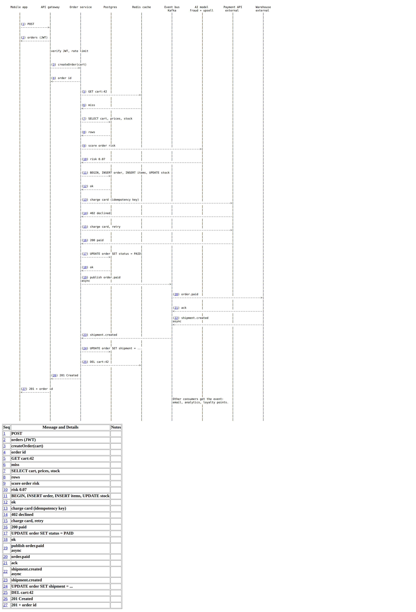
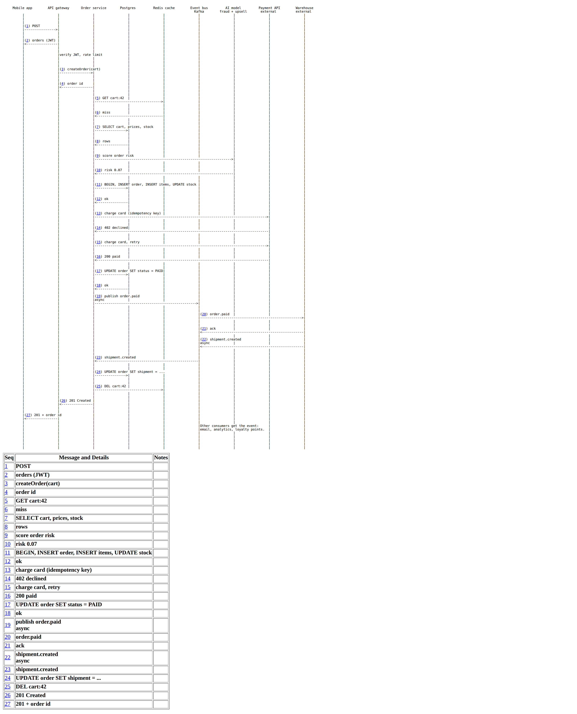
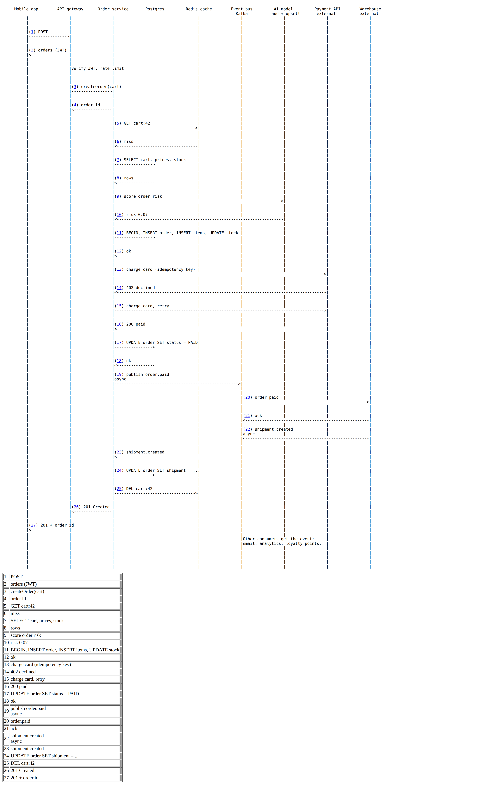
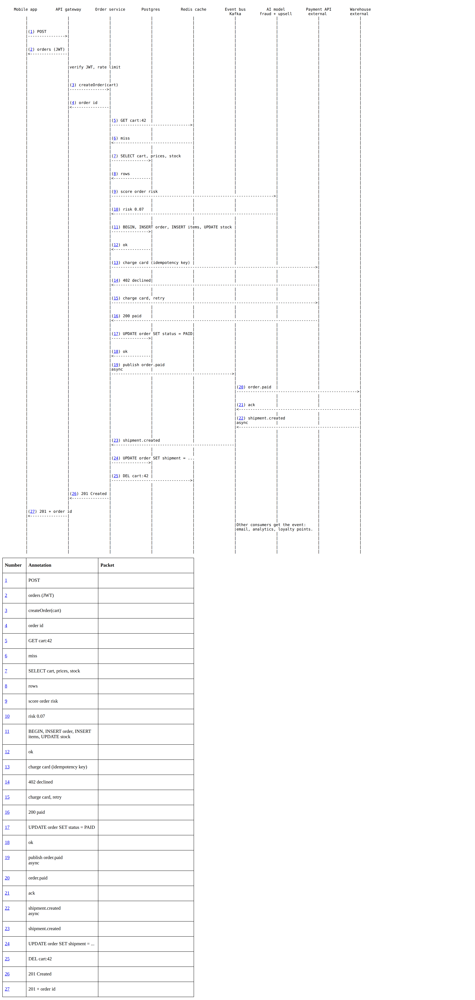

# callplot

Turn a plain-text call flow into a sequence diagram: ASCII art, SVG, Mermaid,
PlantUML, a linked HTML page, and more.

callplot-python is a Python port of **callplot**, the Java tool by Dave Ladd at
dynamicsoft. Its classic outputs are byte-for-byte the same as the original,
bugs and all.

## Install

```sh
pip install callplot-py        # needs Python 3.12 or newer
```

This installs 3 commands: `callplot`, `plottable`, and `callplot-prep`.
`python3 -m callplot` is the same as `callplot`. In the repo instead of from
PyPI: `pip install -e '.[dev]'` inside a virtual environment, and the same
three commands appear in its `bin/` folder of the environment. There is no
`bin/` folder in this repository.

## Quick start

Write a file named `fred`:

```
opt/columnPitch/15
guy/f/Fred
guy/b/Barney
f->b/Please
note/b/Gives bowling ball
b->f/Stuff
b..f/RTP
f->b/Thank You
b->f/You're Welcome
```

Run `callplot fred`:

```
        Fred          Barney
          |              |
          |              |
          |              |
          |Please        |
          |------------->|
          |              |
          |              |
          |              |Gives bowling ball
          |              |
          |              |
          |              |
          |Stuff         |
          |<-------------|
          |              |
          |              |
          |RTP           |
          |..............|
          |              |
          |              |
          |Thank You     |
          |------------->|
          |              |
          |              |
          |You're Welcome|
          |<-------------|
          |              |
          |              |
          |              |
```

Run `callplot -html fred > fred.html` and open it in a browser
for the drawn version with a linked detail table.

## Sample output

`-html` makes one page: the drawn diagram with numbered badges, and a detail
table whose rows link back to the diagram. The layout is a radio button inside
the page; side by side needs a window 1100 px or wider. Captured from
`docs/diagrams/api.msd`, the widest example diagram (9 systems, 27 events):




`-table=style` pairs the ASCII diagram with a linked table. All six styles,
the same input (`docs/diagrams/api.msd`):








The pictures are `docs/images/*.png`, regenerated by `make shots`, which
renders `docs/diagrams/api.msd` through this port's own CLI headless.

## Input language

One command per line.

| Line | Meaning |
|---|---|
| `guy/a/Alice^UA` | Add a participant. `a` is its short name. `^` starts a new label line. |
| `a->b/INVITE` | Arrow from `a` to `b`. |
| `a->b/INVITE/200 OK` | Request and reply. Each extra field flips the direction. |
| `a..b/RTP` | Dotted line, no arrowhead (for example a media stream). |
| `a--b/RTP` | Dotted line. OmniGraffle repeats the label in each column. |
| `note/a/Phone rings` | A note on `a`'s lifeline. |
| `opt/name/value` | Set an option (see below). |
| `!text` | A comment on the last message. Shown in the "Notes" column of tables. |
| `!!text` | A detail on the last message. Shown with the message in tables. |
| `-a->b/X` | A leading `-` hides the next message. |
| `# text` | A comment line. Ignored. |
| `\/` | A literal `/` in a caption. |

Lines that start with a space are not read as `guy`, `note`, or `opt` lines.
This is how the original tool works.

## Outputs

| Flag | Output |
|---|---|
| (none) | ASCII art |
| `-pic` | pic(1) |
| `-xml` | ASCII art plus annotations, as XML |
| `-vml`, `-vxml` | Vector Markup Language (old Internet Explorer and Office) |
| `-svg` | SVG |
| `-graffle` | OmniGraffle 5 |
| `-table[=style]` | HTML or Word table with links to the diagram. Styles: `archtable` (default), `htmltable`, `htmltable2`, `htmltable3`, `nolinks`, `wordtable`. |
| `-mermaid` | Mermaid `sequenceDiagram` (new) |
| `-plantuml` | PlantUML sequence diagram (new) |
| `-html[=layout]` | A modern HTML page: drawn diagram plus linked detail table. Layout `topbottom` (default) or `sidebyside`. (new) |

A flag applies to every file after it: `callplot a.txt -svg b.txt c.txt`.
Use `-` to read standard input.

## Options

| Option | Default | Effect |
|---|---|---|
| `messageNumbering` | off | Number the messages: `(1) INVITE`. |
| `noteNumbering` | off | Also number notes and self-messages. |
| `columnPitch` | 10 | Characters between lifelines. |
| `linePitch` | 4 | Lines between messages. |
| `crunch` | off | Remove empty lines. |
| `stagger` | off | Offset every second label box (SVG, VML, Graffle). |
| `topLabel` / `bottomLabel` | on / off | Show labels at the top / bottom. |
| `title` | — | Title for Mermaid, PlantUML, and HTML. |
| `htmlLayout` | `topbottom` | `topbottom` or `sidebyside` for `-html`. |

Booleans accept `on/off`, `yes/no`, `true/false`. See DESIGN.md section 3.3 for
all options.

## Annotated tables

```sh
callplot -table=htmltable3 flow.txt > flow.html
plottable -style htmltable3 flow.txt > flow.html     # same, old command form
```

Turn on `opt/messageNumbering/on`. Only numbered messages get a table row.
In table output, write `&lt;`, `&gt;`, and `&amp;` for `<`, `>`, and `&` in
annotations. A raw `<` or `&` is an error, as in the original tool.

## Import a packet trace

```sh
callplot-prep --links trace.txt > flow.txt
callplot -html flow.txt > flow.html
```

`callplot-prep` reads a text trace with `Date`, `Source Address`, and
`Destination Address` lines and SIP or HTTP start lines. Add `--links` to turn
on diagram links; add `--debug-file path` for the converter's debug lines.

## Use it as a library

```python
from callplot import render, Mode

print(render(open("fred", encoding="utf-8").read(), Mode.TEXT))
svg = render(text, Mode.SVG)
page = render(text, Mode.HTML, options=RenderOptions(html_layout=HtmlLayout.SIDEBYSIDE))
```

`render` is pure: a string in, a whole document out, or a throw. One
`ctx=RunContext()` shared across calls carries the Graffle ids and the
stagger alternation over files, like the Java statics.

`render` is pure: a string in, a string out. It throws on bad input.

## Compatibility

The classic outputs (ASCII, pic, XML, VML, SVG, OmniGraffle, the 6 table
styles, and `callplot-prep`) match the original Java tool byte for byte,
including its known quirks. For example, these outputs do not escape `&` or
quotes. Do not put untrusted text in them. The new outputs (Mermaid, PlantUML,
HTML) escape all text. The known differences are listed in
[docs/appendix-b.md](docs/appendix-b.md) and DESIGN.md Appendix B.

## Development

```sh
make check        # ruff, mypy --strict, and pytest with coverage (>= 90%)
make test         # pytest over tests/ (unit, golden, cli, snapshot layers)
make fuzz         # 10,000 seeded cases x 7 modes, harness oracle vs port
make oracle-check # probe table + trust check: harness vs one JVM per run
make refs         # regenerate samples/reference (oracle + approved snapshots)
make shots        # regenerate the README screenshots (renders docs/diagrams/api.msd)
make dist         # python -m build + twine check + tools/check_dist.py
```

The gate tools are ruff, mypy and pytest from the `dev` extra
(`pip install -e '.[dev]'`). The CI job `.github/workflows/python.yml` runs
the same thing on Python 3.12, 3.13 and 3.14.

The golden files come from the original tools: Java 8, Xalan, and mawk. The
corpus is shared with the callplot-js port; the goldens here are committed
as pinned bytes.

Examples of every output for every sample are in `samples/reference/`.

## License

LGPL-2.1-only, the same as the original callplot. Original code © dynamicsoft.
