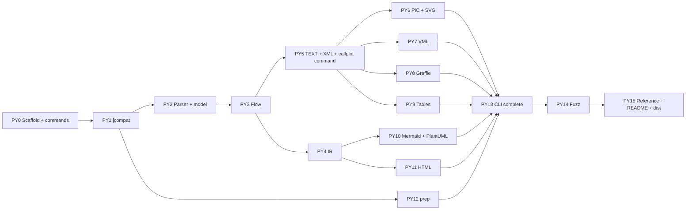

# callplot-py — Python Design and Work Plan

Status: Ready for implementation · Author: Edgar Villanueva (with Claude) · Version: 1 · Date: 2026-11-08 · Runtime: Python 3.12 or newer · Companion to: DESIGN.md Version 11 · Reference runtime: OpenJDK 1.8.0_504

This document is a **companion** to `DESIGN.md`. It tells the builder how to make the Python port. The builder is a coding agent or a junior developer.

**Which document wins**

1. **Behavior** (what each output contains, byte for byte): `DESIGN.md` and the Java oracle win. This document never changes an output.
2. **Language, tools, files, and commands**: this document wins. `DESIGN.md` describes Node.js. Do not copy its Node tools.
3. If you find a conflict, stop. Ask Edgar. Write the conflict in Appendix B.

**How to read this document**

1. Read section 1 (Overview) and section 2 (High Level Design). They take about 20 minutes.
2. Do the checklist in section 1.5.
3. Go to section 5 (Work Plan). Do the chunks in order. Each chunk names the parts of `DESIGN.md` and of this document to read.
4. Read sections 3 and 4 one part at a time, when a chunk asks for it.

**Verified claims.** Items tagged ✅ were run on 2026-11-08 with Python 3.15.2 on macOS. They cover the packaging skeleton, the lint rules, and the Python behaviors in section 3.4 (all rows except the `print()` row).

---

## 1. Overview

### 1.1 Goal

Port callplot to Python 3.12 or newer. The Python port must give the **same bytes** as the Java oracle, in the same 17 outputs as the JS port. It must look and work like a normal Python package. A user installs it with `pip`. The user then types `callplot`, `plottable`, and `callplot-prep`.

| Group | Outputs | Oracle |
|---|---|---|
| Compatible | 7 core modes, 6 table styles, `callplot-prep` | Java 8, Xalan, awk. The goldens already exist from the JS port. |
| New | Mermaid, PlantUML, HTML top and bottom, HTML side by side | The snapshots that Edgar approved for the JS port |

### 1.2 Why this document exists: the first attempt was too literal

The first Python port copied the JS port file by file. It also copied the JS **file layout**. It made a `bin/` folder with scripts that a user must run by path:

```
python3 bin/callplot.py --help
python3 bin/plottable.py -style htmltable3 flow.txt > flow.html
python3 bin/callplot-prep.py --links trace.txt > flow.txt
```

Nobody installs a Python tool like this. In JS, `package.json` maps `bin/*.js` to commands. Python has its own way: an **entry point** in `pyproject.toml`. After `pip install`, the user types the commands below.

```
callplot --help
plottable -style htmltable3 flow.txt > flow.html
callplot-prep --links trace.txt > flow.txt
```

Avoid the same mistake in other places. Each row is a JS habit and its Python way.

| JS habit (do not copy) | Python way |
|---|---|
| `bin/*.js` files | `[project.scripts]` entry points. There is **no** `bin/` folder. Section 3.1. |
| `camelCase` names | `snake_case` for functions and variables. `PascalCase` for classes. `UPPER_SNAKE_CASE` for constants. Names that appear **in output or input** (for example `messageNumbering`, `NumberFormatError`) stay exactly as `DESIGN.md` writes them. |
| Option objects `{ tableStyle: 'x' }` | A frozen `dataclass` (`RenderOptions`) and `enum` types. Section 2.3. |
| `MODES.SVG` plain numbers | `enum.IntFlag` (`Mode.SVG`). |
| JS classes with get and set methods | `@dataclass(slots=True)` classes with plain fields. |
| `RunContext` as a class with methods | A small `dataclass`. Section 3.5. |
| `Out` class with `print` and `println` | `io.StringIO`. |
| Template literals with numbers | f-strings, but numbers go through `fmt_i` and `fmt_d` first. Section 3.3. |
| `switch` on the mode | A `match` statement with a closing `case _:`. |
| JSDoc and `// @ts-check` | Type hints and `mypy --strict`. |
| ESLint | `ruff`. |
| `node:test` and golden helpers | `pytest` with markers and `parametrize`. |
| `npm pack` file allowlist | A wheel check (`python -m build`, `twine check`, `tools/check_dist.py`). |
| `src/render/` folder | `src/callplot/renderers/`. A package named `render` would hide the `render()` function. Section 2.2. |
| `src/prep/prep.js` | `trace_prep.py`. A module named `prep` would hide the `prep()` function. |

### 1.3 Key decisions

| # | Decision | Reason |
|---|---|---|
| **PD1** | Python `>=3.12`. Zero runtime dependencies. Test on 3.12, 3.13, 3.14, and 3.15. | 3.12 is the oldest line that still gets fixes. Zero dependencies keeps the wheel small and safe. |
| **PD2** | Distribution name `callplot-py`. Import name `callplot`. `src` layout. Build backend `hatchling`. | The `src` layout stops tests from importing the source folder by accident. ✅ The skeleton in section 3.1 builds. |
| **PD3** | The 3 commands are installed by **entry points**. There is no `bin/` folder. | This is how Python tools ship. Section 3.1. |
| **PD4** | **One repository, two ports.** The Python port lives in `python/`. Shared data stays at the repo root: `test/`, `samples/`, `reference/`, `tools/`. Python only **reads** them. | One set of goldens. No copies can drift apart. |
| **PD5** | Behavior comes from `DESIGN.md`. Java is the oracle. | Same rule as the JS port. |
| **PD6** | Text inside the port is held as **UTF-16 code units**, like a Java `char`. Section 3.2. | Python counts code points, not code units. This changes layout widths for emoji. |
| **PD7** | The core does no I/O. Only 4 modules may touch `sys`, `os`, `pathlib`, `subprocess`, or `argparse`: `cli.py`, `plottable.py`, `prep_cli.py`, `__main__.py`. `ruff` enforces this. | Same idea as the JS "pure core" rule. ✅ The rule was tested. |
| **PD8** | The 4 new outputs must equal the **JS-approved snapshots**, byte for byte. Python makes **no** snapshots of its own. | Edgar already approved them. Two sets of snapshots could drift apart. |
| **PD9** | Dev tools: `pytest`, `pytest-cov`, `ruff`, `mypy`, `build`, `twine`. Ask before you add another. | |
| **PD10** | The builder **never writes Java**. All Java files are provided (`DESIGN.md` section 4.5.1 and 4.5.2). | An earlier agent went into a text loop while it wrote Java. |

### 1.4 What carries over from DESIGN.md

| `DESIGN.md` section | Use in the Python port |
|---|---|
| 1.3 Reference sources, 1.4 Output matrix, 1.5 Glossary | Unchanged. |
| 3.1–3.4 Parser, model, options, layout, renderers | **The behavior to build.** Follow the algorithms step by step. |
| 3.5 Java-compatibility layer | The helper list stays. This document gives the Python version (section 3.3). |
| 3.6 `RunContext` | Same 3 counters. Section 3.5 here. |
| 3.7 CLI | Same flags and exit codes. Section 3.6 here. |
| 3.8 Quirks | Unchanged. Do **not** fix any of them. |
| 3.9–3.14 New outputs, tables, prep | The behavior to build. |
| 4.2–4.4 Oracle, fixtures, CLI cases | **Reused as they are.** Do not regenerate them. |
| 4.5.1–4.5.3 Fast oracle, probes, traps | **Reused as they are.** The Java files are provided. |
| 4.7 Snapshots, 4.10 Reference samples | **Reused.** Python compares to them. |
| 2.5 Node best practices, 2.6 CI, 4.8 Browser tests, 4.9 Quality gates | **Replaced.** Sections 2.5, 2.6, and 4.8 here. |
| 5 Work Plan, 6 Estimate | **Replaced.** Sections 5 and 6 here. |

### 1.5 Before you start (checklist)

1. Open `DESIGN.md`. Line 3 must say `Version: 9` or a higher number. If it does not, ask Edgar.
2. Read this document once from top to bottom.
3. Run `python3 --version`. It must be 3.12 or newer.
4. Run `java -version 2>&1`. It must show `1.8.0`. Java is used only by the shared tools.
5. Check that the shared data exists:
   - `find test/golden -maxdepth 1 -name '*.out' | wc -l` prints `697`.
   - `reference/build/com/dynamicsoft/callplot/Main.class` exists.
   - `reference/build-tools/FuzzOracle.class` and `reference/build-probes/ExitProbe.class` exist.
6. Chunks PY10 and PY11 need the approved snapshots in `test/snapshots/`. If they are not there, do the other chunks first. Tell Edgar.
7. If any item fails, stop. Ask Edgar. Do not rebuild the shared data yourself.
8. Create the work folder: `mkdir -p python/docs`. Progress notes go in `python/docs/progress.md`.

---

## 2. High Level Design

### 2.1 The commands

A user installs the package once. Then the 3 commands exist in the shell.

```
pip install ./python            # or: pipx install ./python
callplot --help
callplot -svg fred > fred.svg
plottable -style htmltable3 flow.txt > flow.html
callplot-prep --links trace.txt > flow.txt
python3 -m callplot -svg fred   # same as the first command form
```

A developer installs it in a virtual environment, in edit mode:

```
python3 -m venv python/.venv
. python/.venv/bin/activate
pip install -e './python[dev]'
```

`pip` writes one small wrapper program for each entry point, into the `bin/` folder of the virtual environment. The wrapper calls `sys.exit(main())`. So each `main()` **returns the exit code as an `int`**.

### 2.2 Module map

All modules are in `python/src/callplot/`.

| Python module | JS module | Responsibility |
|---|---|---|
| `constants.py` | `constants.js` | `Mode` (`IntFlag`) and the fixed numbers. Section 2.3. |
| `errors.py` | error classes in `jcompat.js` | `CallplotError` and its subclasses. Section 3.5. |
| `jcompat.py` | `jcompat.js` | `to_units`, `from_units`, `read_lines`, `fmt_i`, `fmt_d`, `idiv`, `fdiv`, `parse_java_int`, `java_trim`, `java_split`, `tokenize`, `CharBuf`. Section 3.3. |
| `context.py` | `context.js` | `RunContext`. |
| `model.py` | `model.js` | `Player` and `Message` data classes. |
| `parser.py` | `parser.js` | `parse(lines) -> Flow`. DESIGN 3.1. |
| `options.py` | (JS options bag) | `RenderOptions`, `TableStyle`, `HtmlLayout`, `parse_table_style`, `parse_html_layout`. |
| `flow.py` | `flow.js` | Options, `layout()`, numbering. DESIGN 3.3 and 3.4.0. |
| `ir.py` | `ir.js` | `build_model(flow)`. DESIGN 3.9. |
| `escape.py` | `escape.js` | `esc_html`, `esc_mermaid`, `esc_plantuml`. |
| `renderers/text.py`, `pic.py`, `svg.py`, `vml.py`, `graffle.py` | `render/*.js` | One renderer for each core mode. |
| `renderers/mermaid.py`, `plantuml.py` | same | New outputs. |
| `renderers/table/__init__.py` and `archtable.py`, `htmltable.py`, `htmltable2.py`, `htmltable3.py`, `nolinks.py`, `wordtable.py` | `render/table/*.js` | Shared row list, and one module for each style. |
| `renderers/html/layout.py`, `svg.py`, `page.py`, `style.py` | `render/html/*.js` | The new `-html` output. |
| `trace_prep.py` | `prep/prep.js` | `prep(text, *, links)`, `awk_fields`, `awk_num`. |
| `api.py` | `index.js` | `render()`. Converts text to code units and back. Picks a renderer with `match`. |
| `__init__.py` | `index.js` exports | Public names and `__all__`. |
| `cli.py` | `bin/callplot.js` | `main()` for the `callplot` command. |
| `plottable.py` | `bin/plottable.js` | `main()` for the `plottable` command. |
| `prep_cli.py` | `bin/callplot-prep.js` | `main()` for the `callplot-prep` command. |
| `__main__.py` | — | `python -m callplot`. Calls `cli.main()`. |
| `py.typed` | — | Empty marker file. It tells type checkers that the package has types. |

### 2.3 Public API

```python
from callplot import render, prep, Mode, RunContext, RenderOptions, TableStyle, HtmlLayout

svg = render(source_text, Mode.SVG)                       # fresh counters
ctx = RunContext()                                         # the CLI shares one ctx across files
render(a, Mode.GRAFFLE, ctx=ctx)
render(b, Mode.GRAFFLE, ctx=ctx)

table = render(source_text, Mode.TABLE, options=RenderOptions(table_style=TableStyle.HTMLTABLE3))
page = render(source_text, Mode.HTML,
              options=RenderOptions(html_layout=HtmlLayout.SIDEBYSIDE, id_prefix="flow1-"))
msd = prep(trace_text, links=True)
```

- `render(text: str, mode: Mode, *, ctx: RunContext | None = None, options: RenderOptions | None = None) -> str`.
  - It builds the whole output in memory and returns it.
  - On a bad input it raises a `CallplotError`. It returns no output.
  - It never prints and never reads a file.
- `RenderOptions` is a frozen `dataclass` with 3 fields: `table_style: TableStyle = TableStyle.ARCHTABLE`, `html_layout: HtmlLayout | None = None`, and `id_prefix: str = ""`. When `html_layout` is set, it overrides `opt/htmlLayout` in the input.
- `TableStyle` is a `StrEnum` with `ARCHTABLE`, `HTMLTABLE`, `HTMLTABLE2`, `HTMLTABLE3`, `NOLINKS`, and `WORDTABLE`. `parse_table_style(name)` also accepts `tmltable` (same as `htmltable`). An unknown name raises `CallplotError`.
- `HtmlLayout` is a `StrEnum` with `TOPBOTTOM` and `SIDEBYSIDE`. `parse_html_layout(value)` raises `CallplotError` on an unknown value.
- `Mode` is an `IntFlag`: `TEXT=1, PIC=2, XML=4, VML=8, SVG=16, GRAFFLE=32, MERMAID=0x40, PLANTUML=0x80, HTML=0x100, TABLE=0x200`, and the alias `VXML = VML | XML`.
- `prep(text: str, *, links: bool = False) -> str`.
- `__init__.py` defines `__all__`, and `__version__` (read with `importlib.metadata.version("callplot-py")`).

### 2.4 Repository layout

```
callplot-js/                         the existing repository
├── python/
│   ├── pyproject.toml, README.md, LICENSE, .python-version (contains 3.13)
│   ├── src/callplot/                the package (section 2.2)
│   │   ├── renderers/               text, pic, svg, vml, graffle, mermaid, plantuml
│   │   │   ├── table/               __init__.py + 6 style modules
│   │   │   └── html/                layout, svg, page, style
│   ├── tests/
│   │   ├── conftest.py, paths.py
│   │   ├── unit/                    test_*.py
│   │   ├── golden/                  test_golden.py, test_snapshots.py, test_reference.py
│   │   └── cli/                     test_cli.py
│   ├── tools/                       oracle_client.py, fuzz.py, check_dist.py
│   └── docs/progress.md
├── test/ samples/ reference/ tools/ DESIGN.md DESIGN-PYTHON.md     SHARED. Python reads only.
```

- The shared folders are owned by the JS port. Do not edit, move, or regenerate anything in them.
- The one exception: Python fuzz may **add** fixtures named `pyseedS_caseK` to `test/fixtures/fuzz/` (section 4.6).
- If Edgar wants a separate repository later, copy the 4 shared folders in. Keep them byte equal.

### 2.5 Python best practices

These rules replace section 2.5 of `DESIGN.md`. The sources are PEP 8, PEP 561, PEP 621, PEP 639, and the Python Packaging User Guide.

| Area | Practice | What to do in this project |
|---|---|---|
| Structure | `src` layout. Folders by job. | The package is in `python/src/callplot/`. One renderer in each module. |
| Naming | PEP 8 | `snake_case`, `PascalCase`, `UPPER_SNAKE_CASE`. The Java field `from` becomes `from_`. Names that appear in input or output keep the `DESIGN.md` spelling. |
| Types | Type hints on every function. | `mypy --strict` must give 0 errors. `py.typed` is in the package. |
| Data | `dataclass` and `enum` for fixed shapes. | `@dataclass(slots=True)` for `Player` and `Message`. `frozen=True` for `RenderOptions`. No `dict` for a fixed shape. |
| Lint and format | `ruff` | Rules: `E F W I N UP B SIM PT RUF S TID`. `ruff check` and `ruff format --check` give 0 findings. |
| Imports | Absolute, at the top | `from callplot.jcompat import fmt_d`. No `import *`. No import inside a function. |
| Import side effects | None | Importing a module changes no state. The 3 Java `static` counters live in `RunContext`. |
| Errors | Custom exceptions | All subclass `CallplotError`. No bare `except:`. Use `raise X from err` when you wrap an error. |
| Errors, one place | One handler for each command | Each command's `main()` has one `try`. The core does not catch errors. |
| Exit | Return an `int` | `main()` returns the code. The wrapper calls `sys.exit`. Flush stdout first. Never call `os._exit`. |
| Files | Bytes in, bytes out | Read with `Path.read_bytes()`. Write to `sys.stdout.buffer`. Only the command modules do this. |
| Strings | f-strings and `io.StringIO` | No `+=` in a loop over output lines. |
| Dispatch | `match` | `api.py` imports every renderer at the top and ends with `case _:`. No `importlib` by name. No `eval`, `exec`, `pickle`, or `shell=True`. |
| Regex | Safe and fast | Compile at module level. Use `re.ASCII` and `re.fullmatch`. No nested repeats. A unit test runs the parser on one 100,000-character line and must finish in under 1 second. |
| Child processes | Only in `tools/` and tests | Use `subprocess.run([...])` with an argument list. Never build a shell string from a file name. |
| Testing | `pytest` | Markers: `unit`, `golden`, `cli`, `snapshot`, `fuzz`. Test names: `test_<unit>__<scenario>__<expected>`. Arrange, act, assert. No shared state between tests. |
| Coverage | `pytest-cov` | `--cov-branch`. `fail_under = 90` (lines and branches together). |
| Packaging | PEP 621 | One `pyproject.toml`. No `setup.py`. No `requirements.txt`. `dependencies = []`. SPDX license `LGPL-2.1-only`. |
| Python version | One pinned dev version | `.python-version` contains `3.13`. `requires-python = ">=3.12"`. |
| Security | Lint and audit | `ruff` rule set `S`. `pip-audit` on the dev environment once a month. |
| Docs | Source references | Each renderer function has a docstring that names its Java source file and line range. |

Not applied: web-server practices, Docker, and any item about logging libraries. A CLI writes to stdout and stderr.

### 2.6 Continuous integration

One workflow file, `.github/workflows/python.yml`.

| Job | Steps | Needs Java? |
|---|---|:-:|
| `check` | Matrix 3.12, 3.13, 3.14, 3.15. `pip install -e './python[dev]'` → `ruff check` → `ruff format --check` → `mypy` → `pytest --cov` | No (goldens are committed) |
| `dist` | `python -m build` → `twine check dist/*` → `python tools/check_dist.py` | No |
| `fuzz` | Manual or nightly. `python python/tools/fuzz.py --seed 1 --count 2000` | Yes |

There is no browser job and no Mermaid or PlantUML syntax job. The Python output equals the JS snapshots byte for byte. The JS jobs already check those files.

---

## 3. Detailed Design

### 3.1 Packaging and entry points

✅ This `pyproject.toml` was built and installed on 2026-11-08 with stub modules. The 3 commands ran, and `python -m callplot` ran. The wheel held only `callplot/*` and `dist-info`. `ruff`, `mypy --strict`, and `pytest --strict-markers` accepted the settings.

```toml
[build-system]
requires = ["hatchling>=1.27"]
build-backend = "hatchling.build"

[project]
name = "callplot-py"
version = "0.1.0"
description = "Draw call-flow (sequence) diagrams from a text file. A Python port of callplot 0.2."
readme = "README.md"
requires-python = ">=3.12"
license = "LGPL-2.1-only"
license-files = ["LICENSE"]
dependencies = []

[project.optional-dependencies]
dev = ["pytest>=8", "pytest-cov>=5", "ruff>=0.8", "mypy>=1.13", "build>=1.2", "twine>=5"]

[project.scripts]
callplot = "callplot.cli:main"
plottable = "callplot.plottable:main"
callplot-prep = "callplot.prep_cli:main"

[tool.hatch.build.targets.wheel]
packages = ["src/callplot"]

[tool.ruff]
line-length = 100
target-version = "py312"

[tool.ruff.lint]
select = ["E", "F", "W", "I", "N", "UP", "B", "SIM", "PT", "RUF", "S", "TID"]

[tool.ruff.lint.flake8-tidy-imports.banned-api]
"sys".msg = "Only the command modules may do I/O."
"os".msg = "Only the command modules may do I/O."
"pathlib".msg = "Only the command modules may do I/O."
"subprocess".msg = "Only the command modules may do I/O."
"argparse".msg = "Only the command modules may do I/O."

[tool.ruff.lint.per-file-ignores]
"src/callplot/cli.py" = ["TID251"]
"src/callplot/plottable.py" = ["TID251"]
"src/callplot/prep_cli.py" = ["TID251"]
"src/callplot/__main__.py" = ["TID251"]
"tests/**" = ["S101", "TID251"]

[tool.mypy]
strict = true
files = ["src"]

[tool.pytest.ini_options]
testpaths = ["tests"]
addopts = "--strict-markers"
markers = [
    "unit: helper and parser tests",
    "golden: output equals the stored Java, Xalan, or awk output",
    "cli: runs the installed commands",
    "snapshot: output equals an approved new-output snapshot",
    "fuzz: needs Java 8 and the harness",
]

[tool.coverage.run]
branch = true
source = ["callplot"]

[tool.coverage.report]
fail_under = 90
show_missing = true
```

Rules:

1. Do not create a `bin/` folder. Do not add a `#!` line or `chmod +x` to any file. The entry points make the commands.
2. `pip install -e './python[dev]'` must put `callplot`, `plottable`, and `callplot-prep` in the virtual environment's `bin/` folder.
3. `python -m callplot ARGS` must give the same result as `callplot ARGS`.
4. If the build rejects the `license = "LGPL-2.1-only"` form, stop and ask Edgar. Do not switch to the old `license = {text = ...}` form on your own.
5. `tools/check_dist.py` lists the wheel with `zipfile`. It fails if a file is outside `callplot/` and `callplot_py-*.dist-info/`.
6. The `ruff` rule `TID251` bans `sys`, `os`, `pathlib`, `subprocess`, and `argparse` everywhere except the 4 command modules (PD7). ✅ A test file that imported `sys` in the core was flagged.

### 3.2 Text model: UTF-16 code units

A Java `char` is one UTF-16 code unit. A Python `str` holds code points. They differ for characters above U+FFFF, such as emoji. `"a😀b"` has 3 Python characters and 4 Java chars. Layout code uses string lengths, so this changes the output. ✅ Checked on 2026-11-08.

**Rule.** Inside the port, every `str` is a **unit string**. In a unit string, a character above U+FFFF is stored as 2 surrogate characters, as Java stores it. Then `len(s)`, `s[i]`, and slices count code units, like Java and JS.

| Function | Where it runs | What it does |
|---|---|---|
| `to_units(s)` | First step of `render()` and `prep()` | Replaces each character above U+FFFF with its 2 surrogate characters. If the text has no such character, return it unchanged. |
| `from_units(s)` | Last step of `render()` and `prep()` | Joins each valid surrogate pair back into one character. A lone surrogate stays as it is. |

✅ Both were tested: `"a😀b"` gives length 4 and round-trips. A lone surrogate written with `encode("utf-8", "replace")` gives `?`, which is what Java writes.

**Reading and writing (command modules only):**

- Read a file with `Path.read_bytes().decode("utf-8", errors="replace")`. Never use `open()` in text mode. Never use `utf-8-sig`. Java does not remove a BOM.
- Write with `sys.stdout.buffer.write(text.encode("utf-8", "replace"))`. Never use `print()`.
- The line end of the output is always `"\n"`.

**Lines.** `read_lines(text)` copies Java's `BufferedReader.readLine`:

1. Split the text on `\r\n`, `\r`, or `\n`.
2. If the text is empty, or ends with a line end, drop the last (empty) item.
3. **Never use `str.splitlines()`.** It also splits on `\x0b`, `\x0c`, `\x1c`–`\x1e`, `\x85`, `
`, and `
`. ✅

| Input | Lines |
|---|---|
| `""` | `[]` |
| `"a"` | `["a"]` |
| `"a\n"` | `["a"]` |
| `"a\n\n"` | `["a", ""]` |
| `"\n"` | `[""]` |
| `"a\r\nb\rc"` | `["a", "b", "c"]` |
| `"a\x0bb"` | `["a\x0bb"]` (one line) |

### 3.3 Java compatibility helpers (`jcompat.py`)

Every compatible renderer must use these helpers. The behavior is the same as `DESIGN.md` section 3.5. This table gives the Python way.

| Helper | Java behavior | Python spec |
|---|---|---|
| `fmt_i(n)` | `"" + int` | `n` must satisfy `type(n) is int`. A `bool` is **not** accepted. Return `str(n)`. |
| `fmt_d(x)` | `"" + double` | Accept `float` or `int` (not `bool`). Convert with `float(x)`. NaN gives `"NaN"`. Infinity gives `"Infinity"` or `"-Infinity"`. Zero gives `"0.0"`, and negative zero gives `"-0.0"`. If `1e-3 <= abs(x) < 1e7`, return `repr(x)`. It is always positional and always has `.`. ✅ Otherwise use the scientific form (next paragraph). |
| `idiv(a, b)` | `int / int` | `b == 0` raises `CallplotArithmeticError("/ by zero")`. Otherwise divide the absolute values with `//`. Give the result a minus sign if exactly one of `a` and `b` is negative. This rounds toward zero. |
| `fdiv(a, b)` | `double / double` | If `b` is `0.0` or `-0.0`, follow IEEE 754. If `a` is `0` or NaN, the result is NaN. Any other `a` gives infinity. The sign is the sign of `a` times the sign of the zero. Otherwise return `a / b`. |
| `parse_java_int(s)` | `Integer.parseInt` | Match with `re.fullmatch(r"[+-]?[0-9]+", s, re.ASCII)`. Then call `int(s)`. The value must be in `[-2**31, 2**31 - 1]`. Else raise `NumberFormatError`. |
| `java_trim(s)` | `String.trim` | `s.strip(TRIM_CHARS)`. `TRIM_CHARS` holds every character from U+0000 to U+0020. |
| `java_split(s, pattern)` | `String.split(regex)` | `pattern` is a compiled `re.Pattern` with **no capturing groups**. Call `pattern.split(s)`. If the result has 1 item, return it as it is. Otherwise drop all trailing `""` items. If nothing is left, return `[]`. |
| `tokenize(s, "^")` | `StringTokenizer` | `[t for t in s.split("^") if t]` |
| `CharBuf(width)` | `char[]` | Same behavior as the JS `CharBuf`. A negative width raises `NegativeArraySizeError`. `get`, `set`, and `copy_in` check `0 <= index < width` **in code**. They raise `CallplotIndexError` otherwise. Never rely on Python's own list index errors. |

**Scientific form of `fmt_d`.** Take `repr(abs(x))`. Make a `decimal.Decimal` from that text. Read its digits and its exponent with `as_tuple()`. Remove trailing zero digits, but keep at least one digit. The scientific exponent is `len(digits) + exponent - 1`. Write the first digit, then `.`, then the other digits (or `0` if there are none), then `E`, then the exponent with a `-` sign only if it is negative. Put `-` in front for a negative `x`.

`fmt_d` test table. Use the 12 rows of the `DESIGN.md` section 3.5 table (write the inputs as floats). Add these 3 rows:

| Input | Expected |
|---|---|
| `1e16` | `1.0E16` |
| `1.5e-5` | `1.5E-5` |
| `123456789012345680.0` | `1.2345678901234568E17` |

**Typing rule for renderers.** The 3 rules of `DESIGN.md` section 3.5 apply without change. Never put an `int` or a `float` directly in an f-string for output. Call `fmt_i` or `fmt_d` first. Keep the operator order of floating-point expressions.

### 3.4 Python built-ins that differ from Java

Use this table before you use a built-in on text or numbers. ✅ Every row except the last one was run on 2026-11-08.

| Python habit | What Python does | What Java does | Use instead |
|---|---|---|---|
| `s.strip()` | Removes all Unicode white space, including U+00A0 | `trim()` removes only characters `<= U+0020` | `java_trim` |
| `s.splitlines()` | Splits on 8 extra characters | `readLine` splits on `\n`, `\r`, `\r\n` | `read_lines` |
| `s.split()` with no argument | Splits on all Unicode white space | (awk) splits on space, tab, newline | `awk_fields` (section 3.8) |
| `re.split`, `str.split(sep)` | Keeps trailing empty strings | `split` drops them | `java_split` |
| `int(s)` | Accepts `" 5 "`, `"1_0"`, and non-ASCII digits | `parseInt` is strict | `parse_java_int` |
| `\d`, `\s`, `\w` in `re` | Match Unicode characters | ASCII only | `re.ASCII`, or `[0-9]` |
| `$` in `re` | Also matches before a final `\n` | End of text only | `re.fullmatch` or `\Z` |
| `a // b` on ints | Rounds down (`-7 // 2` is `-4`) | Rounds toward zero (`-3`) | `idiv` |
| `a % b` | Sign of `b` | Sign of `a` | Use `%` only when both are `>= 0`. This holds for `mynum % 2`. |
| `a / b` with `b == 0` | Raises `ZeroDivisionError` | Gives infinity or NaN (doubles) | `fdiv` |
| `round(x)` | Rounds half to even | `Math.round` is `floor(x + 0.5)` | The Java source does not call `Math.round`. If you meet it, use `math.floor(x + 0.5)`. |
| `str(x)`, `repr(x)`, `f"{x}"` on numbers | `1e+16`, `1.5e-05` | `1.0E16`, `1.5E-5` | `fmt_i`, `fmt_d` |
| `True` as a number | `bool` is a subclass of `int` | — | `type(n) is int` in `fmt_i` |
| `lst[-1]` | Gives the last item | Throws | Check the index in code (`CharBuf`) |
| `s.encode("utf-8")` on a lone surrogate | Raises `UnicodeEncodeError` | Writes `?` | `encode("utf-8", "replace")` |
| `html.escape(s)` | Writes `'` as `&#x27;` | — | `esc_html` writes `&#39;` (section 3.7) |
| `print(...)`, text-mode `open()` | Uses the locale and may change line ends | — | Bytes and `sys.stdout.buffer` (section 3.2) |

**Which of these matter in the real Java code.** The Java source has one `%` (`mynum++ % 2.0`, both sides `>= 0`), one `Math.abs`, no `Math.round`, and no `(int)` cast. The `idiv` case that matters is `Math.abs(a - b) / columnPitch` in `Message.java:291`. A negative `columnPitch` gives a negative result in Java. Python's `//` would give a different number. Write a fixture for it if none exists.

### 3.5 Data model, context, and errors

**Data classes.**

- `Player` and `Message` are `@dataclass(slots=True)`. Fields and meaning follow `DESIGN.md` section 3.2. The Java field `from` is `from_`. `Message` also has `src_line: int` and `is_reply: bool`.
- `Flow` holds the players, the messages, the options map, and the layout results. Methods follow `DESIGN.md` sections 3.3 and 3.4.0.

**`RunContext`.** A `@dataclass` with 3 fields: `player_id = 1000000`, `message_id = 1`, `mynum = 0`. `DESIGN.md` section 3.6 gives the rules for when each one changes. No module keeps state of its own.

**Errors** (`errors.py`). Each class has a class attribute `name`. The command prints `callplot: {err.name}: {err}`.

| Python class | `name` | Java source |
|---|---|---|
| `CallplotError(Exception)` | — | Base class. |
| `NumberFormatError` | `NumberFormatError` | `NumberFormatException` |
| `IllegalArgumentError` | `IllegalArgumentError` | `IllegalArgumentException` |
| `CallplotIndexError` | `IndexError` | `IndexOutOfBoundsException` |
| `NullPointerError` | `NullPointerError` | `NullPointerException` |
| `CallplotArithmeticError` | `ArithmeticError` | `ArithmeticException` |
| `NegativeArraySizeError` | `NegativeArraySizeError` | `NegativeArraySizeException` |
| `TableInputError` | `TableInputError` | A raw `<` or a bare `&` in an annotation (DESIGN 3.13.4) |

Do **not** name a class `IndexError` or `ArithmeticError`. Those are Python built-ins. A field that is missing from a line must raise `CallplotIndexError`. Use a helper (`field(parts, i)`). A bare `parts[i]` raises the built-in `IndexError`, and that counts as a programmer error.

### 3.6 The commands

All 3 `main()` functions have the signature `main(argv: Sequence[str] | None = None) -> int`. With `argv=None` they read `sys.argv[1:]`.

#### `callplot` (`cli.py`)

The flags and their effects are in `DESIGN.md` section 3.7. Use these Python rules:

1. **Do not use `argparse`.** A mode flag affects only the files after it. A `--help` after a file must keep the earlier output. `-table=style` is one token. These rules need a hand-written loop over the arguments, as in Java.
2. Make one `RunContext` for the whole run. Pass it to every `render()` call.
3. For each file argument: read the bytes, decode, call `render()`, encode, write to `sys.stdout.buffer`, and flush. Then go to the next argument.
4. `-` reads `sys.stdin.buffer.read()`.
5. `-?` or `--help` writes the usage text to stderr and returns `0` at once.
6. The usage text is one module constant (`USAGE`). Copy it from `Main.java:79–159`, or from the JS constant, plus the block for the new flags. Tests do not compare stderr.
7. **First error stops the run**, as in Java. Write `callplot: {name}: {message}` to stderr. Return `1`. A file that cannot be read prints `callplot: {file}: {reason}` and returns `1`.
8. **Programmer errors** (any exception that is not a `CallplotError`): print the traceback and `callplot: internal error, please report it`. Return `1`.
9. `KeyboardInterrupt`: return `130` with no traceback.
10. **Closed pipe.** If `BrokenPipeError` happens while writing (`callplot big.txt | head`):
    1. Open `os.devnull` for writing.
    2. Copy it over the stdout file descriptor with `os.dup2`. This keeps Python quiet when it flushes at exit.
    3. Return `0` with nothing on stderr.
11. Graffle `--` debug lines go to stderr.

#### `plottable` (`plottable.py`)

It copies the old shell script, as `DESIGN.md` section 3.13.5 says. Use a hand-written loop, not `argparse`. `-debug` must come first. `-style NAME` comes next. The rest must be exactly 1 file. If it is not, write the usage text to **stdout** and return `1`. The table comes from `render(text, Mode.TABLE, options=RenderOptions(table_style=...))`. `-debug` also writes the `-xml` output to `_x_<pid>.xml` (use `os.getpid()`) and writes the `retaining xml intermediate file` line to stderr.

#### `callplot-prep` (`prep_cli.py`)

Here `argparse` is the right tool. The flags are ordinary options: `--links`, `--debug-file PATH`, and one optional file argument (default `-`, meaning stdin). Set `prog="callplot-prep"`. A bad option makes `argparse` exit with code 2, not 1. This is a deliberate difference. It is already in Appendix B.

### 3.7 Renderers

1. Each renderer is a function that takes a `Flow` and a `RunContext` and returns a `str`. Build the text in an `io.StringIO`.
2. `api.render()` does this, in order: `to_units(text)`, parse, layout, pick the renderer with `match`, `from_units(result)`. The `match` ends with `case _:` and raises `CallplotError`.
3. Write `case Mode.VXML:` for `-vxml`. It is an alias member, so the match works. Do not test bits with `&` for exact modes.
4. **Fixed text.** Copy it from the Java string literals (rule 5 of `DESIGN.md` section 5.4). A `\\` in Java is one backslash in the output. In Python, a raw string `r"..."` keeps both backslashes. Do not use one by mistake.
5. **Escapes** are in `escape.py`. Each one is a table passed to `str.translate`. `translate` changes every character in **one pass**. This is the one-pass rule of `DESIGN.md` section 3.10.
   - `esc_html`: `&` → `&amp;`, `<` → `&lt;`, `>` → `&gt;`, `"` → `&quot;`, `'` → `&#39;`. ✅ Do not use `html.escape`. It writes `&#x27;`.
   - `esc_mermaid` and `esc_plantuml`: use the character tables of `DESIGN.md` sections 3.10 and 3.11. Check them with the `new_xss` fixture.
6. **The HTML page text and CSS** (`renderers/html/style.py` and `page.py`) must match the JS snapshots byte for byte. Copy the CSS string and the fixed page text from the JS files `style.js` and `page.js`. Do not retype them. The snapshot tests prove the copy. This is the one place where you read JS source for output text.
7. Each renderer function has a docstring that names its Java source file and line range.

### 3.8 `callplot-prep` in Python

`DESIGN.md` section 3.14 gives the rules. In Python, take care with these awk details:

1. **One `if` block for each awk rule, in file order.** A rule without `next` lets later rules run on the same line. So do not join rules with `elif`. A rule with `next` ends with `continue`.
2. `awk_fields(line)` splits on runs of space, tab, and newline **only**. Ignore empty items. Do not call `str.split()` with no argument. ✅
3. `awk_num(x)`:
   - If `x` is a whole number, return `str(int(x))`.
   - Otherwise return `"%.6g" % x`. ✅ Python's `%.6g` is the same as C's, so it matches awk.
   - Unit tests: `awk_num(3.0)` is `"3"`. `awk_num(0.5)` is `"0.5"`. `awk_num(1234567.5)` is `"1.23457e+06"`.
4. Compile each pattern with `re.ASCII`. awk `sub` replaces the first match: `pattern.sub(repl, s, count=1)`. awk `gsub` replaces all matches.
5. Remove the first `\r` from each line before the rules run.
6. The `debug` file is written only with `--debug-file` (Appendix B in `DESIGN.md`). The core `prep()` returns a string and never writes a file. The command writes the debug text.

---

## 4. Test Plan

### 4.1 Strategy

The oracles are the same as in the JS port, so **no new oracle output is made.**

| Layer | Tool | What it proves | Needs Java? |
|---|---|---|:-:|
| Unit `unit` | `pytest` | Helpers, the traps in section 3.4, parser state, layout numbers, `awk_num`, escapes, IR rules | No |
| Golden `golden` | `pytest` | Each fixture × each compatible mode: the output equals the stored oracle output | No |
| Snapshot `snapshot` | `pytest` | Each fixture × each new mode equals the JS-approved snapshot | No |
| Reference `golden` | `pytest` | Each of the 5 samples × 17 outputs equals `samples/reference/` | No |
| CLI `cli` | `pytest` + `subprocess` | The **installed commands** with the 16 cases of `DESIGN.md` section 4.4 | No |
| Fuzz `fuzz` | `tools/fuzz.py` | Random inputs through Java and Python, 7 core modes | **Yes** |

There are no browser tests and no Mermaid or PlantUML syntax checks here (section 2.6).

### 4.2 Test files and naming

```
python/tests/
  paths.py            REPO_ROOT and the shared folders. One place for every path.
  conftest.py         shared helpers
  unit/               test_jcompat.py, test_parser.py, test_flow.py, test_ir.py, test_escape.py, test_prep.py
  golden/             test_golden.py, test_snapshots.py, test_reference.py
  cli/                test_cli.py
```

- `REPO_ROOT` is `Path(__file__).resolve().parents[2]`.
- `test_golden.py` finds files with `sorted(GOLDEN_DIR.glob("*.out"))`. A file name is `<fixture>.<mode>.out`. Use the name as the test id.
- **Compare bytes.** Encode the result with `encode("utf-8", "replace")`. On a mismatch, show a unified diff made with `difflib`.
- **Exit codes.** Read `<name>.exit`. If it is `0`, compare the bytes. If it is not `0`, call `render()` inside `pytest.raises(CallplotError)`. Do not compare stdout, because Java may have leaked partial output (`DESIGN.md` section 3.7).
- Table goldens with a non-zero exit: `render()` must raise `CallplotError` (`TableInputError` for the annotation checks).
- A programmer error (`KeyError`, `TypeError`, and so on) must **fail** the test. Never write `pytest.raises(Exception)`.

### 4.3 What the Python port reuses

| Item | Where | Rule |
|---|---|---|
| 53 + 4 fixtures, 697 goldens | `test/fixtures/`, `test/golden/` | Read only. |
| 8 CLI goldens, `plottable_usage.expected` | `test/golden/cli/`, `test/cli/` | Read only. |
| Approved snapshots | `test/snapshots/` | Read only. Python never writes here. |
| Reference samples (85 files) | `samples/reference/` | Read only. |
| Oracle scripts | `tools/jref.sh`, `tools/gen-golden*.sh` | Never edit. Run them only if Edgar asks. |
| Fast oracle | `tools/oracle/`, `reference/build-tools/`, `reference/build-probes/` | Provided. Never write or edit Java. |

If a golden looks wrong, do not change it. Stop and ask Edgar.

### 4.4 Required trap tests

Each trap in section 3.4 needs a unit test. Name it after the helper, for example `test_java_trim__nbsp__kept`.

| # | Test | Expected |
|---|---|---|
| 1 | `java_trim(" x ")` | unchanged |
| 2 | `read_lines("a\x0bb")` | `["a\x0bb"]` |
| 3 | `read_lines` on the 7 rows of section 3.2 | as in the table |
| 4 | `awk_fields("a\x0bb\xa0c")` | `["a\x0bb\xa0c"]` (one field) |
| 5 | `parse_java_int` on `" 5"`, `"5 "`, `"1_0"`, `"+7"`, `"٣"`, `""`, `"2147483648"` | `+7` gives 7. All others raise `NumberFormatError`. |
| 6 | `idiv(-7, 2)` and `idiv(7, -2)` | `-3` and `-3` |
| 7 | `idiv(1, 0)` | raises `CallplotArithmeticError` |
| 8 | `fdiv(1.0, 0.0)`, `fdiv(-1.0, 0.0)`, `fdiv(0.0, 0.0)` | `inf`, `-inf`, NaN |
| 9 | `fmt_i(True)` | raises |
| 10 | `fmt_d` on the 15 rows (section 3.3) | as in the table |
| 11 | `to_units("a😀b")` | length 4. `from_units` gives the original. |
| 12 | Layout of a caption with an emoji | width counts 2 for the emoji |
| 13 | `CharBuf(3)` with index `-1` and index `3` | both raise `CallplotIndexError` |
| 14 | `CharBuf(-1)` | raises `NegativeArraySizeError` |
| 15 | `"a\ud83d".encode("utf-8", "replace")` path through the command writer | `b"a?"` |
| 16 | `esc_html("'")` | `&#39;` |
| 17 | `esc_mermaid("#;")` | `#35;#59;` (one pass) |
| 18 | `awk_num` on the 3 rows of section 3.8 | as listed |
| 19 | Parser on one 100,000-character line | under 1 second |
| 20 | `java_split` on `"///"`, `""`, `"a/b/"` | `[]`, `[""]`, `["a","b"]` |

### 4.5 CLI cases

Use the 16 cases of `DESIGN.md` section 4.4. Read the same `test/cli/*.json` files. Run each case with the **installed commands**, as a user does:

- Find a command with `shutil.which`. Put the virtual environment's `bin/` folder first in `PATH`.
- `callplot ...` cases run `callplot`. `plottable` and `callplot-prep` cases run those commands.
- Run `plottable_debug` in a temporary folder (`tmp_path` as the working directory).
- `epipe`: start `callplot` with `stdout=PIPE`, read 1 line, close the pipe, and wait. Expect exit `0` and empty stderr.
- Add 1 test that runs `python -m callplot -xml samples/fred_annot` and compares it with `callplot -xml samples/fred_annot`.
- Add 1 test that the files `callplot`, `plottable`, and `callplot-prep` are **not** in the repository tree (`bin/` does not exist).

### 4.6 Fuzz (`python/tools/fuzz.py`)

Command: `python python/tools/fuzz.py --seed S --count N`.

1. Use `random.Random(seed)`. Cases differ from the JS fuzz, because the generator differs. That is fine.
2. Make each case with the grammar of `DESIGN.md` section 4.5, steps 1–3.
3. **Harness client** (`tools/oracle_client.py`). The Java harness is provided. The client does this:
   - Start `java -cp reference/build-tools FuzzOracle reference/build com.dynamicsoft.callplot.Main` with `subprocess.Popen`. Set `stdin=PIPE` and `stdout=PIPE`. Send stderr to a temporary file. Set the environment variable `JAVA_TOOL_OPTIONS=-Dfile.encoding=UTF-8`.
   - Send `CASE <id> <modeFlag> <n>\n`, then `n` bytes. Flush.
   - Read the `RESULT` line with `readline()`. Then read exactly `m` bytes. `BufferedReader.read(m)` returns fewer bytes only at end of file. Check the length.
   - **Timeout.** A `threading.Timer(5, process.kill)` starts for each case. If it fires, record exit code `124` and start a new client.
   - Use **one client for each worker thread**. Never share a client between threads.
4. Use `ThreadPoolExecutor(max_workers=8)`.
5. Run each case through the in-process `render()` for the 7 core modes. Map the result to an exit code: normal return is `0`, `CallplotError` is `1`, any other exception is a **diff**.
6. If both exit codes are `0`, compare bytes. If Java is non-zero, compare only the exit codes.
7. Save the first 50 diffs as `test/fixtures/fuzz/pyseedS_caseK`. Make their goldens with `tools/gen-golden.sh`, one process for each run. Do not use the harness for goldens.
8. Print the number of cases, the number of diffs, and the run time.

**Trust check for the client (before the full run).** Run 300 cases (seed 99) × 7 modes through the Python client and through `tools/jref.sh`. All stdout bytes and exit codes must be equal. Keep it as `pytest -m fuzz tests/fuzz_client_check.py`.

**Stop rule.** If the same step fails twice with the same error, look it up in `DESIGN.md` section 4.5.3. If it fails a third time, write the error text, the command, and your changes in `python/docs/progress.md`. Ask Edgar. Do not try a fourth change. Never write Java. If you see text that repeats (for example `java.java.java`), stop. Do not open the file. Delete it with `rm`. Ask Edgar for a new session.

### 4.7 Acceptance criteria

The work is done when all of these are true:

1. All unit tests pass, including the trap tests of section 4.4.
2. **100%** of the golden fixtures match in every compatible mode (7 core, 6 tables, prep). The exit codes match.
3. All 16 CLI cases pass, through the installed commands.
4. Fuzz: 10,000 cases (seed 1) × 7 core modes give **0 diffs**.
5. All 4 new outputs equal the JS-approved snapshots byte for byte. Python wrote no snapshot.
6. The reference test passes: 5 samples × 17 outputs equal `samples/reference/`.
7. `ruff check`, `ruff format --check`, and `mypy` give 0 findings. Coverage is at least 90% (lines and branches).
8. Only the 4 command modules import `sys`, `os`, `pathlib`, `subprocess`, or `argparse`. `ruff` proves it.
9. `python -m build`, `twine check`, and `tools/check_dist.py` pass.
10. The demo in section 4.8 works.
11. Each renderer function has a docstring that names its Java source file and line range.
12. Each entry in Appendix B has a fixture.

### 4.8 Final demo (Edgar runs this)

In a new virtual environment:

```
python3 -m venv /tmp/cp-demo && . /tmp/cp-demo/bin/activate
pip install ./python
callplot --help
callplot -svg samples/fred > /tmp/fred.svg
plottable -style htmltable3 samples/fred_annot > /tmp/flow.html
callplot-prep --links samples/trace_sip.trace > /tmp/flow.txt
callplot -html /tmp/flow.txt > /tmp/flow-page.html
python3 -m callplot -xml samples/fred_annot | head -3
```

Expected: every command runs from the shell with no `python3 bin/...` and no path. `/tmp/fred.svg` equals `samples/reference/fred/fred.svg`. `/tmp/flow.html` equals the `htmltable3` reference for `fred_annot`.

---

## 5. Work Plan

### 5.1 Chunks and dependencies

There are 16 chunks (PY0–PY15). The graph shows the order.



**A real command from PY5.** In the JS plan, the CLI comes last. Here, `callplot` works end to end after PY5 (`text` and `xml`). Each renderer chunk adds its own flag. Then a person can run the tool by hand early. PY13 finishes the rest.

After PY4 and PY5, these 5 tracks can run at the same time, each in its own git worktree: core renderers (PY6–PY8), tables (PY9), diagram text (PY10), HTML (PY11, the longest), and prep (PY12, can start after PY1).

### 5.2 Milestones

| Milestone | Chunks | Human check at the end (about 10 min) |
|---|---|---|
| **PM1 Foundation** | PY0–PY3 | Edgar runs `callplot` and `python -m callplot` in a clean virtual environment. Edgar reads `pyproject.toml`. |
| **PM2 First output** | PY4–PY5 | Edgar runs `callplot samples/fred` and compares it with Java. Edgar reads one renderer next to its Java source. |
| **PM3 All outputs** | PY6–PY12 | Edgar checks that the 4 new outputs equal the JS snapshots (the test says so). No new approval is needed. |
| **PM4 Integration** | PY13–PY14 | Edgar reads the fuzz summary and Appendix B. |
| **PM5 Release** | PY15 | Edgar runs the demo in section 4.8. |

**Context compaction (agents only).** At the end of each milestone, write a status note in `python/docs/progress.md`. It has what is done, the test counts, and what comes next. Then send this message to Edgar and wait:

> Milestone PM*n* is done. Please run `/compact` before I start the next milestone.

### 5.3 Chunk definitions

For each chunk: **Read** the listed sections. **Build** the listed files. **Done when** every item is true. Then report the test command and its pass and fail counts. "D" means a section of `DESIGN.md`. "P" means a section of this document.

| Chunk | Read | Build | Done when |
|---|---|---|---|
| **PY0** Scaffold + commands | P 2.1, 2.4, 2.5, 2.6, 3.1 | `python/pyproject.toml`, `.python-version`, `README.md` (short), `LICENSE` (copy), `src/callplot/{__init__,__main__,cli,plottable,prep_cli}.py` as stubs, `py.typed`, `tests/{paths,conftest}.py`, `.github/workflows/python.yml` | In a new virtual environment, `pip install -e './python[dev]'` works. `command -v callplot plottable callplot-prep` finds all 3. `python -m callplot` and `callplot` give the same result. There is no `bin/` folder. `ruff`, `mypy`, and `pytest` pass. A test checks the 3 entry points with `importlib.metadata`. |
| **PY1** jcompat | P 3.2, 3.3, 3.4; D 3.5 | `constants.py`, `errors.py`, `jcompat.py`, `tests/unit/test_jcompat.py` | Trap tests 1, 2, 3, 5, 6, 7, 8, 9, 10, 11, 13, 14, and 20 of section 4.4 pass. |
| **PY2** Parser + model | D 3.1, 3.2, 3.6; P 3.5 | `context.py`, `model.py`, `parser.py`, `tests/unit/test_parser.py` | The dummy logic, split, escapes, parse errors, `src_line`, and `is_reply` are tested. Trap test 19 passes. |
| **PY3** Flow | D 3.3, 3.4.0 | `options.py`, `flow.py`, `tests/unit/test_flow.py` | `fred` gives `W=55`, `H=29`, and message lines `5,9,13,17,21,25`. Option errors raise. Trap test 12 passes. |
| **PY4** IR | D 3.9 | `ir.py`, `tests/unit/test_ir.py` | Kinds, ids, and the numbering rule are tested. `sip_annot` gives numbers 1–13. `build_model` does not change `Flow`. |
| **PY5** TEXT + XML + command | D 3.4.1, 3.7; P 3.2, 3.6, 3.7, 4.2 | `renderers/text.py`, `api.py`, the real `cli.py` loop for `text` and `xml`, `tests/golden/test_golden.py` | All `text` and `xml` goldens pass. `callplot samples/fred` prints the 30-line `fred` diagram. |
| **PY6** PIC + SVG | D 3.4.2, 3.4.3 | `renderers/pic.py`, `svg.py`, flags `-pic` and `-svg` | All `pic` and `svg` goldens pass. |
| **PY7** VML | D 3.4.4 | `renderers/vml.py`, flags `-vml` and `-vxml` | All `vml` and `vxml` goldens pass. |
| **PY8** Graffle | D 3.4.5, 3.6 | `renderers/graffle.py`, flag `-graffle` | All `graffle` goldens pass. The IDs carry across files in one run. |
| **PY9** Tables | D 3.13.1–3.13.4 | `renderers/table/*`, flag `-table[=style]` | All 6 × 53 table goldens pass (with the non-zero exit rule). |
| **PY10** Mermaid + PlantUML | D 3.10, 3.11; P 3.7 | `renderers/mermaid.py`, `plantuml.py`, `escape.py`, `tests/golden/test_snapshots.py`, flags `-mermaid` and `-plantuml` | The Mermaid and PlantUML outputs equal the JS snapshots. Trap tests 16 and 17 pass. |
| **PY11** HTML | D 3.12; P 3.7 | `renderers/html/{layout,svg,page,style}.py`, flag `-html[=layout]` | Both layouts equal the JS snapshots for every fixture. The `new_xss` test passes. |
| **PY12** prep | D 3.14; P 3.8 | `trace_prep.py`, `tests/unit/test_prep.py` | All prep goldens pass, with and without `--links`. Trap tests 4 and 18 pass. |
| **PY13** CLI complete | D 3.7, 3.13.5, 3.14; P 3.6, 4.5 | Finish `cli.py` (usage text, errors, closed pipe). Real `plottable.py` and `prep_cli.py`. `tests/cli/test_cli.py` | All 16 CLI cases pass through the installed commands, including `epipe`. The extra tests of section 4.5 pass. Trap test 15 passes. |
| **PY14** Fuzz | D 4.5, 4.5.1–4.5.3; P 4.6 | `tools/oracle_client.py`, `tools/fuzz.py`, new fuzz fixtures | The client trust check passes (300 × 7, 0 differences). Then 10,000 cases, 0 diffs. Each fix has a fixture. The report gives the run time. |
| **PY15** Reference + README + dist | D 4.10; P 4.8, Appendix C | `tests/golden/test_reference.py`, `tools/check_dist.py`, `python/README.md` | The reference test passes (85 files). `build`, `twine check`, and `check_dist.py` pass. All criteria of section 4.7 are true. |

### 5.4 Rules for the builder

All 12 rules of `DESIGN.md` section 5.4 apply. Rule 4 (snapshots) applies as written in PD8. Add these:

1. **Never create a `bin/` folder.** Never write a script that a user runs by path. Only entry points make commands.
2. **Do not translate the JS port file by file.** Read the algorithm in `DESIGN.md`. Write idiomatic Python. Use section 1.2 as the checklist. You may read JS source to settle a doubt. The Java oracle wins over JS.
3. **Never write Java.** All Java files are provided. If one is missing, stop and ask Edgar.
4. **Never edit shared data** (`test/`, `samples/`, `reference/`, `tools/`). The only exception is the fuzz fixtures `pyseedS_caseK`.
5. **Use the helpers of sections 3.3 and 3.4.** Do not use `strip()`, `splitlines()`, `int()` on input, `html.escape`, or `print()` for output.
6. **Never change a snapshot.** If the output differs, fix the Python code. If you believe the JS snapshot is wrong, stop and tell Edgar.
7. **Do not add a runtime dependency.** Ask before you add a dev dependency that is not in section 3.1.
8. **Loop guard.** If your own output starts to repeat, stop. Do not open the file. Delete it with `rm`. Write one line in `python/docs/progress.md`. Ask Edgar for a new session.
9. Commit once for each chunk, on a branch. Example: `PY6: PIC and SVG, all goldens pass`.

---

## 6. Work Plan Estimate

### 6.1 Agent time

**Assumptions.** One coding agent with local shell access. Java 8 is installed. The JS port is finished, so the goldens, the snapshots, and the JS source exist. Times are wall-clock minutes, including test-and-fix loops. They do not include human review.

| Chunk | Low | Likely | High | Main risk |
|---|---:|---:|---:|---|
| PY0 Scaffold + commands | 10 | 15 | 25 | Entry points and editable install |
| PY1 jcompat | 15 | 25 | 40 | `fmt_d` scientific form. `to_units`. |
| PY2 Parser + model | 10 | 20 | 30 | The dummy state machine |
| PY3 Flow | 8 | 12 | 20 | `idiv` with a negative `columnPitch` |
| PY4 IR | 8 | 15 | 25 | Kind rules |
| PY5 TEXT + XML + command | 20 | 30 | 50 | Label overflow errors |
| PY6 PIC + SVG | 15 | 25 | 40 | `fmt_i` and `fmt_d` choice |
| PY7 VML | 12 | 20 | 30 | Fixed strings |
| PY8 Graffle | 20 | 35 | 55 | The `RunContext` counters |
| PY9 Tables | 20 | 30 | 50 | The Xalan output rules |
| PY10 Mermaid + PlantUML | 20 | 30 | 50 | Escape tables |
| PY11 HTML | 50 | 75 | 120 | Copying the page text and CSS exactly |
| PY12 prep | 15 | 25 | 45 | awk rules without `elif` |
| PY13 CLI complete | 15 | 25 | 40 | Closed pipe. Exit codes. |
| PY14 Fuzz | 20 | 35 | 70 | The client framing. Timeouts. |
| PY15 Reference + README + dist | 10 | 15 | 25 | — |
| **Total, one agent, in order** | **4.5 h** | **7.2 h** | **11.9 h** | |
| **Total, 5 tracks at the same time** | **2.4 h** | **4.0 h** | **6.6 h** | Merge conflicts in `api.py` and `cli.py` |

The Python port takes about 53% of the JS agent time (8.4 / 13.5 / 22.3 h). It reuses the oracle, the 697 goldens, the fuzz harness, the snapshots, and the reference samples. It has no browser and no syntax-check work.

**Critical path (tracks at the same time):** PY0 → PY1 → PY2 → PY3 → PY4 → PY11 → PY13 → PY14 → PY15.

### 6.2 Junior developer time (rough)

**Assumptions.** One junior developer who writes Python and can **read** JS, Java, awk, and XSLT. The design gives the facts, so they do not need to write those languages. 6 focused hours per working day. 4, 5, and 6 times the agent time. Check this again after milestone PM2.

| | Low | Likely | High |
|---|---:|---:|---:|
| Python port, after the JS port | 18 h | 36 h | 72 h |
| JS port (`DESIGN.md` section 6.2) | 34 h | 68 h | 136 h |
| **Both ports** | **52 h** | **104 h** | **208 h** |
| Both ports, calendar (40 h a week) | about 1.3 weeks | about 2.6 weeks | about 5.2 weeks |

Hardest parts: PY8 (Graffle), PY9 (Xalan rules), PY12 (awk rules), and PY14 (fuzz). Pair with a senior developer for the first hour of each. Two juniors, one for each language, can work from the same goldens. Then the calendar time is about half. The total effort stays the same.

---

## Appendix A. Open questions (not blocking)

1. Is the name `callplot-py` free on PyPI? Publish with trusted publishing, or keep the package private?
2. Keep the Python port in `python/` of this repository, or move it to its own repository (see section 2.4)?
3. Should the package support Windows? It is not tested. The code writes bytes to stdout, which helps. The closed-pipe code uses `os.devnull` and `dup2`, which needs a check on Windows.
4. Should the root `README.md` describe both ports?

## Appendix B. Spec errata and known differences

Use the same format as `DESIGN.md` Appendix B: date, section, what the spec said, what the tool does, and the fixture that covers it.

| Date | Section | Spec said | Python does | Fixture |
|------|---------|-----------|-------------|---------|
| 2026-11-08 | 3.6 | JS `callplot-prep` exits 1 on a bad option. | `argparse` exits 2. (Deliberate.) | none (exit code of a usage error is not tested) |

## Appendix C. README text for the Python port

This text goes at the top of `python/README.md` (chunk PY15). Update the output with the real run.

````markdown
# callplot-py

Draw call-flow (sequence) diagrams from a plain text file. This is a Python port of
callplot 0.2. It gives the same output as the Java original.

## Install

```
pip install callplot-py        # needs Python 3.12 or newer
```

This installs 3 commands: `callplot`, `plottable`, and `callplot-prep`.

## Quick start

```
callplot --help
callplot -svg fred > fred.svg
plottable -style htmltable3 flow.txt > flow.html
callplot-prep --links trace.txt > flow.txt
```

`python3 -m callplot` is the same as `callplot`.

## Use it as a library

```python
from callplot import render, Mode

print(render(open("fred", encoding="utf-8").read(), Mode.TEXT))
```
````
