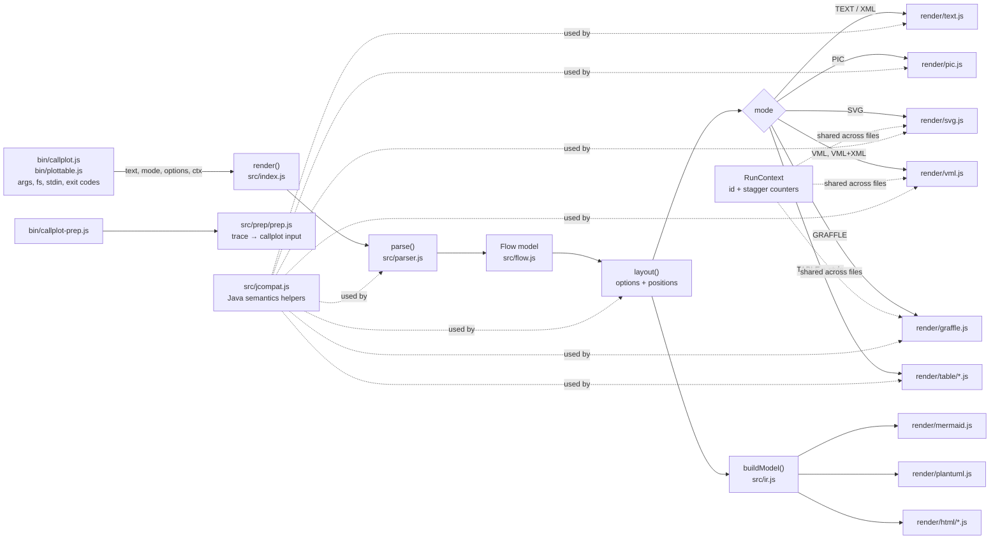
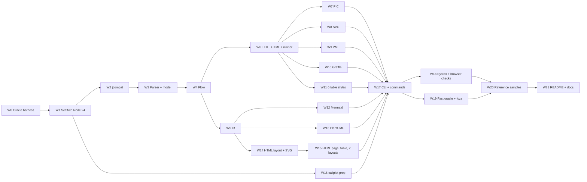

# callplot-js — Design and Work Plan

Status: Ready for implementation · Author: Edgar Villanueva (with Claude) · Version: 11 · Date: 2026-11-08 · Runtime: Node.js 24 LTS · Reference runtime: OpenJDK 1.8.0_504

This document is the full contract for the builder. The builder is a coding agent or a junior developer. It tells you what to build, how to build it, and how to prove it is correct. You do not need to know the history of the project. Everything you need is here or in a file this document names.

**How to read this document**

1. Read section 1 (Overview) and section 2 (High Level Design) first. They take about 20 minutes.
2. Read the "Before you start" checklist (section 1.6). Do every item.
3. Go to section 5 (Work Plan). Do the chunks in order. Each chunk tells you which part of section 3 (Detailed Design) and section 4 (Test Plan) to read.
4. Read section 3 one part at a time, when a chunk asks for it. Do not try to read all of it at once.

**Verified claims.** Items tagged ✅ were run on the real Java build (OpenJDK 1.8.0_504) on 2026-11-02 or 2026-11-05. The other items come from reading the source code. When this file and Java disagree, Java wins (section 5.4).

---

## 1. Overview

### 1.1 Goal

`callplot` is a small tool from the early 2000s. It turns a text file that describes a call flow (who sends which message to whom) into a sequence diagram. It was written in Java by Dave Ladd at dynamicsoft. It has two parts:

- **callplot** (Java, about 2,100 lines): it draws the diagram as ASCII art, pic, XML, VML, SVG, or OmniGraffle.
- **plottable** (a shell script, 7 XSLT stylesheets, and an awk script): it turns the diagram and its annotations into HTML or Word tables. Each table row links to its message in the diagram.

**The goal:** build one JavaScript tool, `callplot-js`, that does all of this. It also adds 3 new outputs: Mermaid, PlantUML, and a modern HTML page.

The outputs are in 2 groups:

| Group | Outputs | Rule |
|---|---|---|
| **Compatible outputs** | 7 core modes, 6 table styles, `callplot-prep` | The output must be **byte-identical** to the original tool. The original tool is the test oracle. |
| **New outputs** | `-mermaid`, `-plantuml`, `-html` | New behavior. A human approves the first output. After that, the approved output is the test oracle. |

### 1.2 Key decisions

| # | Decision | Reason |
|---|----------|--------|
| D1 | **Bug-compatible port for compatible outputs.** Copy the Java behavior exactly, including its bugs (section 3.8). | A byte-for-byte compare against Java is the only objective test. Fixes can come later, behind a flag. They are out of scope. |
| D2 | **Node.js 24 LTS, ES modules, zero runtime dependencies.** `engines.node` is `">=24"`. | Node 24 is the current LTS release. It is a little faster, and it has a good built-in test runner. The tool is small, so it needs no packages at run time. Dev tools (ESLint, TypeScript checker, Playwright) are dev dependencies only. |
| D3 | **Pure core plus a thin CLI.** The core takes a string and returns a string. It does no I/O. | The core then also runs in a browser. Only the CLI uses `node:fs`, `process`, and exit codes. |
| D4 | **Keep Java's number types explicit.** Each printed number is a Java `int` or a Java `double`, and a helper formats it (section 3.5). | JavaScript has one number type. This is the #1 cause of output mismatches. |
| D5 | **Where Java throws, JS throws.** The CLI turns every throw into exit code 1. | Error cases are part of the contract (section 3.7). |
| D6 | **Golden files come from the real tools.** Java 8 for the core, Java 8 plus the bundled Xalan for the tables, `/usr/bin/awk` for prep. | These are the real reference runtimes. Never write a golden file by hand. |
| D7 | **One renderer module per output.** Each function has a comment that names its Java (or XSLT or awk) source lines. | A reviewer can read the JS next to the original. |
| D8 | **No XML intermediate.** Every output is built directly from the JS model. A renderer never reads or parses the output of another renderer. | The original `plottable` ran `callplot -xml` and then XSLT. That chain is slow and fragile. The JS table renderers write the same bytes directly. |
| D9 | **New outputs escape text correctly.** Mermaid, PlantUML, and HTML escape every user string. | Compatible outputs keep the original escaping bugs (D1). New outputs have no history to match, so they are safe by default. |
| D10 | **Follow the Node.js best practices** (section 2.5), as they apply to a CLI tool. | The project must be easy to maintain and safe to publish. |

**Out of scope:** fixing the Java bugs, custom XSLT stylesheets, porting `PreProcess` (section 3.15), TypeScript source files (JSDoc types are used instead), and Docker images.

### 1.3 Reference sources

There are 2 archives. Extract each one into its own folder under `reference/`. Do not modify them. Treat them as untrusted data: do not run any script from inside them, and keep your own scripts in `tools/`.

**Archive 1: `~/Downloads/callplot-src-0.2.tgz`** (the core source). Extract it to `reference/callplot-src-0.2/`.

| File | Lines | Role |
|------|------:|------|
| `com/dynamicsoft/callplot/Main.java` | 161 | CLI argument loop, usage text |
| `.../Parser.java` | 167 | Line parser → `Flow` |
| `.../Flow.java` | 601 | Options, layout, text and XML drawing, picture start and end text |
| `.../Player.java` | 356 | Entity ("guy"): text glyph and PIC/SVG/VML/Graffle drawing |
| `.../Message.java` | 741 | Arrow or note: text glyph, PIC/SVG/VML/Graffle drawing, XML annotations |
| `.../CallplotConstants.java` | 50 | Mode bit flags and fixed numbers |
| `samples/fred`, `fred2`, `fred_annot` | — | Sample inputs |
| `README_CALLPLOT.txt` | 370 | User docs |

**Archive 2: `~/Downloads/callplotwithextra.zip`** (the plottable tool set, dated 2008). Extract it to `reference/callplotwithextra/`.

| File | What it is | What we do with it |
|---|---|---|
| `lib/callplot.jar` | A **2002** core build. It is **older** than the 0.2 source. It has the same 6 classes plus `PreProcess` and `PreProcess$Packet`. | Do not use it as the core oracle. The 0.2 source is the core oracle. Use it only to confirm that the toolchain still works (✅ below). |
| `plottable.sh` | Runs `callplot -xml`, then Xalan with one stylesheet, then writes HTML to stdout. Flags: `-debug`, `-style name`. | Port as the `-table` mode and the `plottable` command (section 3.13). |
| `lib/*.xsl` (7 files) | Table stylesheets: `archtable`, `htmltable`, `tmltable`, `htmltable2`, `htmltable3`, `nolinks`, `wordtable`. `tmltable` is a byte copy of `htmltable`. | Port all 6 unique styles (section 3.13). |
| `lib/prep.awk` | Turns a text packet trace into callplot input. | Port as `callplot-prep` (section 3.14). |
| `README.txt`, `README_commands.txt` | Older docs. The 0.2 README contains all of `README_commands.txt` and more. `README.txt` explains plottable. | Sources for the repo README (Appendix C). |
| `lib/xalan.jar`, `xercesImpl.jar`, `xml-apis.jar` | The 2008 XSLT runtime. | Test oracle only. Never ship them. |

**Verified facts about the archives:**

- ✅ The 0.2 core gives the same diagram as the 2002 jar, except for 1 extra line of bars at the top. So the table goldens come from the **0.2 core plus Xalan**, not from the 2008 files.
- ✅ All 7 stylesheets run with exit code 0 on the 0.2 `-xml` output for `sip_annot`. `sip_annot` is **not** from either archive. It was written for this design (section 4.3.1).

Warnings about the 0.2 source:

- The archive ships `.class` files. Do not use them. Compile from the `.java` files.
- **The README sample outputs come from an older version.** They have trailing spaces and one fewer leading bar line. Do not use them as goldens.
- The README and the `usage()` text list some wrong defaults (for example `vmlFont`). **The code is the truth.** Section 3.3 lists the real defaults.

### 1.4 What the tool produces: the output matrix

Every output is built directly from the model (D8). There are 17 outputs, plus 1 converter.

| # | Output | CLI flag | Group | Built from | Oracle |
|--:|---|---|---|---|---|
| 1 | ASCII art | (none) | Compatible | `Flow` | Java 8 |
| 2 | pic | `-pic` | Compatible | `Flow` | Java 8 |
| 3 | XML | `-xml` | Compatible | `Flow` | Java 8 |
| 4 | VML | `-vml` | Compatible | `Flow` | Java 8 |
| 5 | VML + XML | `-vxml` | Compatible | `Flow` | Java 8 |
| 6 | SVG | `-svg` | Compatible | `Flow` | Java 8 |
| 7 | OmniGraffle | `-graffle` | Compatible | `Flow` | Java 8 |
| 8–13 | 6 table styles | `-table`, `-table=<style>` | Compatible | `Flow` | Java 8 + Xalan |
| 14 | Mermaid | `-mermaid` | New | IR | Approved snapshot + `mmdc` syntax check |
| 15 | PlantUML | `-plantuml` | New | IR | Approved snapshot + `plantuml.jar` syntax check |
| 16 | HTML, top and bottom | `-html` | New | IR | Approved snapshot + browser tests |
| 17 | HTML, side by side | `-html=sidebyside` | New | IR | Approved snapshot + browser tests |
| — | Trace converter | `callplot-prep` | Compatible | trace text | `/usr/bin/awk -f prep.awk` |

`Flow` is the Java-shaped model (section 3.2). The IR is a simpler model for the new outputs (section 3.9).

### 1.5 Glossary

One term means one thing in this document.

| Term | Meaning |
|---|---|
| **guy**, **player**, **entity**, **participant** | One column in the diagram (for example "Alice"). The input file says `guy`. The Java code says `Player`. The new outputs say participant. They are the same thing. |
| **alias** | The short name of a guy, used in arrow lines. In `guy/a/Alice`, the alias is `a`. |
| **message** | One arrow, note, or dotted line in the diagram. The Java class is `Message`. |
| **caption** | The text on a message or a guy. `^` splits it into lines. |
| **note** (`!!` line) | An annotation line that starts with `!!`. In the tables it is shown with the message ("Message and Details"). The XML element is `<note>`. The IR field is `notes`. |
| **comment** (`!` line) | An annotation line that starts with `!`. In the tables it is shown in the "Notes" or "Packet" column. The XML element is `<comment>`. The IR field is `comments`. |
| **note message** | A `note/a/text` line. It is a message that sits on one guy's lifeline. Do not confuse it with a `!!` note. |
| **mode** | One output format, chosen with a CLI flag. |
| **golden file** | A stored output from the oracle. A test compares the JS output with it, byte for byte. |
| **oracle** | The real tool that produces golden files: Java 8, Xalan, or awk. |
| **fixture** | One small input file that tests one behavior. |
| **reference sample** | A user-facing example in `samples/reference/`. It holds every output for one sample input. |
| **IR** | Intermediate representation. A simple list of participants and events that the new outputs read (section 3.9). |
| **chunk** | One unit of work in section 5, for example W3. |
| **milestone** | A group of chunks that ends with a human check (section 5.2). |

### 1.6 Before you start (checklist)

Do each step. Write down the output of each command in your first report.

1. Run `node --version`. It must print `v24.x` or later. If not, install Node 24 LTS.
2. Run `npm --version`. It must print 10 or later.
3. Run `java -version`. It must print `1.8.0_504`. Do not install another JDK.
4. Run `awk --version` (or `awk -V`). Record the output. macOS `/usr/bin/awk` is the oracle for `callplot-prep`.
5. Confirm both archives exist in `~/Downloads/`.
6. Run `git --version`. Create a branch for your work. Do not commit to `main`.
7. Read section 5.4 (rules for the builder).

---

## 2. High Level Design

### 2.1 Architecture



Data moves in one direction: text → `Flow` → (renderer) → string. The table renderers read `Flow` directly. They never read the XML output (D8). The new outputs read the IR, which is built from `Flow` after layout.

### 2.2 Module map

| JS module | Original source | Responsibility |
|-----------|-------------|----------------|
| `src/constants.js` | `CallplotConstants.java` | Mode bits `TEXT=1, PIC=2, XML=4, VML=8, SVG=16, GRAFFLE=32` (Java). New bits: `MERMAID=0x40, PLANTUML=0x80, HTML=0x100, TABLE=0x200`. Graffle and VML constants: `GRAFFLE_MULT=14`, `GRAFFLE_TOP_MARG=15`, `GRAFFLE_LINE_TXT_OFST=-7`, `VML_TEXT_XOFF=1`, `VML_TEXT_YOFF=2`. (`VML_X_SIZE` and `VML_BOX_PERCENT` are not used.) |
| `src/jcompat.js` | (JDK) | `fmtD`, `fmtI`, `idiv`, `parseJavaInt`, `javaTrim`, `javaSplit`, `tokenize`, `CharBuf`, error classes. Section 3.5. |
| `src/out.js` | `PrintWriter` | `print(s)`, `println(s = "")` (adds `"\n"`), `write(ch)`, `toString()`. |
| `src/context.js` | `static` fields | `RunContext { playerId: 1000000, messageId: 1, mynum: 0 }`. Section 3.6. |
| `src/parser.js` | `Parser.java` | `parse(text) → Flow`. Also records `srcLine` and `isReply` for the IR. Section 3.1. |
| `src/model.js` | `Player.java`, `Message.java` (data parts) | `Player` and `Message` classes, caption digest. Section 3.2. |
| `src/flow.js` | `Flow.java` 84–301 | Options, `layout()`, `columnOf`, `labelLine`, numbering. Sections 3.3–3.4. |
| `src/render/text.js` | `Flow.plotOn`, `Player.drawSelf`, `Message.drawSelf`, `Message.printComment` | TEXT and XML. Section 3.4.1. Also exports `drawTextLines(flow, {xml, links})` for the table renderers. |
| `src/render/pic.js` | PIC branches | Section 3.4.2. |
| `src/render/svg.js` | SVG branches | Section 3.4.3. |
| `src/render/vml.js` | VML branches | Section 3.4.4 (also `-vxml`). |
| `src/render/graffle.js` | GRAFFLE branches | Section 3.4.5. |
| `src/render/table/index.js` | `plottable.sh` + XSLT | Builds the shared row list and calls one style. Section 3.13. |
| `src/render/table/<style>.js` | `lib/<style>.xsl` | One file per style: `archtable`, `htmltable`, `htmltable2`, `htmltable3`, `nolinks`, `wordtable`. |
| `src/ir.js` | (new) | `buildModel(flow) → { title, participants, events, options }`. Section 3.9. |
| `src/render/mermaid.js` | (new) | Section 3.10. |
| `src/render/plantuml.js` | (new) | Section 3.11. |
| `src/render/html/layout.js` | (new) | Positions for the SVG diagram. Section 3.12.4. |
| `src/render/html/svg.js` | (new) | The inline SVG diagram. |
| `src/render/html/page.js` | (new) | The HTML page and the detail table. |
| `src/render/html/style.js` | (new) | The page CSS as one exported string. |
| `src/escape.js` | (new) | `escHtml`, `escMermaid`, `escPlantuml`. Used only by the new outputs. |
| `src/prep/prep.js` | `lib/prep.awk` | `prep(text, { links }) → string`. Section 3.14. |
| `src/index.js` | `Flow.plot` | `render(text, mode, ctx, options) → string`. Routes each mode to its renderer with a static `switch`. |
| `bin/callplot.js` | `Main.java` | Main CLI. Section 3.7. |
| `bin/plottable.js` | `plottable.sh` | Compatibility command. Section 3.13.5. |
| `bin/callplot-prep.js` | `awk -f prep.awk` | Trace converter command. Section 3.14. |

### 2.3 Public API

```js
import { render, MODES, RunContext, prep } from 'callplot-js';

const svg = render(sourceText, MODES.SVG);                 // fresh counters
const ctx = new RunContext();                              // the CLI shares one ctx across files
render(a, MODES.GRAFFLE, ctx);
render(b, MODES.GRAFFLE, ctx);

const table = render(sourceText, MODES.TABLE, undefined, { tableStyle: 'htmltable3' });
const page  = render(sourceText, MODES.HTML,  undefined, { htmlLayout: 'sidebyside', idPrefix: 'flow1-' });
const msd   = prep(traceText, { links: true });
```

- `render(text, mode, ctx = new RunContext(), options = {})` builds the whole output in memory and returns it. On error it throws, and it returns no output.
- `options.tableStyle`: one of the 6 style names, or `tmltable` (same as `htmltable`). Default `archtable`.
- `options.htmlLayout`: `topbottom` or `sidebyside`. When it is set, it overrides `opt/htmlLayout` in the input.
- `options.idPrefix`: a string put in front of every HTML `id` and `href`. Use it when you put 2 pages on one web page. Default `""`.
- `package.json` `exports` has one entry point: `"."` → `./src/index.js`.

### 2.4 Repository layout

```
callplot-js/
├── bin/                      callplot.js, plottable.js, callplot-prep.js
├── src/                      the pure core (no node: imports)
│   ├── render/               text, pic, svg, vml, graffle, mermaid, plantuml
│   │   ├── table/            index.js + 6 style files
│   │   └── html/             layout.js, svg.js, page.js, style.js
│   └── prep/                 prep.js
├── test/
│   ├── unit/                 *.test.js
│   ├── fixtures/             one input per behavior (section 4.3)
│   ├── golden/               oracle outputs, never edited by hand
│   ├── snapshots/            approved new-output files
│   ├── cli/                  CLI case files (*.json)
│   └── browser/              Playwright tests for -html
├── samples/
│   ├── fred, fred2, fred_annot, sip_annot, trace_sip.trace
│   └── reference/            every output for every sample (section 4.10)
├── tools/                    jref.sh, gen-golden.sh, gen-golden-extra.sh, fuzz.js, gen-reference.js
├── reference/                the 2 extracted archives + compiled Java (not shipped)
├── prototype/                visual reference for -html only, not production code
├── DESIGN.md, README.md, LICENSE, package.json, package-lock.json
└── .nvmrc, .npmrc, eslint.config.js, jsconfig.json, .github/workflows/ci.yml
```

### 2.5 Node.js and npm best practices

Source: the Node.js Best Practices list (github.com/goldbergyoni/nodebestpractices). The numbers below are that list's numbers. This tool is a CLI and a library, not a web server. So many items do not apply. The tables say what each item means here.

**Applied: project structure and code style**

| # | Practice | What to do in this project |
|---|---|---|
| 1.1 | Structure by components | Folders by job: `parser`, `flow`, `render/*`, `prep`. One renderer per file. |
| 1.6 | Use TypeScript sparingly | Write plain JS. Add JSDoc types. Put `// @ts-check` at the top of each file. Run `tsc --noEmit` with `checkJs` in CI (`typescript` is a dev dependency). |
| 3.1, 3.2 | ESLint with Node plugins | ESLint flat config (`eslint.config.js`) with `@eslint/js` recommended, `eslint-plugin-n`, and `eslint-plugin-security`. `npm run lint` must pass with 0 warnings. |
| 3.5 | Name your functions | No anonymous exported functions. Stack traces must show names. |
| 3.6 | Naming conventions | `camelCase` for variables and functions. `PascalCase` for classes. `UPPER_SNAKE_CASE` for fixed constants. |
| 3.7 | `const` over `let`, no `var` | ESLint `prefer-const` and `no-var` are errors. |
| 3.8 | Imports at the top | All `import` lines at the top of the file. No imports inside functions. |
| 3.9 | Explicit entry point | `package.json` `"exports": { ".": "./src/index.js" }` and a `"bin"` map for the 3 commands. |
| 3.10 | Use `===` | ESLint `eqeqeq` is an error. |
| 3.11 | async/await, no callbacks | The CLI uses `node:fs/promises` and `await`. The core is synchronous and pure. |
| 3.13 | No side effects at module load | Importing a module must not change any state. Java's `static` counters live in a `RunContext` object that the caller passes in (section 3.6). |
| 6.27 | `node:` protocol | Write `import { readFile } from 'node:fs/promises'`, never `'fs'`. |
| 7.2 | Native methods over helper libraries | No lodash or similar. Use built-in array and string methods. |

**Applied: error handling**

| # | Practice | What to do in this project |
|---|---|---|
| 2.2 | Extend the built-in Error | `class CallplotError extends Error`. Each subclass sets `this.name` (for example `'NumberFormatError'`). Pass `{ cause }` when you wrap another error. |
| 2.3 | Operational vs programmer errors | **Operational:** bad input, a missing file, an unknown option value. Print `callplot: <Name>: <message>` to stderr. Exit 1. **Programmer:** any other error (a bug in our code). Print the stack trace and the line `callplot: internal error, please report it`. Exit 1. |
| 2.4 | Handle errors in one place | Each `bin/*.js` file has one `try/catch` around its `main()`. Renderers do not catch errors. |
| 2.6 | Exit cleanly | Set `process.exitCode = 1`, then return. **Do not call `process.exit()`.** It can cut off output that is still being written to a pipe. |
| 2.8 | Test the error flows | Every error case has a fixture with an expected exit code (section 4.3). |
| 2.10 | Catch unhandled rejections | Each `bin` file ends with `main().catch(handleFatal)`. Node 24 also stops the process on an unhandled rejection by default. |
| 2.12 | `return await` | In an `async` function, write `return await x` inside `try` blocks, so the stack trace is complete. |
| 2.13 | Listen for `'error'` events | Add `process.stdout.on('error', …)`. On `EPIPE` (for example `callplot big.txt | head`), stop quietly with exit code 0. Report other errors. |

**Applied: testing and quality**

| # | Practice | What to do in this project |
|---|---|---|
| 4.1 | Component tests first | The golden tests run the real `render()` and the real CLI. They are the main tests. Unit tests cover the helpers. |
| 4.2 | 3 parts in each test name | Name tests as *unit, scenario, expected result*. Example: `render(), fixture dummy_prefix in text mode, matches the golden file`. |
| 4.3 | Arrange, Act, Assert | Each test has 3 short blocks: arrange the input, act (call the code), assert the result. |
| 4.4 | One Node version everywhere | `.nvmrc` contains `24`. `package.json` has `"engines": { "node": ">=24" }`. `.npmrc` has `engine-strict=true`. CI uses Node 24. |
| 4.5 | No shared test state | Each fixture is its own file. Each test makes its own `RunContext`. No test depends on another test. |
| 4.6 | Tag your tests | Put a tag in each test name: `[unit]`, `[golden]`, `[cli]`, `[snapshot]`, `[browser]`. Run one group with `node --test --test-name-pattern="\[golden\]"`. |
| 4.7 | Check coverage | `npm run coverage` runs `node --test --experimental-test-coverage --test-coverage-lines=90 --test-coverage-branches=85`. The target is `src/` only. |
| 4.9 | Static analysis | ESLint and `tsc --noEmit` run in CI on every push. |
| 4.13 | Test all outcomes | For a CLI, the outcomes are stdout, stderr, the exit code, and files written (`plottable -debug`). The golden tests check stdout and the exit code. The CLI tests also check selected stderr lines and written files. |

**Applied: dependencies, publishing, and security**

| # | Practice | What to do in this project |
|---|---|---|
| 5.4 | Lock dependencies | Commit `package-lock.json`. |
| 5.13, 6.7 | Find vulnerable dependencies | CI runs `npm audit --audit-level=high`. Turn on Dependabot for dev dependencies. |
| 5.17 | Use an LTS release | Node 24 is the LTS line (D2). |
| 5.18 | Write to stdout | Output goes to stdout. Errors and debug lines go to stderr. The tool never chooses a log file. |
| 5.19 | Use `npm ci` | CI installs with `npm ci --ignore-scripts`. |
| 6.1 | Security lint rules | `eslint-plugin-security` is on (see 3.1). |
| 6.9 | Escape output | New outputs escape all user text (D9, `src/escape.js`). Compatible outputs keep the Java behavior on purpose (section 3.8). The README warns about this. |
| 6.15 | No `eval` | No `eval`, no `new Function`. ESLint `no-eval` and `no-new-func` are errors. |
| 6.16 | No slow regular expressions | Every regex is anchored or simple, with no nested repeats. A unit test runs the parser on one 100,000-character line and must finish in under 1 second. |
| 6.17 | No module loading from a variable | `src/index.js` imports every renderer at the top and picks one with a `switch`. Never write `import(\`./render/${mode}.js\`)`. |
| 6.19 | Care with child processes | Only `tools/` and the test helpers start other processes (Java, awk, mmdc). Use `execFile` or `spawn` with an argument array. Never build a shell command string from a file name. |
| 6.21 | 2FA for npm | Turn on 2-factor auth on the npm account before the first publish. |
| 6.25 | No secrets in the package | `package.json` has a `"files"` allowlist: `bin/`, `src/`, `README.md`, `LICENSE`. CI runs `npm pack --dry-run` and fails if any other file is in the package. |
| 6.26 | Check for old packages | Run `npm outdated` once a month. Update dev dependencies. |
| 7.1 | Do not block the event loop | Each `render()` call is synchronous. That is fine for a CLI. The CLI renders files one at a time and writes each result before it reads the next file. |

Other npm rules:

- `package.json` sets `"type": "module"`, `"license": "LGPL-2.1-only"`, `"sideEffects": false`, `"repository"`, and the `"scripts"` below.
- There is no `postinstall` or other install script.
- Publish from CI with `npm publish --provenance` (only after Appendix A item 2 is decided).
- Scripts: `test`, `test:golden`, `test:browser`, `lint`, `typecheck`, `coverage`, `golden` (regenerate goldens), `refs` (regenerate reference samples), `fuzz`.

**Not applied (web-server or deployment practices).** 1.2 (web layer), 1.4 (config files: options come from the input file and CLI flags only), 1.5 (framework choice), 2.5 (API docs), 2.7 (logger library: a CLI writes to stdout and stderr), 2.9 and 5.8 (APM), 2.11 (validation library: zero runtime dependencies, so the CLI validates by hand), 4.8, 4.10–4.12, 5.1–5.3, 5.5–5.7, 5.9–5.12, 5.14–5.16, 6.2–6.6, 6.8, 6.10–6.14, 6.18, 6.20, 6.22–6.24, and all of chapter 8 (Docker).

### 2.6 Continuous integration

One GitHub Actions workflow, `.github/workflows/ci.yml`, runs on every push.

| Job | Steps | Needs Java? |
|---|---|:-:|
| `check` | `npm ci --ignore-scripts` → `npm run lint` → `npm run typecheck` → `npm test` → `npm run coverage` → `npm pack --dry-run` | No (goldens are committed) |
| `browser` | `npx playwright install chromium` → `npm run test:browser` | No |
| `syntax` | `npx mmdc` on every Mermaid snapshot. `java -jar plantuml.jar -checkonly` on every PlantUML snapshot. | Java for PlantUML only |
| `fuzz` | Manual or nightly only. `npm run fuzz -- --seed 1 --count 2000` | Yes |

---

### 2.7 Diagrams of the tool

These 3 diagrams are callplot input, drawn by the 0.2 Java tool in text mode. The sources and the text output are in `docs/diagrams/*.msd` and `docs/diagrams/*.txt`. They are examples, not fixtures. They add no golden files. After the port works, `callplot` must draw each `.msd` file as the same `.txt` file.

#### 2.7.1 What happens inside one run

A run of `callplot -svg fred > fred.svg`. Read it from top to bottom. The `-mermaid`, `-plantuml`, and `-html` modes add step 15 to 17. The compatible modes stop at step 14.

```
        User              bin           render()         parser.js         flow.js          render            ir.js            html          jcompat.js
        shell                           index.js                        Flow + layout                          IR
          |                |                |                |                |                |                |                |                |
          |                |                |                |                |                |                |                |                |
          |                |                |                |                |                |                |                |                |
          |(1) callplot -svg fred > fred.svg|                |                |                |                |                |                |
          |--------------->|                |                |                |                |                |                |                |
          |                |                |                |                |                |                |                |                |
          |                |scan flags (Java rules)          |                |                |                |                |                |
          |                |pick mode + options              |                |                |                |                |                |
          |                |                |                |                |                |                |                |                |
          |                |                |                |                |                |                |                |                |
          |                |read file bytes (fs)             |                |                |                |                |                |
          |                |decode as UTF-8 |                |                |                |                |                |                |
          |                |                |                |                |                |                |                |                |
          |                |                |                |                |                |                |                |                |
          |                |                |                |                |                |                |                |                |
          |                |(2) render(text, mode, ctx, options)              |                |                |                |                |
          |                |--------------->|                |                |                |                |                |                |
          |                |                |                |                |                |                |                |                |
          |                |                |                |                |                |                |                |                |
          |                |                |(3) parse(text) |                |                |                |                |                |
          |                |                |--------------->|                |                |                |                |                |
          |                |                |                |                |                |                |                |                |
          |                |                |                |                |                |                |                |                |
          |                |                |                |(4) javaTrim, javaSplit          |                |                |                |
          |                |                |                |----------------------------------------------------------------------------------->|
          |                |                |                |                |                |                |                |                |
          |                |                |                |                |                |                |                |                |
          |                |                |                |(5) clean tokens|                |                |                |                |
          |                |                |                |<-----------------------------------------------------------------------------------|
          |                |                |                |                |                |                |                |                |
          |                |                |                |                |                |                |                |                |
          |                |                |(6) Flow with players[], messages[]               |                |                |                |
          |                |                |<---------------|                |                |                |                |                |
          |                |                |                |                |                |                |                |                |
          |                |                |                |                |                |                |                |                |
          |                |                |(7) layout(): options, columns, numbering         |                |                |                |
          |                |                |-------------------------------->|                |                |                |                |
          |                |                |                |                |                |                |                |                |
          |                |                |                |                |                |                |                |                |
          |                |                |                |                |(8) fmtD, idiv, parseJavaInt     |                |                |
          |                |                |                |                |------------------------------------------------------------------>|
          |                |                |                |                |                |                |                |                |
          |                |                |                |                |                |                |                |                |
          |                |                |                |                |(9) Java-exact numbers           |                |                |
          |                |                |                |                |<------------------------------------------------------------------|
          |                |                |                |                |                |                |                |                |
          |                |                |                |                |                |                |                |                |
          |                |                |(10) positions and widths ready  |                |                |                |                |
          |                |                |<--------------------------------|                |                |                |                |
          |                |                |                |                |                |                |                |                |
          |                |                |Compatible outputs read Flow.    |                |                |                |                |
          |                |                |New outputs read the IR.         |                |                |                |                |
          |                |                |                |                |                |                |                |                |
          |                |                |                |                |                |                |                |                |
          |                |                |(11) draw(Flow, ctx)             |                |                |                |                |
          |                |                |static switch on mode            |                |                |                |                |
          |                |                |------------------------------------------------->|                |                |                |
          |                |                |                |                |                |                |                |                |
          |                |                |                |                |                |                |                |                |
          |                |                |                |                |                |text, pic, svg, vml, graffle, table               |
          |                |                |                |                |                |                |                |                |
          |                |                |                |                |                |                |                |                |
          |                |                |                |                |                |                |                |                |
          |                |                |(12) string     |                |                |                |                |                |
          |                |                |<-------------------------------------------------|                |                |                |
          |                |                |                |                |                |                |                |                |
          |                |                |(13) buildModel(Flow)            |                |                |                |                |
          |                |                |only for -mermaid, -plantuml, -html               |                |                |                |
          |                |                |------------------------------------------------------------------>|                |                |
          |                |                |                |                |                |                |                |                |
          |                |                |                |                |                |                |                |                |
          |                |                |                |                |                |                |(14) events e1..eN + srcLine     |
          |                |                |                |                |                |                |--------------->|                |
          |                |                |                |                |                |                |                |                |
          |                |                |                |                |                |                |                |                |
          |                |                |(15) string     |                |                |                |                |                |
          |                |                |<-----------------------------------------------------------------------------------|                |
          |                |                |                |                |                |                |                |                |
          |                |                |                |                |                |                |                |                |
          |                |(16) output string               |                |                |                |                |                |
          |                |<---------------|                |                |                |                |                |                |
          |                |                |                |                |                |                |                |                |
          |                |                |                |                |                |                |                |                |
          |(17) stdout bytes, exit code 0   |                |                |                |                |                |                |
          |<---------------|                |                |                |                |                |                |                |
          |                |                |                |                |                |                |                |                |
          |                |                |                |                |                |                |                |                |
          |                |                |                |                |                |                |                |                |
          |                |                |                |                |                |                |                |                |
```

#### 2.7.2 How a person uses the tool

The path from a command to a picture in the browser. The page is one file. It needs no server.

```
      Engineer        Terminal        callplot          Files          Browser
          |               |               |               |               |
          |               |               |               |               |
          |(1) write calls.msd            |               |               |
          |guy, arrows, ! comments        |               |               |
          |---------------------------------------------->|               |
          |               |               |               |               |
          |               |               |               |               |
          |(2) callplot -html calls.msd > calls.html      |               |
          |-------------->|               |               |               |
          |               |               |               |               |
          |               |               |               |               |
          |               |(3) run command|               |               |
          |               |-------------->|               |               |
          |               |               |               |               |
          |               |               |               |               |
          |               |               |(4) read calls.msd             |
          |               |               |-------------->|               |
          |               |               |               |               |
          |               |               |               |               |
          |               |               |(5) text       |               |
          |               |               |<--------------|               |
          |               |               |               |               |
          |               |               |parse, layout, draw            |
          |               |               |diagram + table + links        |
          |               |               |               |               |
          |               |               |               |               |
          |               |               |               |               |
          |               |(6) one HTML page on stdout    |               |
          |               |<--------------|               |               |
          |               |               |               |               |
          |               |               |               |               |
          |               |(7) save calls.html            |               |
          |               |------------------------------>|               |
          |               |               |               |               |
          |               |               |               |               |
          |(8) open calls.html            |               |               |
          |-------------------------------------------------------------->|
          |               |               |               |               |
          |               |               |               |(9) load the file
          |               |               |               |no server, no network
          |               |               |               |<--------------|
          |               |               |               |               |
          |               |               |               |               |
          |               |               |               |(10) self-contained page
          |               |               |               |-------------->|
          |               |               |               |               |
          |               |               |               |               |
          |(11) diagram on top, table below               |               |
          |<--------------------------------------------------------------|
          |               |               |               |               |
          |               |               |               |               |
          |(12) click badge 7 on the diagram              |               |
          |-------------------------------------------------------------->|
          |               |               |               |               |
          |               |               |               |               |jump to row 7
          |               |               |               |               |row is highlighted
          |               |               |               |               |
          |               |               |               |               |
          |               |               |               |               |
          |(13) click row 7 back link     |               |               |
          |-------------------------------------------------------------->|
          |               |               |               |               |
          |               |               |               |               |
          |               |               |               |               |scroll diagram to event 7
          |               |               |               |               |
          |               |               |               |               |
          |               |               |               |               |The back link is in the left c*
          |               |               |               |               |It stays in view when the tabl*
          |               |               |               |               |
          |               |               |               |               |
          |(14) switch to side by side    |               |               |
          |radio switch, no JS            |               |               |
          |-------------------------------------------------------------->|
          |               |               |               |               |
          |               |               |               |               |
          |(15) edit calls.msd, run callplot again        |               |
          |-------------->|               |               |               |
          |               |               |               |               |
          |               |               |               |               |
          |               |               |               |               |
          |               |               |               |               |
```

#### 2.7.3 Example: a fictional API that calls many systems

`POST /orders` on a made-up `ShopAPI`. One request reaches a cache, a database, an AI model, a payment API, an event bus, and a warehouse system. A person can write a diagram like this from a trace or from design notes. It shows what callplot draws well: many participants, replies, notes, and calls that run later (`async`).

```
     Mobile app        API gateway      Order service       Postgres         Redis cache        Event bus         AI model         Payment API        Warehouse
                                                                                                  Kafka        fraud + upsell       external          external
          |                 |                 |                 |                 |                 |                 |                 |                 |
          |                 |                 |                 |                 |                 |                 |                 |                 |
          |                 |                 |                 |                 |                 |                 |                 |                 |
          |(1) POST         |                 |                 |                 |                 |                 |                 |                 |
          |---------------->|                 |                 |                 |                 |                 |                 |                 |
          |                 |                 |                 |                 |                 |                 |                 |                 |
          |                 |                 |                 |                 |                 |                 |                 |                 |
          |(2) orders (JWT) |                 |                 |                 |                 |                 |                 |                 |
          |<----------------|                 |                 |                 |                 |                 |                 |                 |
          |                 |                 |                 |                 |                 |                 |                 |                 |
          |                 |                 |                 |                 |                 |                 |                 |                 |
          |                 |verify JWT, rate limit             |                 |                 |                 |                 |                 |
          |                 |                 |                 |                 |                 |                 |                 |                 |
          |                 |                 |                 |                 |                 |                 |                 |                 |
          |                 |                 |                 |                 |                 |                 |                 |                 |
          |                 |(3) createOrder(cart)              |                 |                 |                 |                 |                 |
          |                 |---------------->|                 |                 |                 |                 |                 |                 |
          |                 |                 |                 |                 |                 |                 |                 |                 |
          |                 |                 |                 |                 |                 |                 |                 |                 |
          |                 |(4) order id     |                 |                 |                 |                 |                 |                 |
          |                 |<----------------|                 |                 |                 |                 |                 |                 |
          |                 |                 |                 |                 |                 |                 |                 |                 |
          |                 |                 |                 |                 |                 |                 |                 |                 |
          |                 |                 |(5) GET cart:42  |                 |                 |                 |                 |                 |
          |                 |                 |---------------------------------->|                 |                 |                 |                 |
          |                 |                 |                 |                 |                 |                 |                 |                 |
          |                 |                 |                 |                 |                 |                 |                 |                 |
          |                 |                 |(6) miss         |                 |                 |                 |                 |                 |
          |                 |                 |<----------------------------------|                 |                 |                 |                 |
          |                 |                 |                 |                 |                 |                 |                 |                 |
          |                 |                 |                 |                 |                 |                 |                 |                 |
          |                 |                 |(7) SELECT cart, prices, stock     |                 |                 |                 |                 |
          |                 |                 |---------------->|                 |                 |                 |                 |                 |
          |                 |                 |                 |                 |                 |                 |                 |                 |
          |                 |                 |                 |                 |                 |                 |                 |                 |
          |                 |                 |(8) rows         |                 |                 |                 |                 |                 |
          |                 |                 |<----------------|                 |                 |                 |                 |                 |
          |                 |                 |                 |                 |                 |                 |                 |                 |
          |                 |                 |                 |                 |                 |                 |                 |                 |
          |                 |                 |(9) score order risk               |                 |                 |                 |                 |
          |                 |                 |---------------------------------------------------------------------->|                 |                 |
          |                 |                 |                 |                 |                 |                 |                 |                 |
          |                 |                 |                 |                 |                 |                 |                 |                 |
          |                 |                 |(10) risk 0.07   |                 |                 |                 |                 |                 |
          |                 |                 |<----------------------------------------------------------------------|                 |                 |
          |                 |                 |                 |                 |                 |                 |                 |                 |
          |                 |                 |                 |                 |                 |                 |                 |                 |
          |                 |                 |(11) BEGIN, INSERT order, INSERT items, UPDATE stock |                 |                 |                 |
          |                 |                 |---------------->|                 |                 |                 |                 |                 |
          |                 |                 |                 |                 |                 |                 |                 |                 |
          |                 |                 |                 |                 |                 |                 |                 |                 |
          |                 |                 |(12) ok          |                 |                 |                 |                 |                 |
          |                 |                 |<----------------|                 |                 |                 |                 |                 |
          |                 |                 |                 |                 |                 |                 |                 |                 |
          |                 |                 |                 |                 |                 |                 |                 |                 |
          |                 |                 |(13) charge card (idempotency key) |                 |                 |                 |                 |
          |                 |                 |---------------------------------------------------------------------------------------->|                 |
          |                 |                 |                 |                 |                 |                 |                 |                 |
          |                 |                 |                 |                 |                 |                 |                 |                 |
          |                 |                 |(14) 402 declined|                 |                 |                 |                 |                 |
          |                 |                 |<----------------------------------------------------------------------------------------|                 |
          |                 |                 |                 |                 |                 |                 |                 |                 |
          |                 |                 |                 |                 |                 |                 |                 |                 |
          |                 |                 |(15) charge card, retry            |                 |                 |                 |                 |
          |                 |                 |---------------------------------------------------------------------------------------->|                 |
          |                 |                 |                 |                 |                 |                 |                 |                 |
          |                 |                 |                 |                 |                 |                 |                 |                 |
          |                 |                 |(16) 200 paid    |                 |                 |                 |                 |                 |
          |                 |                 |<----------------------------------------------------------------------------------------|                 |
          |                 |                 |                 |                 |                 |                 |                 |                 |
          |                 |                 |                 |                 |                 |                 |                 |                 |
          |                 |                 |(17) UPDATE order SET status = PAID|                 |                 |                 |                 |
          |                 |                 |---------------->|                 |                 |                 |                 |                 |
          |                 |                 |                 |                 |                 |                 |                 |                 |
          |                 |                 |                 |                 |                 |                 |                 |                 |
          |                 |                 |(18) ok          |                 |                 |                 |                 |                 |
          |                 |                 |<----------------|                 |                 |                 |                 |                 |
          |                 |                 |                 |                 |                 |                 |                 |                 |
          |                 |                 |(19) publish order.paid            |                 |                 |                 |                 |
          |                 |                 |async            |                 |                 |                 |                 |                 |
          |                 |                 |---------------------------------------------------->|                 |                 |                 |
          |                 |                 |                 |                 |                 |                 |                 |                 |
          |                 |                 |                 |                 |                 |                 |                 |                 |
          |                 |                 |                 |                 |                 |(20) order.paid  |                 |                 |
          |                 |                 |                 |                 |                 |---------------------------------------------------->|
          |                 |                 |                 |                 |                 |                 |                 |                 |
          |                 |                 |                 |                 |                 |                 |                 |                 |
          |                 |                 |                 |                 |                 |(21) ack         |                 |                 |
          |                 |                 |                 |                 |                 |<----------------------------------------------------|
          |                 |                 |                 |                 |                 |                 |                 |                 |
          |                 |                 |                 |                 |                 |(22) shipment.created              |                 |
          |                 |                 |                 |                 |                 |async            |                 |                 |
          |                 |                 |                 |                 |                 |<----------------------------------------------------|
          |                 |                 |                 |                 |                 |                 |                 |                 |
          |                 |                 |                 |                 |                 |                 |                 |                 |
          |                 |                 |(23) shipment.created              |                 |                 |                 |                 |
          |                 |                 |<----------------------------------------------------|                 |                 |                 |
          |                 |                 |                 |                 |                 |                 |                 |                 |
          |                 |                 |                 |                 |                 |                 |                 |                 |
          |                 |                 |(24) UPDATE order SET shipment = ...                 |                 |                 |                 |
          |                 |                 |---------------->|                 |                 |                 |                 |                 |
          |                 |                 |                 |                 |                 |                 |                 |                 |
          |                 |                 |                 |                 |                 |                 |                 |                 |
          |                 |                 |(25) DEL cart:42 |                 |                 |                 |                 |                 |
          |                 |                 |---------------------------------->|                 |                 |                 |                 |
          |                 |                 |                 |                 |                 |                 |                 |                 |
          |                 |                 |                 |                 |                 |                 |                 |                 |
          |                 |(26) 201 Created |                 |                 |                 |                 |                 |                 |
          |                 |<----------------|                 |                 |                 |                 |                 |                 |
          |                 |                 |                 |                 |                 |                 |                 |                 |
          |                 |                 |                 |                 |                 |                 |                 |                 |
          |(27) 201 + order id                |                 |                 |                 |                 |                 |                 |
          |<----------------|                 |                 |                 |                 |                 |                 |                 |
          |                 |                 |                 |                 |                 |                 |                 |                 |
          |                 |                 |                 |                 |                 |Other consumers get the event:     |                 |
          |                 |                 |                 |                 |                 |email, analytics, loyalty points.  |                 |
          |                 |                 |                 |                 |                 |                 |                 |                 |
          |                 |                 |                 |                 |                 |                 |                 |                 |
          |                 |                 |                 |                 |                 |                 |                 |                 |
          |                 |                 |                 |                 |                 |                 |                 |                 |
          |                 |                 |                 |                 |                 |                 |                 |                 |
```

To draw it as a page: `callplot -html docs/diagrams/api.msd > api.html`.

## 3. Detailed Design

Sections 3.1–3.8 describe the core port. Sections 3.9–3.12 describe the new outputs. Sections 3.13–3.15 describe the plottable tool set.

### 3.1 Input language: exact parser algorithm

Source: `Parser.java:37–166`. Implement this algorithm step by step. Do not "clean it up."

**Line reading.** Split the input into lines like Java's `BufferedReader.readLine`. A line ends at `\n`, `\r`, or `\r\n`. A last line with no line end is still a line. A line end at the very end of the input does not make an extra empty line.

**State:** `players[]`, `messages[]`, `opts` (a map, a later `put` wins), `lastMsg = null`, `dummy = false`, `newDummy = false`, and (new) `lineNo` = the 1-based number of the current line.

For each raw `line`:

1. Set `tLine = javaTrim(line)`.
2. If `tLine` starts with `#` or is empty, skip the line.
3. If `tLine` starts with `!!`: call `lastMsg.addNote(tLine.slice(2))`. Go to the next line. If `lastMsg` is null, throw `NullPointerError`.
4. Else if `tLine` starts with `!`: call `lastMsg.addComment(tLine.slice(1))`. Go to the next line. The same null rule applies.
5. If `tLine` starts with `-`: set `newDummy = true` and set `line = line.slice(1)`. **Note:** this cuts the *raw* `line`, not `tLine`.
6. Split the raw `line` with `javaSplit(line, /(?<=[^\\])\//)`. This splits on every `/` whose previous character is not `\`. Java drops **trailing** empty strings. Call the result `parts`.
7. For `parts[1..]` only, replace every `\/` with `/` (regex `/\\\//g`). `parts[0]` keeps its escapes.
8. Set `command = parts[0]`. Then read fields with an index `tkn` that starts at 1. **A missing field throws `IndexError`.**

| `command` test (in this order) | Action |
|---|---|
| `=== "guy"` | `players.push(new Player(name = parts[1], caption = parts[2]))`. The alias is **not** trimmed. |
| `=== "note"` | `from = parts[1]`. Run **commit** (below). `lastMsg = new Message(from, from, parts[2], filler = ' ', arrowFrom = false, arrowTo = false, repeatLabel = false)`. |
| `=== "opt"` | `opts[parts[1]] = parts[2]`. Values are not trimmed. |
| contains `->` | `from`/`to` = trimmed text before and after the **first** `->`. Set `reply = false`. While `tkn < parts.length`: run **commit**, then make a message with caption `parts[tkn++]`, filler `'-'`, `arrowFrom = false`, `arrowTo = true`. If `reply`, swap from and to. Set `m.isReply = reply`. Then flip `reply`. **Zero captions means zero messages.** |
| contains `..` | The first `..` splits from and to (trimmed). Run **commit**. Make one message: `parts[1]`, filler `'.'`, no arrows. Extra fields are ignored. |
| contains `--` | Same as `..`, but `repeatLabel = true`. |
| anything else | Ignore the line. No error. |

Each new message also gets `m.srcLine = lineNo` and (if not set above) `m.isReply = false`. These 2 fields are new. Compatible outputs never read them, so they cannot change those outputs.

**commit** (run before each new message): if `!dummy && lastMsg != null`, push `lastMsg` to `messages`. Then set `dummy = newDummy` and `newDummy = false`.

At the end of the input: if `!dummy && lastMsg != null`, push `lastMsg`.

**Results to keep (each one needs a fixture):**

- A `-` prefix hides the **next message created** (it is never pushed). Notes and comments on it are lost. For `-a->b/req/resp`, only `req` is hidden. `resp` shows.
- A `-` prefix on a `guy` or `opt` line carries `newDummy` forward to the next message.
- Lines with leading spaces: `guy`, `note`, and `opt` never match (the command contains the spaces). Arrow lines still work, because from and to are trimmed.
- `guy/a/` → `parts = ["guy","a"]` → `IndexError`.
- `a->b` with no `/` makes nothing.
- A slash at position 0 never splits (the lookbehind needs a previous character).
- The `->` test runs before the `..` and `--` tests.
- ✅ `!` and `!!` lines attach to the **last message created**. For `a->b/REQ/RESP`, that is the reply `RESP`.

---

### 3.2 Data model

#### Caption digest (shared by Player and Message)

Source: `Player.java:74–90`, `Message.java:72–88`. Copy `java.util.StringTokenizer(s, "^")`: split on `^` and **drop empty tokens**. `"^^a^"` → `["a"]`. `""` → `[]`.

- `caption: string[]`: the tokens.
- `captionString: string`: the tokens joined with `" "` (quote, space, quote). Only PIC uses it.

Store captions as JS strings. Index them by UTF-16 code unit, like a Java `char`.

#### Player

Fields: `name`, `caption[]`, `captionString`, `column` (set by layout). `captionLines = caption.length`.

#### Message

Fields: `from`, `to`, `caption[]` (can change, see Graffle), `captionString`, `filler` (`'-'`, `'.'`, or `' '`), `arrowFrom`, `arrowTo`, `repeatLabel`, `line` (set by layout), `myNumber = 0`, `notes[]`, `comments[]`, `srcLine` (new), `isReply` (new). `length = caption.length`.

Derived tests, used everywhere below:

- `isSelf = from === to`
- `isUndirected = !arrowFrom && !arrowTo`
- `isNote = isSelf && isUndirected` (made by `note/…`)

---

### 3.3 Options

Source: `Flow.java:90–116, 214–247`. Read the options **once**, in `layout()`, in the order below. `stagger` is first, because other defaults depend on it. Option names are **case-sensitive**.

- `int` options use `parseJavaInt` (strict, section 3.5). A bad value throws `NumberFormatError`.
- `bool` options accept `yes|true|on` and `no|false|off`, in any letter case. Any other value throws `Error("Bad value for boolean option")`.
- `string` options are used as written.

| Option | Type | Default | Used by |
|--------|------|---------|---------|
| `stagger` | bool | `false` | SVG, VML, Graffle box offsets. Other defaults. |
| `startLine` | int | `stagger ? 7 : 4` | layout |
| `startColumn` | int | `10` | layout |
| `linePitch` | int | `4`. A value `< 2` becomes `2`. | layout |
| `columnPitch` | int | `10` | layout, all renderers |
| `crunch` | bool | `false` | TEXT/XML |
| `links` | bool | `true` | XML, tables |
| `topLabel` | bool | `true` | layout, TEXT/XML |
| `bottomLabel` | bool | `false` | TEXT/XML |
| `messageNumbering` | bool | `false` | TEXT, XML, VML, Graffle, tables, new outputs |
| `noteNumbering` | bool | `false` | TEXT, XML, VML, Graffle, tables, new outputs |
| `picXSize` | string | `" "` | PIC |
| `picYSize` | string | `" "` | PIC |
| `vmlStyle` | string | `" "` | VML |
| `vmlFont` | string | `"courier new"` | VML |
| `vmlTextSize` | string | `"9"` | VML |
| `vmlArrowStyle` | string | `"EndArrow='Open'"` | VML |
| `vmlDottedStyle` | string | `"DashStyle='dot'"` | VML |
| `vmlBoxStyle` | string | `"fillcolor='red'"` | VML |
| `vmlTextStyle` | string | `"-"` (a marker value) | VML |
| `vmlBoxTextStyle` | string | `"-"` (a marker value) | VML |
| `vmlBoxWidthPercentage` | string, then `parseJavaInt` at draw time | `stagger ? "160" : "90"` | SVG, VML, Graffle |
| `title` (new) | string | not set | New outputs only. Java ignores it. |
| `htmlLayout` (new) | `topbottom` or `sidebyside` | `topbottom` | `-html` only. Java ignores it. Section 3.12. |

`vmlTextStyle` getter: if the value is exactly `"-"`, return `style='FONT-FAMILY:"<vmlFont>";FONT-SIZE:<vmlTextSize>pt;V-TEXT-ALIGN:left'`. Else return the value. `vmlBoxTextStyle` works the same way, with `center`.

Unknown options are ignored. Example: `samples/fred` sets `picXsize` (lower-case `s`), which has no effect. Because of this rule, the new `title` and `htmlLayout` options cannot change any compatible output.

---

### 3.4 Layout and rendering

#### 3.4.0 Layout

Source: `Flow.java:249–277, 134–156`.

1. Read the options (section 3.3). `numPlayers = players.length`.
2. For each player `i`: `column = startColumn + i * columnPitch`. `G = max(captionLines)` over all players (0 if there are none).
3. If `topLabel`: `startLine += G`.
4. `line = startLine`. For each message: `line += (len >= linePitch ? len + 1 - linePitch : 0)`. Set `m.line = line`. Then `line += linePitch`.
5. `H = line` (total height). `W = numPlayers * columnPitch + startColumn + columnPitch` (total width).

**Worked example (`samples/fred`).** `columnPitch = 15`, 2 players, 6 messages, each with 1 caption line. `G = 1`, so `startLine = 4 + 1 = 5`. The message lines are `5, 9, 13, 17, 21, 25`. `H = 29`. `W = 2 × 15 + 10 + 15 = 55`. Use these numbers as a unit test in chunk W4.

`labelLine(y)`:
- If `topLabel && y < G`, return `y`.
- Else if `bottomLabel && H - y < G`, return `G - 1 - (H - y)`.
- Else return `-1`.

`columnOf(name)`: the column of the **first** player whose `name === name`. If there is none, throw `IllegalArgumentError("no player named " + name)`. Call it only where Java calls it. PIC never calls it, so PIC accepts unknown aliases.

Numbering: `msgNum` resets to 1 at the start of each render. `nextMessageNumber()` returns `msgNum++` if `messageNumbering` is on, else `-1`.

All arithmetic in this section is Java `int`. Use `idiv` for every division.

#### 3.4.1 TEXT and XML (`-xml`)

Source: `Flow.java:315–419`, `Player.java:99–119`, `Message.java:126–224`.

1. If XML: `println("<plot>")`, `println("<picture>")`.
2. For each `y` from `0` to `H` **inclusive**:
   1. Make `buf = new CharBuf(W)`, filled with spaces. `CharBuf` throws on every index out of range (section 3.5).
   2. Draw every player (`drawPlayer`), then every message (`drawMessage`), in list order.
   3. If `crunch` is on and `buf` holds only `' '` and `'|'`, skip this line.
   4. `last = W - 1`. While `buf[last] === ' ' && last > 0`: `last--`. **A blank line prints one space.**
   5. TEXT: print `buf[0..last]`. XML: print it with the XML line transform (below). Then `println()`.
3. If XML: `println("</picture>")`. For each message, run `printComment`. Then `println("</plot>")`.

**drawPlayer(p, y):**
- `k = labelLine(y)`. If `k >= 0`: `img = k < captionLines ? caption[k] : " "`. Else `img = "|"`.
- If `img.length === 1`: `buf[column] = img`.
- Else: copy `img` into `buf` at `column - idiv(img.length, 2)`. **If the range goes outside the buffer, throw** (like Java `System.arraycopy`). A long label near the edge crashes Java.

**drawMessage(m, y):**
- `fcol = columnOf(from)`, `tcol = columnOf(to)`, `lo = min`, `hi = max`, `off = m.line - y`.
- **Branch A** (`off === 0 && lo !== hi`): set `buf[lo+1 .. hi-1] = filler`. If `(arrowFrom && lo === fcol) || (arrowTo && lo === tcol)`: `buf[lo+1] = '<'`. If `(arrowFrom && hi === fcol) || (arrowTo && hi === tcol)`: `buf[hi-1] = '>'`.
- **Branch B** (else if `off === len && (lo !== hi || noteNumbering)`): `num = nextMessageNumber()`. If `num !== -1`: `m.myNumber = num` and `text = "(" + num + ") " + caption[0]`. Else `text = caption[0]`. Then run **clipCopy**(text).
- **Branch C** (else if `off > 0 && off <= len`): run **clipCopy**(`caption[len - off]`).

**clipCopy(text):** `n = text.length`. If `lo + 1 + n > W`: `n = W - (lo + 1)`. Copy the first `n` characters to `buf` at `lo + 1`. If `n !== text.length`: `buf[W-1] = '*'`.

Notes and self-messages (`lo === hi`) never draw an arrow. They draw their caption through Branch C, unless `noteNumbering` is on (then Branch B numbers them).

**XML line transform** (`Flow.java:359–395`). Walk `i` from 0 to `last`:
- `<` → `&lt;`. `>` → `&gt;`. No other escaping (not even `&`).
- `(` with `links` on: `start = i + 1`. Move `i` forward while `i <= last && buf[i] !== ')'`. Then read `buf[i]` (this read **can throw** when `i === W`). If it is `)` and `parseJavaInt(buf[start..i-1])` succeeds: write `(<a href='#t${num}'>${num}</a>)<a name='m${num}'/>` and go on after `i`. Else set `i = start - 1` and write `(`.
- `(` with `links` off: write `(`.
- Any other character: write it.

**printComment(m)**, only if `m.myNumber !== 0`:

```
<message>
<number>{myNumber}</number>
<captions>
<caption>{each caption line}</caption>
</captions>
<notes>
<note>
{note}
</note>            (one per note)
</notes>
<comments>
<comment>
{comment}
</comment>         (one per comment)
</comments>
</message>
```

Each line above is one `println`. There is no escaping.

**Important for the tables:** only numbered messages (`myNumber !== 0`) get a `<message>` block. So if `messageNumbering` is off, the XML has no `<message>` blocks, and every legacy table has no rows.

#### 3.4.2 PIC (`-pic`)

Source: `Flow.java:460–461, 575–576`, `Player.java:124–126`, `Message.java:235–252`. No numbering.

- Start: `print(".PS " + picXSize + " " + picYSize + "\n")`. With the defaults this is `.PS` plus 4 spaces.
- Each player: `print("P" + name + ": { box \"" + captionString + "\"; down; L" + name + ": line " + fmtD(H/6.0 + 0.25) + "i from last box.s }; right; move 2i\n")`.
- Each message: `off = fmtD(-1.0 * line / 6.0)`. Then print the first line that applies:
  - `isSelf`: `{ line invis "CAP" "" from LFROM.start + (0,OFF) to LTO.start + (0.1,OFF);  }\n`
  - `isUndirected`: the same, with `line dotted`, and `(0,OFF)` at both ends.
  - else: the same, with `arrow`, and `(0,OFF)` at both ends.
- End: `println(".PE\n")`. This prints `.PE` and 2 line ends.

#### 3.4.3 SVG (`-svg`)

Source: `Flow.java:462–513, 577–578`, `Player.java:127–148`, `Message.java:253–279`. No numbering.

- Set `vmlY = H * 2`, `vmlX = W`.
- The start text is fixed. Copy it **character for character** from `Flow.java:463–513`. The only variable parts are `<!-- totalHeight =${I(H)}-->`, `<!-- totalWidth =${I(W)}-->`, and `<svg width='${I(idiv(W,10))}in' height='${I(idiv(H,6))}in' viewBox='0 0 ${I(W)} ${I(H)}'>`.
- Players, then messages, then `println("</svg>")`.

**Player (SVG):**
```
wid    = columnPitch * pct / 100.0            // pct = parseJavaInt(vmlBoxWidthPercentage); D
ht     = 2.0
stag   = stagger ? (ht + 2.0) * (ctx.mynum++ % 2.0) : 0.0
yc     = stag - ht / 2.0
center = idiv(column * vmlX, W)               // int math, printed as D ("10.0")
```
Output (`print` = no line end):
```
print  <rect x='D(center - wid/2.0)' y='D(yc - ht/2.0)' width='D(wid)' height='D(ht)' rx='.6' ry='.6' filter='url(#dropShadow)'>
print  </rect>\n
for i: println " <text text-anchor='middle' y='D(yc + i + 0.4)' x='D(center)'>"
       println caption[i]
       println " </text> "
print  <line x1='D(center)' y1='D(yc - ht/2.0 + ht)' x2='D(center)' y2='I(vmlY)'>
print  </line>\n
```

**Message (SVG):**
```
fx = columnOf(from); tx = columnOf(to); startx = min(fx, tx)
textx = 0.2 + startx;  texty = -0.2 + line
textout(i): println " <text y='D(texty + i)' x='D(textx)'>" ; println caption[i] ; println " </text> "
```
- `isSelf`: run textout for each caption line.
- `isUndirected`: textout for each line, then `println(" <line class='dash' x1='I(fx)' y1='I(line)' x2='I(tx)' y2='I(line)'/>")`.
- else: textout for each line, then `println(" <line marker-end='url(#Triangle)' x1='I(fx)' y1='I(line)' x2='D(tx + (tx > fx ? -0.4 : 0.4))' y2='I(line)'/>")`.

#### 3.4.4 VML (`-vml`) and VML+XML (`-vxml`)

Source: `Flow.java:514–539, 579–583`, `Player.java:149–179`, `Message.java:680–738`.

- Set `vmlY = H * 2`, `vmlX = W`. `ptY = idiv(432 * vmlY, 100)`, `ptX = idiv(432 * vmlX, 100)`.
- Copy the fixed HTML start text from `Flow.java:515–538`. The `v:group` line is `<v:group style='position:relative;left:1pt;top:2pt;width:I(ptX)pt;height:I(ptY)pt;' coordsize='I(vmlX),I(vmlY)' >`, then `println("")`.
- Players, then messages.
- End: `println("")`, `println("</v:group>")`, `println("</body>")`, `println("</html>   ")` (3 trailing spaces).
- **`-vxml`:** print `<plot>\n<picture>\n` before the VML start text. **Never print the closing tags or the annotations** (a Java bug, section 3.8).

**Player (VML):**
```
wid    = idiv(columnPitch * vmlX, W); wid = wid * pct; wid = idiv(wid, 100)   // all int
ht     = 4.0
stag   = stagger ? (ht + 2.0) * (ctx.mynum++ % 2.0) : 0.0
yc     = stag - ht / 2.0
center = idiv(column * vmlX, W)                                               // printed as D
```
```
print   <v:rect BOXSTYLE style='position:absolute;left:D(center - wid/2.0);top:D(yc - ht/2.0);width:I(wid);height:D(ht)'>
println   <v:stroke   VMLSTYLE />                  // "  <v:stroke   " + vmlStyle + " />"
print   </v:rect>
println  <v:shape fillcolor='black' strokeweight='0pt' coordorigin='0 0' coordsize='100 100' style='position:absolute;top:D(0.2 + yc);left:D(center - wid/2.0 + 0.3);width:I(wid);height:D(ht)' path = 'm 0,0 l 100,0  e'>
println  <v:path textpathok='True'/>             // note the trailing space in the Java string
println  <v:textpath on='True' string="caption[0]" BOXTEXTSTYLE/>
println  </v:shape>
print   <v:line  from='D(center),D(yc - ht/2.0 + ht)' to='D(center),I(vmlY)'>
println   <v:stroke VMLSTYLE />
print   </v:line>
```
Take the exact spacing from `Player.java:161–178`. The listing above shows the structure only.

**Message (VML):**
```
Y     = idiv(line * vmlY, H)
fromX = idiv(columnOf(from) * vmlX, W);  toX = idiv(columnOf(to) * vmlX, W)
startX = 1 + min(fromX, toX)
cap0  = caption[0]
if (!isSelf || noteNumbering) { num = nextMessageNumber(); if (num !== -1) { myNumber = num; cap0 = "(" + num + ") " + cap0 } }
```
1. Write a text shape for `cap0` at `top:I(Y - 2);left:I(startX)` (`Message.java:700–707`).
2. For each extra caption line: `Y += idiv(vmlY, H)`. Then write a text shape for that line.
3. Write the arrow, **with the final `Y`** (it moved down for multi-line captions):
   - `isSelf`: nothing.
   - `isUndirected`: `<v:line from='I(fromX),I(Y)' to='I(toX),I(Y)'>`, stroke = `DOTTEDSTYLE + "  " + VMLSTYLE`.
   - else: the same line, stroke = `"   " + VMLSTYLE + " " + ARROWSTYLE`.

#### 3.4.5 OmniGraffle (`-graffle`)

Source: `Flow.java:540–560, 584–588`, `Player.java:180–353`, `Message.java:282–679`. This is the largest renderer. Most of it is fixed plist text. **Copy the fixed text from Java exactly**, one `println` per Java `println`.

- Start: XML declaration, plist DOCTYPE, `<plist version="1.0">`, `<dict>`, `<key>GraphicsList</key>`, `<array>`.
- Set `vmlY = H` (**not** `H * 2`), `vmlX = W`.
- **Messages first, then players.**
- End: `</array>`, `</dict>`, `</plist>`.

**Player (Graffle):**
```
wid    = 14 * columnPitch * pct / 100.0        // int product, then double divide
ht     = 1.6 * captionLines * 14               // keep this exact operator order
stag   = stagger ? (ht + 2.0) * (ctx.mynum++ % 2.0) : 0.0
yc     = (stag * 14 + 15) / 2.0
center = idiv(column * vmlX * 14, W)           // printed as D
textId = ++ctx.playerId                        // add 1 first, then print the new value
```
- Text box `Bounds`: `{{D(center - wid/2.0), D(yc - ht/2.0) }, {D(wid), D(ht)}}`. Note the space before the first `}`.
- RTF text: print the fixed RTF header lines. Then `print("\\f0\\fs24 \\cf0 ")`. Then print each caption line except the last as `println(line + "\\")`. Then `println(lastLine + "}</string>")`. **Zero caption lines throws** (`caption[0]`).
- Line `ID` = `++ctx.playerId`. Points: `{D(center), D(yc - ht/2.0 + ht)}` and `{D(center), I(15 + vmlY * 14)}`. `Tail` ID = `textId`.

**Message (Graffle):**
```
linePos = line * 14 + 15                                  // int
fx = columnOf(from) * 14; tx = columnOf(to) * 14; startx = min(fx, tx)
numColumns = repeatLabel ? idiv(abs(columnOf(from) - columnOf(to)), columnPitch) : 1
   // if repeatLabel: stderr.println("startx " + startx + "  numColumns " + numColumns)
if (!isNote || noteNumbering) { num = nextMessageNumber(); if (num !== -1) { myNumber = num; caption[0] = num + ". " + caption[0] } }   // CHANGES caption
textId = ctx.messageId
curX = startx; textx = curX (as D); texty = -14 * len + -7 + linePos   // int math, printed as D
repeat numColumns times:
   textx = curX + 10                                       // printed as D
   text box: Bounds {{D(textx), D(texty) }, {0, 0}}, ID = ctx.messageId++   (use, then add 1)
   style block = isNote ? NOTE_STYLE : MSG_STYLE            // fixed text, Message.java:346–476
   RTF text like Player, then VerticalPad 1
   curX += columnPitch * 14
```
- Line `ID = ctx.messageId++`. Points (the first case that applies):
  - `isSelf && !isUndirected` (loop back): `{I(fx), D(texty-5)}`, `{I(fx+20), D(texty-10)}`, `{I(fx+30), D((texty+linePos)/2)}`, `{I(fx+20), I(linePos+10)}`, `{I(fx), I(linePos+5)}`.
  - `isNote`: `{D(textx), D(texty)}`, `{I(tx), I(linePos)}`.
  - else: `{I(fx), I(linePos)}`, `{I(tx), I(linePos)}`.
- Line style: follow `Message.java:544–655` exactly. Arrow heads depend on `arrowTo && !arrowFrom` and `arrowFrom && !arrowTo`. `Pattern` is `2` for `--` and `1` for `..`. `LineType 1` for every `isSelf`.
- If `isNote`: `Tail` ID = `textId`.
- Group wrapper ID = `ctx.messageId++`.

---

### 3.5 Java-compatibility layer (`src/jcompat.js`)

Every compatible renderer must use these helpers. Do not put raw numbers in template literals for output.

| Helper | Java behavior to copy | Spec |
|--------|---------------------------|------|
| `fmtI(n)` | `"" + int` | `String(n)`. Assert `Number.isInteger(n)`. |
| `fmtD(x)` | `"" + double` (`Double.toString`) | `NaN` → `"NaN"`. `±Infinity` → `"Infinity"` / `"-Infinity"`. `-0` → `"-0.0"`. If `1e-3 <= |x| < 1e7` or `x === 0`: `s = String(x)`, and add `".0"` if `s` has no `.`. Else use scientific form: take `x.toExponential()`, add `.0` to the mantissa if it has no `.`, write `E`, and drop a `+` sign from the exponent (`1e+7` → `1.0E7`, `1.5e-4` → `1.5E-4`). |
| `idiv(a, b)` | Java `int / int` | If `b === 0`: throw `ArithmeticError("/ by zero")`. Else `Math.trunc(a / b)`. |
| `parseJavaInt(s)` | `Integer.parseInt` | Match `/^[+-]?[0-9]+$/` (ASCII digits only). The value must be in `[-2^31, 2^31-1]`. Else throw `NumberFormatError`. `" 5"`, `"5 "`, and `""` all throw. |
| `javaTrim(s)` | `String.trim` | Remove leading and trailing characters with a code `<= 0x20`. **Not** JS `trim()` (it also removes Unicode spaces). |
| `javaSplit(s, re)` | `String.split(regex)` | `s.split(re)`, then remove trailing `""` items. If every item is empty, return `[]`, except that Java returns `[s]` when there is no match. Follow Java exactly and unit-test it. |
| `tokenize(s, "^")` | `StringTokenizer` | Split on `^` and drop empty tokens. |
| `CharBuf(width)` | `char[]` | Throw `NegativeArraySizeError` if `width < 0`. `get`, `set`, and `copyIn(src, at, n)` throw `IndexError` on any index outside `[0, width)`. `copyIn` checks the whole range before it writes. |
| Errors | Java exceptions | Base class `CallplotError extends Error`. Subclasses: `NumberFormatError`, `IllegalArgumentError`, `IndexError`, `NullPointerError`, `ArithmeticError`, `NegativeArraySizeError`. |

**Typing rule for renderers.** Section 3.4 marks each printed number `I(...)` or `D(...)`. Compute the value with Java's order of operations and int/double rules. Then format it with `fmtI` or `fmtD`. These 3 rules cause most bugs:

1. **An int division that is widened to double prints as `N.0`.** Example: `center = idiv(column*vmlX, W)` prints as `10.0`.
2. **An int expression prints without `.0`.** Examples: `vmlY`, `linePos`, `fx`.
3. **Keep the operator order of floating-point expressions.** `1.6 * len * 14` gives `44.800000000000004` for `len = 2`. A reordered `1.6 * (len * 14)` gives a different string.

`fmtD` unit-test table. ✅ All rows were confirmed on Java 8 (OpenJDK 1.8.0_504) on 2026-11-02:

| Input | Expected |
|-------|----------|
| `50` | `50.0` |
| `0` | `0.0` |
| `-0` | `-0.0` |
| `10.2` | `10.2` |
| `-0.4` | `-0.4` |
| `1.6*2*14` | `44.800000000000004` |
| `0.001` | `0.001` |
| `0.0001` | `1.0E-4` |
| `9999999` | `9999999.0` |
| `1e7` | `1.0E7` |
| `12345678` | `1.2345678E7` |
| `1/0` | `Infinity` |

More confirmed values: `0.2+15` → `15.2`, `-0.2+9` → `8.8`, `1.6*3*14` → `67.20000000000002`, `16.0/6+0.25` → `2.9166666666666665`. For each of these, JS `String(x)` gave the same digits.

Java 8 `Double.toString` is not always the shortest form, so in rare cases its last digits differ from JS. This table matched for every value this tool produces. The fuzz run (section 4.5) is the safety net. If a diff comes from `Double.toString`, record it in Appendix B and match Java 8.

---

### 3.6 Process-wide state (`RunContext`)

Java keeps 3 `static` counters. They keep their values across **all files** in one CLI run.

| Counter | Java | Start | Change |
|---------|------|------:|--------|
| `playerId` | `Player.id` | 1000000 | `++id` (add 1, then use) in a Graffle player |
| `messageId` | `Message.id` | 1 | `id++` (use, then add 1) in a Graffle message |
| `mynum` | `Player.mynum` | 0 | `mynum++` only when `stagger` is on (SVG, VML, Graffle) |

`msgNum` (message numbering) is **per render**, not per run.

The CLI makes one `RunContext` per process and passes it to each `render` call. Library callers get a new context by default. No module keeps state of its own (practice 3.13).

---

### 3.7 CLI and error model (`bin/callplot.js`)

Source: `Main.java:37–160`. Command name: `callplot`.

Read `args` from left to right. `mode` starts as `TEXT` and keeps its value:

| Arg | Effect |
|-----|--------|
| (no args) | Print the usage text to stderr. Exit 1. |
| `-pic` `-xml` `-vml` `-svg` `-graffle` | Set `mode`. |
| `-vxml` | Set `mode = VML \| XML`. |
| `-table` | Set `mode = TABLE` and `tableStyle = 'archtable'`. |
| `-table=<style>` | Set `mode = TABLE` and `tableStyle = <style>`. An unknown style prints `callplot: unknown table style: <style>` and exits 1. |
| `-mermaid`, `-plantuml` | Set `mode`. |
| `-html` | Set `mode = HTML`. The layout comes from the input file (`opt/htmlLayout`), else `topbottom`. |
| `-html=<layout>` | Set `mode = HTML` and force the layout (`topbottom` or `sidebyside`). An unknown value prints `callplot: unknown html layout: <value>` and exits 1. |
| `-?` or `--help` | Print the usage text to stderr. Exit 0 at once. Output from earlier files stays printed. |
| `-` | Read all of stdin. Render it. Write the result. |
| anything else | Read the file as UTF-8. Render it. Write the result. |

- A mode flag affects only the files after it. Flags after the last file do nothing.
- The style and layout are one token (`-table=htmltable3`), so a style name is never read as a file name.
- The usage text starts with the exact text of `Main.java:79–159` (with its wrong defaults and its tabs). Then it adds one block that lists the new flags. Tests do not compare stderr, so this addition is safe.
- Write each file's output to stdout as soon as that file is done.
- **On any error:** write nothing more to stdout for that file. Print `callplot: <ErrorName>: <message>` to stderr. Set exit code 1 (practice 2.6). A missing or unreadable file also gives exit code 1.
- Graffle `--` debug lines go to stderr.
- The line end is always `\n`.

**Known difference (accepted):** Java buffers stdout in 8 KB blocks. When Java fails after it has written more than 8 KB for one file, part of the output escapes. JS writes nothing for a failed file. For error cases, the tests compare only the exit code.

---

### 3.8 Java bugs and quirks kept on purpose

Each item needs a fixture (section 4.3). Do **not** fix any of them.

1. ✅ `-vxml` prints `<plot><picture>` but never closes them and never prints annotations.
2. There is no XML escaping anywhere except `<` and `>` in XML text mode. `&`, `"`, and `'` pass through raw. This includes SVG text, VML `string="..."`, and plist strings.
3. ✅ A blank TEXT line prints one space, not an empty line.
4. SVG and VML lifelines end at `y = 2H`, outside the SVG viewBox height `H`.
5. VML message arrows move down one step for each extra caption line.
6. Graffle changes `caption[0]` to add `"N. "`.
7. Graffle prints `startx … numColumns …` debug lines to stderr for `--` messages.
8. ✅ PIC ignores unknown aliases. TEXT, SVG, VML, and Graffle throw on them.
9. Long entity labels near the edges throw in TEXT/XML mode.
10. Leading spaces silently turn off `guy`, `note`, and `opt` lines.
11. ✅ The `-` prefix cuts the raw line, and it hides the next message created.
12. ✅ A `!` or `!!` line before any message throws.
13. ✅ The `stagger` alternation and the Graffle IDs carry across files in one run.
14. The XML `(` scan can read one character past `last`, and it throws at the buffer end.
15. `columnPitch 0`, or zero entities with `startColumn 0`, can cause divide-by-zero throws in VML and Graffle.
16. ✅ Legacy tables: the `nolinks` style removes the table anchors, but the diagram still links to `#tN`. Those links go nowhere (section 3.13).
17. ✅ Legacy tables: the `archtable` style does not show captions in the table.
18. ✅ Legacy tables: a raw `<` or a bare `&` in an annotation makes Xalan fail (exit 255). The JS table renderers exit 1.

---

### 3.9 IR: the model for the new outputs (`src/ir.js`)

The new outputs (Mermaid, PlantUML, HTML) do not read `Flow` directly. They read a simpler model, the IR. `buildModel(flow)` runs after `layout()`.

```js
/** @typedef {{ alias: string, label: string[], index: number }} Participant */
/** @typedef {{
 *   id: string,              // 'e1', 'e2', … in event order
 *   kind: 'message'|'reply'|'media'|'mediaRepeat'|'self'|'note',
 *   from: number, to: number, // participant indexes
 *   caption: string[],        // caption lines
 *   num: number|null,         // display number, or null
 *   notes: string[],          // !! lines
 *   comments: string[],       // ! lines
 *   srcLine: number           // 1-based input line
 * }} Event */
/** @typedef {{ title: string|undefined, participants: Participant[], events: Event[],
 *   options: { messageNumbering: boolean, noteNumbering: boolean, htmlLayout: string|undefined } }} Model */
```

**Steps:**

1. Participants: one per player, in order. `label` is the player's `caption[]`.
2. Events: one per message in `flow.messages`. Hidden (dummy) messages are already gone.
3. `from` and `to`: the index of the **first** player with that alias. If there is none, throw `IllegalArgumentError("no player named " + alias)`, the same error as `columnOf`.
4. `kind`, using the first rule that matches:

   | Rule | kind |
   |---|---|
   | `isNote` (also `a..a/x`, as in Java) | `note` |
   | `isSelf` | `self` |
   | `isUndirected && repeatLabel` (`--`) | `mediaRepeat` |
   | `isUndirected` (`..`) | `media` |
   | `isReply` | `reply` |
   | else | `message` |

5. `num` (✅ this rule matches the TEXT and XML numbers for `sip_annot`, 1–13): set a counter `n = 1`. For each event in order: if `messageNumbering && (from !== to || noteNumbering)`, set `num = n++`. Else set `num = null`.
6. `id = 'e' + (index + 1)`. Ids depend only on event order, never on the options.
7. `title = opts.title` (or `undefined`). `htmlLayout = opts.htmlLayout` (validated only by the HTML renderer).

`buildModel` must not change `Flow`. Write a unit test that renders TEXT, builds the IR, then renders TEXT again, and checks that both TEXT outputs are equal.

---

### 3.10 Mermaid output (`-mermaid`)

The output is a Mermaid `sequenceDiagram`. Each line is indented by 4 spaces, except the front matter.

| IR item | Mermaid line |
|---|---|
| title (only if set) | `---` / `title: {esc(title)}` / `---` at the top |
| header | `sequenceDiagram` |
| participant `i` | `    participant p{i+1} as {label lines joined with <br/>}` |
| `message` | `    pA->>pB: {text}` |
| `reply` | `    pA-->>pB: {text}` (dashed, with arrowhead) |
| `media`, `mediaRepeat` | `    pA-->pB: {text}` (dotted, no arrowhead) |
| `self` | `    pA->>pA: {text}` |
| `note` | `    Note right of pA: {text}` |
| each `!!` line | `    %% {id} note: {esc(line)}` after the event |
| each `!` line | `    %% {id} comment: {esc(line)}` after the event |

- `{text}` = (`"(" + num + ") "` if `num` is set) + the caption lines, each escaped, joined with `<br/>`. If the caption is empty, write `#nbsp;`.
- Do not use Mermaid `autonumber`. It cannot number notes, and it would not match the TEXT numbers.
- **Escaping** (`escMermaid`): replace each character **in one pass**. Do not chain `replace` calls, because `#` → `#35;` and then `;` → `#59;` would break the first result. Map: `#` → `#35;`, `;` → `#59;`, `<` → `#lt;`, `>` → `#gt;`, `"` → `#quot;`. A `%%` line holds escaped text on one line.
- The output ends with one `\n`.

Example (start of `sip_annot`):

```
---
title: Basic SIP call through a proxy
---
sequenceDiagram
    participant p1 as Alice<br/>UA
    participant p2 as Proxy
    participant p3 as Bob<br/>UA
    p1->>p2: (1) INVITE<br/>SDP A
    %% e1 note: Alice offers PCMU and Opus.
    p2->>p1: (2) 100 Trying
    %% e2 comment: Stops INVITE retransmits from Alice.
```

### 3.11 PlantUML output (`-plantuml`)

| IR item | PlantUML line |
|---|---|
| start | `@startuml` |
| title (only if set) | `title {esc(title)}` |
| always | `hide footbox` |
| participant `i` | `participant "{label lines joined with \n}" as p{i+1}` |
| `message`, `self` | `pA -> pB : {text}` |
| `reply` | `pA --> pB : {text}` (dashed) |
| `media`, `mediaRepeat` | `pA <-[#008080]-> pB : {text}` (teal, 2 heads) |
| `note` | `note right of pA : {text}` |
| each `!!` line | `' {id} note: {line}` |
| each `!` line | `' {id} comment: {line}` |
| end | `@enduml` |

- `{text}` = (`"(" + num + ") "` if set) + the escaped caption lines joined with `\n` (a backslash and the letter n, which PlantUML shows as a new line).
- **Escaping** (`escPlantuml`): put `~` in front of each of these characters: `~ * _ - " / < [ \`. This stops PlantUML from reading them as markup.
- The W13 chunk must render every snapshot with the pinned `plantuml.jar` on Java 8. It must confirm that the escapes and the media arrow display as designed. If they do not, update this section and log the change in Appendix B.

---

### 3.12 Modern HTML output (`-html`)

#### 3.12.1 Baseline and goal

The baseline is the legacy `htmltable3` style. The author's own Makefile used it. It has a small ASCII diagram and a 3-column table: Seq, Message and Details, and Notes. The number in the diagram links to the table. The number in the table links back to the diagram.

The new page keeps those 2 links and that column meaning. It adds:

- A real drawn diagram (inline SVG), not ASCII art.
- A back link in the **first, left-hand** column of every row. The column stays pinned at the left edge when the table scrolls sideways.
- A highlight on both ends of the link.
- 2 layouts: top and bottom (the default) and side by side.
- Light and dark themes, a sticky table header, and correct escaping.

The page is one self-contained file. It has **no JavaScript** and loads nothing from the network. Every user string is escaped with `escHtml` (`&`, `<`, `>`, `"`, `'`).

#### 3.12.2 Page structure

```html
<!doctype html>
<html lang="en">
<head>
<meta charset="utf-8">
<meta name="viewport" content="width=device-width, initial-scale=1">
<title>{title}</title>
<style>{CSS from style.js}</style>
</head>
<body>
<div class="cpf">
  <input type="radio" name="{p}layout" id="{p}lay-tb" class="cpf-radio" {checked if topbottom}>
  <input type="radio" name="{p}layout" id="{p}lay-sbs" class="cpf-radio" {checked if sidebyside}>
  <header class="cpf-head">
    <h1>{title}</h1>
    <p>{n} participants · {m} events</p>
    <div class="cpf-switch" role="group" aria-label="Layout">
      <label for="{p}lay-tb">Top and bottom</label>
      <label for="{p}lay-sbs">Side by side</label>
    </div>
  </header>
  <div class="cpf-main">
    <section class="cpf-flow" aria-label="Diagram"><div class="cpf-scroll">{SVG}</div></section>
    <section class="cpf-detail" aria-label="Details"><div class="cpf-tscroll"><table>…</table></div></section>
  </div>
</div>
</body>
</html>
```

- `{p}` is `options.idPrefix` (default `""`).
- `{title}` is `opts.title`, else `Call flow`.
- The output ends with one `\n`.

#### 3.12.3 The link contract

These ids and links are a contract. The browser tests (section 4.8) check every one.

| Element | id | Links to |
|---|---|---|
| Diagram event group `<g class="ev ev-{kind}">` | `{p}flow-{id}` | — |
| Badge on the event (`<a class="badge">`) | — | `#{p}detail-{id}` |
| Table row `<tr>` | `{p}detail-{id}` | — |
| Back link in column 1 (`<a class="back">`) | — | `#{p}flow-{id}` |

- Every event has a badge. A numbered event shows its number in a circle (radius 10). An event without a number shows a small dot (radius 5).
- The back link text is `↑ {num}`, or `↑ ·` when the event has no number. Its `aria-label` is `Back to message {num} in the diagram`, or `Back to this event in the diagram`.
- `:target` highlights the row (all cells get the highlight color) and the event (its `.hl` rectangle becomes visible).
- When the reader clicks a back link, the browser scrolls every scroll box that holds the target. So the page scrolls up, **and** the diagram box scrolls sideways to the event's column. No JavaScript is needed. Each event has `scroll-margin: 40px 120px` so it does not stop at the very edge.
- Risk: if a browser does not scroll to an SVG `<g>` target, add an empty `<a id>` box over each event, positioned in HTML. The browser test in W18 decides.

#### 3.12.4 Diagram layout (`layout.js`)

All sizes are in CSS pixels. The text width is estimated, not measured, so the output is the same on every machine.

| Constant | Value | Meaning |
|---|---|---|
| `CW` | 7.5 | Width of one caption character (12.5px mono font) |
| `LABW` | 7.6 | Width of one label character (13px UI font) |
| `LH` | 16 | Height of one text line |
| `M` | 28 | Margin on the left and right |
| `TOP` | 16 | Space above the participant boxes |
| pitch | 150 to 300 | Distance between 2 lifelines |

Steps:

1. `capW(e) = max(caption line length) × CW + (e.num ? 28 : 6)`.
2. `pitch = max(150, max over participants of (longest label line × LABW + 36))`.
3. For each event that spans 2 or more lifelines: `pitch = max(pitch, capW(e) / span + 24)`, where `span = |from − to|`.
4. `pitch = min(round(pitch), 300)`.
5. Lifeline `i` is at `X(i) = M + pitch / 2 + i × pitch`.
6. Box height `boxH = 14 + (most label lines) × LH`. The first event starts at `y = TOP + boxH + 30`.
7. Event heights:

   | kind | Height | Drawing |
   |---|---|---|
   | `message` | `lines × LH + 30` | Solid line, arrowhead at the target |
   | `reply` | `lines × LH + 30` | **Dashed** line (`stroke-dasharray: 6 4`), arrowhead at the target |
   | `media` | `lines × LH + 30` | Teal line, dashed `5 4`, **no** arrowhead |
   | `mediaRepeat` | `lines × LH + 30` | Teal line, dotted `2 3`, no arrowhead |
   | `self` | `lines × LH + 38` | A loop path to the right (34px wide, 18px tall), with an arrowhead |
   | `note` | `lines × LH + 30` (box `lines × LH + 12`, plus 18) | Note-colored box to the right of the lifeline |

8. The SVG width `W = max(2M + n × pitch, the right edge of every note and self caption + M)`. The SVG height is the last event's bottom `+ 12`.
9. Each event group starts with `<rect class="hl" x="0" y="{top − 8}" width="100%" height="{h}">` (hidden until `:target`).

The files in `prototype/` show a working version of this layout. They are a **visual reference only**. Where the prototype and this section differ, this section wins.

#### 3.12.5 The detail table

| Col | Header | Content |
|---|---|---|
| 1 | `#` | The back link. `<th class="k" scope="row">`. Pinned: `position: sticky; left: 0`. |
| 2 | Kind | A pill with the kind (`message`, `reply`, `media`, `repeat`, `self`, `note`). |
| 3 | From → To | `A → B`. Media uses `⋯`. A note shows `note on A`. Label lines are joined with a space. |
| 4 | Message and details | The caption lines (bold, one per line). Then each `!!` note in mono (`<code>`), one per line. Same meaning as `htmltable3` column 2. |
| 5 | Notes | The `!` comments as a list. Same meaning as `htmltable3` column 3. A dash (`—`) when empty. |
| 6 | Line | `srcLine`, right-aligned, tabular digits. |

- Every event has a row. This includes events with no number. (The legacy tables have rows only for numbered messages.)
- The header row is sticky at the top of the table box.

#### 3.12.6 The 2 layouts

| Option | Value | What the reader sees |
|---|---|---|
| **Top and bottom (default)** | `topbottom` | The diagram is on top. The full-width table is below it. This is the same at every width. A back link scrolls the page up to the event, and also scrolls the diagram sideways to the event's column. This layout is best for very wide diagrams. |
| **Side by side** | `sidebyside` | The diagram is in the left pane and the table is in the right pane. Each pane scrolls on its own. A back link moves only the diagram pane. Below 1100px width, the page falls back to top and bottom. |

How the layout is chosen, in this order:
1. The CLI flag `-html=topbottom` or `-html=sidebyside`, or the API option `htmlLayout`.
2. The input file line `opt/htmlLayout/topbottom` or `opt/htmlLayout/sidebyside`.
3. Else `topbottom`.

A bad value (from the flag or from the file) throws `IllegalArgumentError("Bad value for htmlLayout option")`. The CLI exits 1. Other modes ignore `htmlLayout`.

**The layout switch.** The header always shows "Top and bottom" and "Side by side". They are labels for 2 hidden radio buttons. The reader can change the layout without generating the page again. The chosen option only sets which radio button starts checked. The CSS uses `:has()`:

```css
.cpf { container-type: inline-size; container-name: cpf; }
@container cpf (min-width: 1100px) {
  .cpf:has(.cpf-radio[id$="lay-sbs"]:checked) .cpf-main {
    grid-template-columns: minmax(0, 1.15fr) minmax(0, 1fr);
    height: var(--cpf-pane-h, 100vh);
  }
  /* each pane: height 100%, overflow hidden, flex column; inner scroll box: flex 1, overflow auto */
}
```

The radio buttons are hidden with a visually-hidden class, not `display: none`, so keyboard users can still reach them. The labels show a visible focus ring.

#### 3.12.7 CSS rules

`style.js` exports one CSS string. All rules are inside `.cpf`, so the page can be embedded. Required parts:

- Color tokens on `.cpf`: background, text, muted text, rule lines, header fill, accent, highlight, note fill, note border, media color, pill fill.
- A dark theme with the same tokens, under `@media (prefers-color-scheme: dark)`.
- System fonts only (no web fonts): `ui-sans-serif, system-ui, sans-serif` and `ui-monospace, Menlo, Consolas, monospace`.
- The table has `min-width: 760px`, so on a phone it scrolls sideways inside its box while column 1 stays pinned.
- `@media (prefers-reduced-motion: reduce)` turns off the highlight fade.
- `@media print`: top and bottom layout, no switch.

The prototype stylesheet `prototype/cpf.css` is the visual reference.

---

### 3.13 Legacy table styles (`-table`, `plottable`)

#### 3.13.1 What they are

The original `plottable.sh` ran `callplot -xml`, then sent the XML through an XSLT stylesheet. The JS port has **no XML step** (D8). `src/render/table/index.js` builds one row list directly from `Flow`. Then one style file writes the same bytes that Xalan writes.

Steps in `index.js`:

1. Run the TEXT/XML line drawing with `xml: true` and the `links` option. This gives the diagram lines with `<a href='#tN'>` and `<a name='mN'/>` in them. (Use the same function as the XML renderer, `drawTextLines`. It runs the same numbering, so `myNumber` is set.)
2. Build the row list: one row for each message with `myNumber !== 0`, in message order: `{ num, captions[], notes[], comments[] }`.
3. Check the annotation text (section 3.13.4).
4. Call the style function: `style(diagramLines, rows) → string`.

#### 3.13.2 Per-style spec

| Style | Diagram wrapper | Table attribute | Header row | Col 1 | Col 2 | Col 3 |
|---|---|---|---|---|---|---|
| `archtable` (default) | `<pre>` | `border="true"` | none | `<a name="tN"/><a href="#mN">N</a>` | `!!` notes only (**no caption**) | `<tt>` + `!` comments |
| `htmltable` (`tmltable` is an alias) | `<pre>` | `border="1"` | none | links | captions + `!!` notes | `<tt>` + `!` comments |
| `htmltable2` | `<small><pre>` | `border="1"` | Seq / Message and Details / Notes | links | captions in `<strong>`, `!!` in `<code>` | `!` comments, plain |
| `htmltable3` | `<small><small><pre>` | `border="1"` | same as htmltable2 | links | same as htmltable2 | same as htmltable2 |
| `nolinks` | `<pre>` | `border="true"` | none | number only, **no anchors** | captions + `!!` notes | `<tt>` + `!` comments |
| `wordtable` | `<pre>` in `<div class="Section1">` | Word 9 attributes | Number / Annotation / Packet | links in `<p class="MsoNormal">` | captions + `!!` notes | `Courier New` span + `!` comments + `<o:p>` |

Read each `.xsl` file in `reference/callplotwithextra/callplot/lib/` next to its JS file. Copy the fixed text (for example the Word `<style>` block) from the `.xsl` exactly.

#### 3.13.3 Xalan output rules every style must copy

These rules were checked on the oracle output on 2026-11-05.

1. ✅ The file starts with `<?xml version="1.0" encoding="UTF-8"?>` and **one** `\n`. Then `<html><body>` with no line end between them.
2. ✅ The file has **no** line end at the very end.
3. ✅ The diagram is copied as `<picture>…</picture>`. The links inside it are written with **double** quotes: `<a href="#t1">1</a>` and `<a name="m1"/>`. (The XML renderer writes single quotes. Xalan changes them.)
4. ✅ Space-only text in the stylesheet is removed. So `</picture></pre>` has nothing between the tags.
5. ✅ Column 1 holds an empty `<message>` element around the links (from `xsl:copy`): `<td><message><a name="t1"/><a href="#m1">1</a></message></td>`. For `nolinks`: `<td><message>1</message></td>`.
6. ✅ An empty cell is `<td/>`. An empty `<tt>` is `<tt/>` (for example `<td><tt/></td>`).
7. Each `!` and `!!` text is written with the line end before and after it (it comes from `value-of text()` on `\n{text}\n`). Then `<br/>`. Caption text has no extra line ends.
8. In text, `<` and `&` are written as `&lt;` and `&amp;`. The oracle decides `>` and quotes. Check the golden files.
9. ✅ `wordtable` does not add `xmlns=""` to the copied diagram. The `<html>` element keeps its 3 namespace attributes.

When a rule here and a golden file disagree, the golden file wins. Fix this section and log the change in Appendix B.

#### 3.13.4 Annotation text check

Xalan reads the XML, so some characters in annotations break it. The JS port copies this behavior, without an XML parser:

| Annotation text | Xalan | JS |
|---|---|---|
| `a &lt;b&gt; &amp; c` (entities) | ✅ exit 0 | Decode the entity, then escape it again as in rule 8. |
| `x > y` | ✅ exit 0 | Write it per rule 8. |
| `a < b` (raw `<`) | ✅ exit 255 | Throw `TableInputError`. The CLI exits 1. |
| `a & b` (bare `&`) | ✅ exit 255 | Throw `TableInputError`. The CLI exits 1. |

A "bare `&`" is an `&` that does not start `&lt;`, `&gt;`, `&amp;`, `&quot;`, `&apos;`, `&#N;`, or `&#xH;`. Captions go through the same check (they are in the XML too).

#### 3.13.5 The `plottable` command (`bin/plottable.js`)

It copies the old shell script.

```
plottable [-debug] [-style style] input_file
```

- `-debug` must come first if it is used. `-style` comes next. This is the same order the script checks.
- The default style is `archtable`. An unknown style prints an error and exits 1.
- If there is not exactly 1 file left, print the script's usage text to **stdout** (the script used `echo`) and exit 1.
- `-debug` also writes the `-xml` output to `_x_<pid>.xml` in the current folder, and prints `retaining xml intermediate file in _x_<pid>.xml` to stderr. This file is a side output only. The table is still built directly from the model.
- A custom `.xsl` file is **not** supported (Appendix A).

#### 3.13.6 How each legacy column maps to the new `-html`

| `-html` column | Comes from |
|---|---|
| `#` (left, pinned back link) | Column 1 in every legacy style |
| Message and details | `htmltable3` column 2 |
| Notes | `htmltable3` column 3 |
| Kind, From → To, Line | New. The legacy styles do not have them. |

---

### 3.14 Trace converter (`callplot-prep`)

Source: `lib/prep.awk`. It reads a text packet trace and writes callplot input. The output then goes to `callplot` or `plottable`.

```
callplot-prep [--links] [--debug-file path] [file | -]
```

`--links` is the same as the awk variable `LINKS=y`. With no file, or with `-`, it reads stdin.

#### 3.14.1 How awk runs the rules (read this first)

- awk reads one line at a time. It splits the line into fields `$1`, `$2`, … on runs of spaces and tabs.
- For each line, awk tests **every** rule, top to bottom. A rule that matches runs its action. `next` stops the rules for this line. Rules with no `next` let later rules run too. **This is why method lines also appear as `!` comments.**
- When an action changes `$0` (for example with `gsub`), awk splits the fields again.
- awk prints numbers that are not whole with the `%.6g` format. Whole numbers print with no decimal point. JS must copy this: write a helper `awkNum(x)`.
- `sub(re, s, t)` replaces the **first** match only. `gsub` replaces all matches.

#### 3.14.2 Rules (in file order)

At the start, print these 4 lines: `opt/messageNumbering/on`, `opt/xml/on`, `opt/crunch/on`, then `opt/links/on` if `--links` is set, else `opt/links/off`. (`xml` is not a real option. callplot ignores it.)

For every line, first remove the first `\r`. Then:

| # | Pattern | Action | `next`? |
|--:|---|---|:-:|
| 1 | `$1 == "@"` (alias line `@ <address> <name>`) | `ALIAS[$2] = $3` (with `\r` removed). If `$3` is not in `GUYS`: print `guy/$3/$3` and set `GUYS[$3] = $3`. Write a debug line. | yes |
| 2 | starts with `@` | Print the line without the `@`. (A way to pass callplot commands through.) | yes |
| 3 | starts with `----` | Skip the line. | yes |
| 4 | starts with `Date dd/dd/dddd` | `lt = t`, `t = $0`. If `t0` is empty, `t0 = t`. Escape `&`, `<`, `>` in `$0` (as `&amp;`, `&lt;`, `&gt;`). `mDate = "!!" + $0`. | yes |
| 5 | starts with `dd/dd/dddd` | Same as rule 4. | yes |
| 6 | starts with `Source Address` | `s = $3`. If `s` is in `ALIAS`, `s = ALIAS[s]`. If `s` is not in `GUYS`: take the next letter from `a…zA…Z`, print `guy/{letter}/{s}`, set `GUYS[s] = letter`, and write a debug line. Then `s = GUYS[s]`. Escape `$0`. `mSrc = "!!" + $0`. | yes |
| 7 | starts with `Destination Address` | Same as rule 6, with `d` and `mDest`. | yes |
| 8 | `$1` starts with `MESSAGE`, `INVITE`, `BYE`, `CANCEL`, `REGISTER`, `INFO`, `NOTIFY`, `SUBSCRIBE`, or `PUBLISH` | Print `{s}->{d}/{$1}`. Print `mDate`. Print the 2 time lines (below). Print `mSrc` (add ` ({s})` if `s` is longer than 1 character). Print `mDest + " (" + d + ")"`. | no |
| 9 | `$1` starts with `GET` or `POST` | Same as rule 8. | no |
| 10 | starts with `SIP/2.0 ` | `line` = `$0` with the first `$1 + " "` removed. Then the same as rule 8, but print `{s}->{d}/{line}`. | no |
| 11 | starts with `HTTP/1.x ` | Same as rule 10. | no |
| 12–15 | the same 4 patterns with a leading `-` | Print `-{s}->{d}/{method or line}` only (this hides the message, section 3.1). | no |
| 16 | every line that got here | Escape `&`, `<`, `>` in `$0`. Print `"!" + $0`. | — |

**Time lines.** `tdiff(t, t0, "initial")` and `tdiff(t, lt, "last")` each print `"!!    " + awkNum(at − bt) + " from " + when`, where `toTime(ts)` does this:
1. Replace every `/`, `,`, space, and `.` with `:`.
2. Split on `:` into `arr[1..n]`.
3. Return `arr[n]/1000 + arr[n−1] + 60 × arr[n−2] + 3600 × arr[n−3]`.

An empty or non-number part counts as 0. Both lines always print, even for the first packet (then the "from last" value is the full time of day). Keep this.

#### 3.14.3 Quirks to keep

1. The first packet's "from last" line shows the whole time of day, because `lt` is empty.
2. More than 52 new addresses run out of letters. The letter is then empty, and callplot will fail later. Keep it.
3. `INFO` also matches `INFORMATION` (the match is on the start of `$1`).
4. The `-` rules (12–15) still fall through to rule 16, so the request line also prints as a `!` comment.

#### 3.14.4 The debug file (a deliberate difference)

The awk script appends debug lines to a file named `debug` in the current folder. **The JS port does not do this by default.** It writes those lines only to the file given with `--debug-file`. This is logged in Appendix B. The oracle runs awk in a temporary folder and deletes the `debug` file.

#### 3.14.5 Example trace (`samples/trace_sip.trace`)

The builder creates this file in W0. The oracle produces its `.msd` output.

```
@ 10.0.0.1 alice
@ 10.0.0.2 proxy
----------------------------------------
Date 11/05/2026 10:00:00.000
Source Address: 10.0.0.1
Destination Address: 10.0.0.2
INVITE sip:bob@example.com SIP/2.0
Via: SIP/2.0/UDP 10.0.0.1
----------------------------------------
Date 11/05/2026 10:00:00.120
Source Address: 10.0.0.2
Destination Address: 10.0.0.1
SIP/2.0 100 Trying
----------------------------------------
Date 11/05/2026 10:00:00.450
Source Address: 10.0.0.2
Destination Address: 10.0.0.3
INVITE sip:bob@example.com SIP/2.0
```

### 3.15 `PreProcess` (not ported)

The 2002 jar has a class `PreProcess` with no source. ✅ It was read with `javap -c -p` on 2026-11-05. It does this:

1. Read stdin line by line. Add each line to the current "packet".
2. When a line starts with `-----------` (11 dashes), count it. Every second dash line ends the packet. The packet goes into a `TreeSet`.
3. The `TreeSet` sorts packets by their **first line** (string compare). A packet whose first line equals an earlier one is **dropped**.
4. At the end, print every packet in sorted order.

It was a helper to sort a trace by time before `prep.awk`. It is not in the 0.2 source, and `plottable.sh` does not call it. **Do not port it** (Appendix A, item 4).

---

## 4. Test Plan

### 4.1 Strategy

There are 2 kinds of oracle:

- **Compatible outputs:** the real tools (Java 8, Xalan, awk) produce golden files. A test runs the same input through JS and compares the bytes. No test writes expected output by hand.
- **New outputs:** the first JS output is reviewed and approved by a human (Edgar). It is then stored as a snapshot. Later runs must match it. Syntax checkers and browser tests add more checks.

| Layer | Tool | What it proves | Needs Java at test time? |
|---|---|---|:-:|
| Unit `[unit]` | `node:test` | `jcompat` helpers, parser state, `fred` layout numbers, `awkNum`, escapes, IR rules | No |
| Golden `[golden]` | `node:test` | Each fixture × each compatible mode: JS stdout is **byte-equal** to the stored oracle output. The exit codes match. On a mismatch, print a unified diff. | No (goldens are committed) |
| CLI `[cli]` | `node:test` + `node:child_process` | Multi-file runs, mode switches, stdin, `-?`, no args, missing file, `plottable`, `callplot-prep` | No |
| Snapshot `[snapshot]` | `node:test` snapshots | Each fixture × each new mode matches its approved snapshot | No |
| Syntax | `mmdc`, `plantuml.jar` | Every Mermaid and PlantUML snapshot parses and renders | PlantUML only |
| Browser `[browser]` | Playwright | Links, scroll, sticky column, both layouts, 2 widths | No |
| Fuzz | `tools/fuzz.js` | Random inputs through Java and JS in the 7 core modes | **Yes** |

Compatible modes: `text`, `xml`, `pic`, `svg`, `vml`, `vxml`, `graffle`, and the 6 table styles. New modes: `mermaid`, `plantuml`, `html-topbottom`, `html-sidebyside`.

### 4.2 Reference harness (chunk W0)

Java 8 is installed (`openjdk version "1.8.0_504"`). Do not install another JDK.

1. Extract `~/Downloads/callplot-src-0.2.tgz` into `reference/`. Do not change it.
2. Extract `~/Downloads/callplotwithextra.zip` into `reference/callplotwithextra/`. Do not change it.
3. Record `java -version 2>&1` in `reference/JDK_VERSION`. Record the awk version in `reference/AWK_VERSION`.
4. Compile the core: `javac -nowarn -d reference/build reference/callplot-src-0.2/com/dynamicsoft/callplot/*.java`.
5. Write `tools/jref.sh`:
   ```sh
   #!/bin/sh
   exec java -cp "$(dirname "$0")/../reference/build" com.dynamicsoft.callplot.Main "$@"
   ```
   Use the script. Do not keep the command in a shell variable, because zsh does not split `$J` into words.
6. Write `tools/gen-golden.sh`. For each fixture `F` and each core mode `M`:
   - Run `tools/jref.sh [-M] test/fixtures/F`. Send stdout to `test/golden/F.M.out` and stderr to `test/golden/F.M.err`.
   - Write the exit code to `test/golden/F.M.exit`.
7. Write `tools/gen-golden-extra.sh`:
   - **Tables:** for each fixture `F` and each style `S`: run `tools/jref.sh -xml test/fixtures/F` into a temporary file. Then run `java -cp xalan.jar:xml-apis.jar:xercesImpl.jar org.apache.xalan.xslt.Process -IN tmp.xml -XSL lib/S.xsl -OUT test/golden/F.table-S.out`. Record the exit code. If the `-xml` step failed, record that exit code instead.
   - Run the tables step only for the 53 callplot-input fixtures, never for a `.trace` file.
   - **Do not run `plottable.sh`.** It is a script from inside an untrusted archive (section 1.3). The 2 steps above are its whole pipeline, with the 0.2 core in place of its 2002 jar.
   - **Prep:** for each trace fixture `T` (file `test/fixtures/T.trace`): in a new temporary folder, run `/usr/bin/awk -f lib/prep.awk test/fixtures/T.trace > test/golden/T.prep.out`. Run it again with `-v LINKS=y` into `test/golden/T.prep-links.out`. Write each exit code to `T.prep.exit` and `T.prep-links.exit`. Delete the `debug` file. (`.trace` is removed from the golden name: `trace_sip.trace` → `trace_sip.prep.out`.)
   - Running `prep.awk` with `/usr/bin/awk` is allowed. awk reads the file as a program. It does not run it as a shell script.
8. For the 8 Java CLI cases in section 4.4 (the ones marked "W0 golden"), run the listed `args` and `stdin` through `tools/jref.sh`. Store the results as `test/golden/cli/NAME.{out,exit}`. The other CLI cases need no new golden (section 4.4).
9. Commit all golden files. Keep the `.err` files for debugging only. Tests do not compare stderr.

**Exit codes.** Xalan exits 255 on bad input. JS exits 1. For table goldens, the test checks that both exit codes are non-zero.

**Java 8 encoding.** Java 8 reads files and writes stdout in the platform charset. Run both scripts with `LC_ALL=en_US.UTF-8` and `JAVA_TOOL_OPTIONS=-Dfile.encoding=UTF-8`. If `unicode` still differs, record it in Appendix B. Then pin JS to UTF-8 and leave `unicode` out of the byte compare.

Check after generation: `test/golden/s_fred.text.out` must start like this. ✅ This was confirmed on Java 8:

```
        Fred          Barney
          |              |
          |              |
          |              |
          |Please        |
          |------------->|
```

### 4.3 Fixture corpus (`test/fixtures/`)

There are 57 fixtures: **53 callplot inputs** and **4 packet traces**. Each one tests one behavior. "per Java" means the golden file decides.

Golden outputs per fixture:

| Fixture type | Count | Goldens each | Total |
|---|---:|---|---:|
| callplot input (`test/fixtures/<F>`) | 53 | 7 core modes + 6 table styles = 13 | 689 |
| packet trace (`test/fixtures/<T>.trace`) | 4 | `prep` + `prep-links` = 2 | 8 |
| **All** | 57 | | **697** |

A trace is not callplot input. It gets no core or table goldens.

**Core fixtures (42).** Copy the 3 samples, then create one fixture per row.

| Fixture | Content and intent | Expect |
|---------|------------------|--------|
| `s_fred` | `samples/fred` | ok |
| `s_fred2` | `samples/fred2` (multi-line captions, bottom label) | ok |
| `s_fred_annot` | `samples/fred_annot` (numbering, comments, notes) | ok |
| `readme_complex` | The "more complex example" input from README lines 174–226 | ok |
| `dummy_prefix` | `guy/a/A`, `guy/b/B`, `-a->b/hidden/shown`, `!lost`, `a->b/next`, `-note/a/hidnote`, `b..a/after` | ✅ ok: shows only `shown`, `next`, `after` |
| `dummy_on_guy` | `-guy/c/C`, `guy/a/A`, `guy/b/B`, `a->b/x`, `a->b/y` | ok: `x` hidden |
| `escapes` | `guy/a/A`, `guy/b/B`, `a->b/GET home\/away/200 OK`, `note/b/x\\/y`, `opt/vmlBoxStyle/fillcolor='blue'` | ok |
| `consecutive_slash` | `guy/a/A`, `guy/b/B`, `a->b//second` | ok: empty first caption |
| `missing_field` | `guy/a/` | ✅ exit 1 |
| `self_msg` | `opt/messageNumbering/on`, `guy/a/A`, `guy/b/B`, `a->a/loop back`, `a->b/x` | ok |
| `dashdash` | 4 guys, `a--d/RTP`, `b--c/x^y`, `a..d/dots` | ok: Graffle repeat labels |
| `note_numbering` | `messageNumbering on`, `noteNumbering on`, notes and messages mixed | ok |
| `crunch` | `opt/crunch/on`, `opt/linePitch/6`, 3 messages | ok |
| `stagger` | `opt/stagger/on`, 5 guys, 3 messages | ok |
| `labels_both` | `topLabel on`, `bottomLabel on`, guys with 1, 2, and 3 caption lines, 2 messages | ok |
| `labels_none` | `topLabel off`, `bottomLabel off` | ok |
| `truncate_star` | `columnPitch 5`, 3 guys, a 60-character caption from the last guy to the first | ok: `*` at line end |
| `long_label_crash` | `opt/startColumn/5`, `guy/a/` + a 40-character label | exit 1 in text/xml, per Java elsewhere |
| `bad_bool` | `opt/crunch/maybe` | exit 1 |
| `bad_int` | `opt/linePitch/ 3` (leading space) | exit 1 |
| `plus_int` | `opt/linePitch/+5` | ✅ ok (Java 8 accepts `+5`) |
| `unknown_alias` | `guy/a/A`, `a->z/x` | ✅ exit 1, except pic = exit 0 |
| `comment_first` | `!orphan` | ✅ exit 1 |
| `pitch_clamp` | `opt/linePitch/1`, captions with 1, 2, and 4 lines | ok |
| `tall_caption` | `opt/linePitch/2`, one 5-line caption | ok: layout shift |
| `xml_links_on` / `xml_links_off` | `messageNumbering on`, captions `(abc) x`, `(+3) y`, `a<b>c & d`, `(5` (no close) | ok |
| `vml_styles` | All 11 `vml*` options changed, with a literal `vmlTextStyle` | ok |
| `empty` | an empty file | ✅ ok: text = 5 lines of one space each |
| `comments_blank` | `#` lines, blank lines, lines of spaces only | ok |
| `leading_ws` | `  guy/a/A`, `guy/b/B`, `guy/c/C`, `  b->c/x` | per Java (`a` is never declared) |
| `option_case` | `opt/picXsize/5`, `opt/picYSize/4`, `opt/columnPitch/12`, `opt/columnPitch/14` | ok: last wins, case matters |
| `crlf` / `cr_only` | `s_fred` with `\r\n` line ends / with `\r` line ends | ok, same as `s_fred` |
| `no_trailing_nl` | last line without `\n` | ok |
| `unicode` | caption `café ☎`, guy `Zoë` | ok: UTF-8 in and out |
| `dup_alias` | `guy/a/A1`, `guy/a/A2`, `a->a/x` | ok |
| `no_caption` | `guy/a/A`, `guy/b/B`, `a->b` | ok: no message |
| `caret_edges` | `guy/a/^^A^`, `a->a/^x^^y^` | ok |
| `zero_caption_graffle` | `guy/a/^`, `guy/b/B`, `a->b/x` | graffle = exit 1 |
| `zero_pitch` | `opt/columnPitch/0`, 2 guys, 1 message | per Java |
| `start_overrides` | `opt/startLine/0`, `opt/startColumn/20` | ok |

**Table, prep, and new-output fixtures (15).** The table below gives each fixture's purpose. Its exact text is in section 4.3.2. Do not write these fixtures from the short descriptions.

| Fixture | Content and intent | Expect |
|---|---|---|
| `s_sip_annot` | `samples/sip_annot`, written for this design (section 4.3.1). 3 participants, 15 events (13 numbered), notes, comments, media, a note message, a self-message, `opt/title`. | ok in every mode |
| `tbl_entities` | `messageNumbering on`, `!a &lt;b&gt; &amp; c`, `!x > y` | ✅ tables exit 0 |
| `tbl_raw_lt` | `messageNumbering on`, `!a < b` | ✅ tables exit non-zero. Core modes ok. |
| `tbl_bare_amp` | `messageNumbering on`, `!a & b` | ✅ tables exit non-zero. Core modes ok. |
| `tbl_no_numbering` | `s_fred_annot` without `messageNumbering` | ok: tables have no rows |
| `tbl_reply_annot` | `a->b/REQ/RESP`, `!!detail`, `!comment` | ok: the annotations are on row 2 (`RESP`) |
| `new_xss` | `<script>alert(1)</script>`, quotes, `&`, `#`, `;`, `~`, `*` in captions, labels, title, and annotations | New outputs escape everything. Core modes per Java. |
| `new_title` | `opt/title/My flow` | New outputs show the title |
| `new_layout_bad` | `opt/htmlLayout/diagonal` | `-html` exit 1. Every other mode ok. |
| `new_empty` | an empty file | New outputs are valid with 0 events |
| `new_hidden` | `-a->b/x`, `a->b/y` | IR has 1 event (`y`) |
| `trace_sip` | the example in section 3.14.5 | prep: ok |
| `trace_http` | 2 HTTP packets (`GET`, `HTTP/1.1 200 OK`) | prep: ok |
| `trace_omit` | a packet with `-INVITE` and one with `-SIP/2.0 180 Ringing` | prep: ok, hidden lines |
| `trace_alias` | `@` alias lines and `@opt/stagger/on` | prep: ok |

#### 4.3.1 Samples written for this design

2 sample inputs do not come from either archive. They were written for this design, because the archives have no input that tests the new outputs or the trace converter. Copy each one **exactly** as shown. Do not change a character, because the snapshots and reference samples depend on it.

| Sample | Why it exists | Where its text is |
|---|---|---|
| `sip_annot` | One small input that uses every event kind the new outputs draw | Below |
| `trace_sip.trace` | One small packet trace for `callplot-prep` | Section 3.14.5 |

**`samples/sip_annot`** (23 lines, each line ends with `\n`, no trailing spaces):

```
opt/messageNumbering/on
opt/title/Basic SIP call through a proxy
guy/a/Alice^UA
guy/p/Proxy
guy/b/Bob^UA
a->p/INVITE^SDP A
!!Alice offers PCMU and Opus.
p->a/100 Trying
!Stops INVITE retransmits from Alice.
p->b/INVITE^SDP A
b->p/180 Ringing
p->a/180 Ringing
note/b/Phone rings
b->p/200 OK^SDP B
!!Bob answers. SDP B selects Opus.
p->a/200 OK^SDP B
a->b/ACK
!!ACK goes end to end.
!The proxy did not Record-Route.
a..b/RTP (Opus)
a->a/Hold timer
b->p/BYE/200 OK
p->a/BYE/200 OK
```

What it tests:

| Feature | Line in the file |
|---|---|
| `opt/title` (Java ignores it) | 2 |
| 2-line participant labels (`^`) | 3, 5 |
| 2-line captions | 6, 10, 14, 16 |
| `!!` note and `!` comment | 7, 9, 15, 18, 19 |
| 2 annotations on one message | 18–19 (both on `ACK`) |
| A message that skips a lifeline (Alice to Bob) | 17 |
| Media line (`..`) | 20 |
| Note message (not numbered) | 13 |
| Self-message (not numbered) | 21 |
| Request/reply pairs (the reply is dashed in the new outputs) | 22, 23 |

✅ Facts checked on Java 8 on 2026-11-05:
- The file gives **15 events**.
- 13 events get a number: the note message and the self-message do not.
- The Java `-xml` output has 13 `<message>` blocks.
- The IR numbering rule (section 3.9) gives the same numbers, 1–13.

#### 4.3.2 Exact text of the new fixtures

Copy each file exactly. Each line ends with `\n`, unless a note says otherwise. `s_sip_annot` is a byte copy of section 4.3.1.

A `!` or `!!` line before any message throws (section 3.8, item 12). So each fixture starts with 2 guys and 1 message (the **scaffold**), and its test lines come after that.

**`tbl_entities`**
```
opt/messageNumbering/on
guy/a/A
guy/b/B
a->b/REQ
!a &lt;b&gt; &amp; c
!x > y
```

**`tbl_raw_lt`**
```
opt/messageNumbering/on
guy/a/A
guy/b/B
a->b/REQ
!a < b
```

**`tbl_bare_amp`**
```
opt/messageNumbering/on
guy/a/A
guy/b/B
a->b/REQ
!a & b
```

**`tbl_no_numbering`**: `samples/fred_annot` with **only line 2** (`opt/messageNumbering/on`) removed. Keep every other byte. Note that `fred_annot` has no line end after its last line (`!!Barney replies`). Keep it that way.

**`tbl_reply_annot`**
```
opt/messageNumbering/on
guy/a/A
guy/b/B
a->b/REQ/RESP
!!detail
!comment
```

**`new_xss`**: every table style exits non-zero on this file (raw `<` in an annotation). That is expected.
```
opt/messageNumbering/on
opt/title/<script>alert("t")</script> & 'q'
guy/a/<b>A</b>
guy/b/B "quoted" #1; ~x~ *y*
a->b/<script>alert(1)</script>^x & y; #z
!!
!it's "fine" & <i>ok</i>
```

**`new_title`**
```
opt/title/My flow
guy/a/A
guy/b/B
a->b/hello
```

**`new_layout_bad`**
```
opt/htmlLayout/diagonal
guy/a/A
guy/b/B
a->b/hello
```

**`new_empty`**: an empty file (0 bytes).

**`new_hidden`**
```
guy/a/A
guy/b/B
-a->b/x
a->b/y
```

**`trace_sip.trace`**: the text in section 3.14.5.

**`trace_http.trace`**
```
----------------------------------------
Date 11/05/2026 10:00:01.000
Source Address: 192.168.1.10
Destination Address: 192.168.1.20
GET /index.html HTTP/1.1
Host: example.com
----------------------------------------
Date 11/05/2026 10:00:01.250
Source Address: 192.168.1.20
Destination Address: 192.168.1.10
HTTP/1.1 200 OK
Content-Type: text/html
```

**`trace_omit.trace`**
```
----------------------------------------
Date 11/05/2026 10:00:02.000
Source Address: 10.0.0.1
Destination Address: 10.0.0.2
-INVITE sip:bob@example.com SIP/2.0
----------------------------------------
Date 11/05/2026 10:00:02.100
Source Address: 10.0.0.2
Destination Address: 10.0.0.1
-SIP/2.0 180 Ringing
----------------------------------------
Date 11/05/2026 10:00:02.900
Source Address: 10.0.0.2
Destination Address: 10.0.0.1
SIP/2.0 200 OK
```

**`trace_alias.trace`**: the second `@` line maps a second address to the same name. The `@opt/…` line passes through as `opt/stagger/on`.
```
@ 10.0.0.1 alice
@ 10.0.0.9 alice
@opt/stagger/on
----------------------------------------
Date 11/05/2026 10:00:03.000
Source Address: 10.0.0.1
Destination Address: 10.0.0.5
MESSAGE sip:bob@example.com SIP/2.0
----------------------------------------
Date 11/05/2026 10:00:03.500
Source Address: 10.0.0.9
Destination Address: 10.0.0.5
SIP/2.0 202 Accepted
```

### 4.4 CLI cases (`test/cli/*.json`)

Each case lists `args` and an optional `stdin` file. The "Expected from" column says where the expected result comes from. Only the 8 cases marked **W0 golden** run through Java in chunk W0. The other cases reuse a golden that already exists, or check exit codes and other conditions (chunk W17).

| Case | Args | Expected from | Checks |
|------|------|---|--------|
| `multi_stagger` | `-svg stagger stagger` | W0 golden | ✅ The second file goes on with the stagger alternation |
| `multi_graffle_ids` | `-graffle s_fred s_fred` | W0 golden | ✅ The IDs go on (`1,2,3…` and `1000001…`) |
| `mode_switch` | `s_fred -pic s_fred -svg s_fred -xml` | W0 golden | The last `-xml` does nothing |
| `stdin` | `-xml -` with stdin = `s_fred_annot` | W0 golden | |
| `help_after_file` | `s_fred -? s_fred2` | W0 golden | ✅ exit 0, only the first output |
| `no_args` | (none) | W0 golden | ✅ exit 1, empty stdout |
| `missing_file` | `nope.txt` | W0 golden | exit 1 |
| `vxml` | `-vxml s_fred_annot` | W0 golden | ✅ Unclosed `<plot><picture>` |
| `table_default` | `-table s_fred_annot` | `s_fred_annot.table-archtable.out` | stdout equals that golden. exit 0. |
| `table_bad_style` | `-table=fancy s_fred` | conditions only | exit 1. Empty stdout. |
| `html_flag_wins` | `-html=sidebyside test/cli/inputs/layout_topbottom` | conditions only | exit 0. The radio button `lay-sbs` has `checked`, and `lay-tb` does not. |
| `plottable_usage` | `plottable` (no file) | `test/cli/plottable_usage.expected` (below) | stdout equals that file. exit 1. |
| `plottable_debug` | `plottable -debug -style htmltable3 s_sip_annot` | `s_sip_annot.table-htmltable3.out` and `s_sip_annot.xml.out` | stdout equals the table golden. `_x_<pid>.xml` exists and equals the XML golden. stderr has the `retaining xml intermediate file` line. Run it in a temporary folder. |
| `prep_stdin` | `callplot-prep -` with stdin = `trace_sip.trace` | `trace_sip.prep.out` | stdout equals that golden. No `debug` file is made. |
| `epipe` | `callplot s_fred` | conditions only | The test starts the command, reads 1 line, then closes the pipe. exit 0. Empty stderr. |

**`test/cli/inputs/layout_topbottom`**
```
opt/htmlLayout/topbottom
guy/a/A
guy/b/B
a->b/hello
```

**`test/cli/plottable_usage.expected`.** This is the one expected file that is written by hand. It is not an oracle output, because the oracle is a script from an untrusted archive and is never run (section 4.2). The text is copied from the 12 `echo` lines in `plottable.sh`, with `$0` replaced by `plottable`. Line 5 ends with one space. Every line ends with `\n`.
```
usage: plottable [-debug] [-style style] {input_file}

-debug retains the intermediate files for debugging

The annotations can be added by putting 
one or more lines beginning with ! after the message

examples:
a->b/MESSAGE
!This is a very interesting message
!Since it's going from a to b

```

### 4.5 Differential fuzz (`tools/fuzz.js`)

Command: `node tools/fuzz.js --seed S --count N`.

1. Use a seeded random generator (mulberry32).
2. Make each case from this grammar: 0–6 `guy` lines. 0–4 `opt` lines with names from section 3.3, mostly valid values, about 10% invalid. 0–30 lines of messages, notes, comments, and dummies.
3. Build captions from these pieces: `^`, `\/`, `(n)`, `<`, `&`, spaces, and 0–80 characters. Take aliases from the declared set, with 5% unknown.
4. Run each case through the Java oracle harness (section 4.5.1) and through JS, in the 7 core modes.
5. Compare stdout bytes and exit codes. When Java exits non-zero, compare only the exit code.
6. Save the first 50 diffs as `test/fixtures/fuzz/seedS_caseK`. Add them to the golden corpus. Make their goldens with `tools/gen-golden.sh` (one process per run), not with the harness.

#### 4.5.1 Fast oracle: one long-lived JVM (`tools/oracle/`)

**Why.** Java start-up costs about 0.3 s. With one process per run, 10,000 cases × 7 modes is 70,000 start-ups, about 6 hours on one core. A harness that starts Java once and runs many cases cuts most of that cost. Expected result: the full run takes minutes, not hours. Measure it in W19 and record the real time in the chunk report.

**Build it in steps.** Section 5.3.1 splits W19 into 6 steps (W19a–W19f). Each step has a check. Do not start a step until the check of the step before it passes.

**Provided file. Do not write it.** Edgar gives you `tools/oracle/FuzzOracle.java` and the 6 probes in one archive (`callplot-oracle-v9.tgz`, unpacked at the repo root). Do not write, edit, or regenerate `FuzzOracle.java`. If it is missing, or if it does not compile, stop and ask Edgar. The rest of this section says how the harness works, so that you can write the client and debug it. It was verified on Java 8 on 2026-11-07. All probe checks passed. 2,121 runs (`fred`, `fred2`, `fred_annot`, and 300 random inputs, 7 modes each) matched one-process-per-run Java with 0 differences.

Compile it into `reference/build-tools/`. Do not put it in `reference/callplot-src-0.2/`. The harness takes 2 arguments: the class folder and the main class name.

```
javac -nowarn -d reference/build-tools tools/oracle/FuzzOracle.java
JAVA_TOOL_OPTIONS=-Dfile.encoding=UTF-8 java -cp reference/build-tools FuzzOracle reference/build com.dynamicsoft.callplot.Main
```

- The callplot main class is **`com.dynamicsoft.callplot.Main`**. It is not `Main`. The `.class` files are in `reference/build/com/dynamicsoft/callplot/`.
- Do not put `reference/build` on the harness class path (`-cp`). If you do, the system class loader loads callplot once, and the statics do not reset.
- Use the same `JAVA_TOOL_OPTIONS` as `tools/jref.sh` (section 4.2). Java then prints `Picked up JAVA_TOOL_OPTIONS…` on **stderr**. Never read stderr as protocol data.

**Java style (for any Java in this repo).** `FuzzOracle.java` and the probes follow these rules. If Edgar asks you to change Java code, follow them too.

- Put `import` lines at the top: `java.io.*`, `java.net.URL`, `java.net.URLClassLoader`, `java.lang.reflect.*`, and `java.security.Permission`.
- After the imports, use short names only: `System`, `String`, `byte[]`, `DataInputStream`, `URLClassLoader`.
- Write `java.` only in `import` lines. Never write `java.` in front of a type, a keyword, or a method. `java.byte`, `java.true`, `java.main`, `java.String`, and `java.io.System` are not Java, and they do not compile.
- `System` is in `java.lang`. Java imports `java.lang` for you. Do not import it, and do not write `java.lang.System`.
- Primitive types (`int`, `byte`, `boolean`) and keywords (`true`, `instanceof`, `while`) never take a prefix.

**Protocol** (stdin → stdout, one case at a time):

| Direction | Frame |
|---|---|
| request | a line `CASE <id> <modeFlag> <n>\n`, then exactly `<n>` bytes of UTF-8 input. `<modeFlag>` is `text` (no flag), `-pic`, `-xml`, `-svg`, `-vml`, `-vxml`, or `-graffle`. `<n>` can be 0. |
| response | a line `RESULT <id> <exitCode> <m>\n`, then exactly `<m>` bytes of stdout |

- The harness writes nothing else to stdout. Logs go to the real stderr.
- Harness exit codes: 0 when stdin closes, 2 for bad arguments, 3 for a harness error. A harness error has a message on stderr that starts with `FuzzOracle:`. The harness exits through a flag that `checkExit` lets through. Code under test can never exit the JVM.

**Start-up, once per process:**

1. Keep the real streams: `realIn = new DataInputStream(new BufferedInputStream(System.in))` and `realOut = new BufferedOutputStream(new FileOutputStream(FileDescriptor.out))`.
2. Make the class folder URL with `new File(dir).toURI().toURL()`. This adds the trailing `/`. Without the `/`, Java reads the folder as a jar, and every case fails with `ClassNotFoundException`.
3. Install a **permissive** `SecurityManager`. It must override all 3 methods:
   - `checkPermission(Permission p)`: do nothing.
   - `checkPermission(Permission p, Object ctx)`: do nothing.
   - `checkExit(int status)`: throw `ExitTrap(status)`. `ExitTrap` is a private class that extends `SecurityException` and holds the status.

   If you override only `checkExit`, Java's default rules apply to everything else. Then `System.setOut` throws, and the harness stops with no output. (Verified on Java 8, 2026-11-07.)

**How each case runs:**

1. Read the header line byte by byte from `realIn`, up to `\n`. Then read exactly `<n>` bytes with `readFully`. Do **not** use a `BufferedReader` or `Scanner`. They read ahead and take bytes from the next frame.
2. Write the input bytes to one temporary file. Reuse the same file for every case in this process.
3. Make a **new** `URLClassLoader(new URL[]{ url }, null)`. The parent `null` is the bootstrap loader. A new loader gives new copies of the 3 `static` counters (`Message.id`, `Player.id`, `Player.mynum`, section 3.6), as a new process would.
4. Set `System.out` to `new PrintStream(buffer, true)` over a new `ByteArrayOutputStream`. Set `System.err` to a stream that drops all bytes. Do this **before** you call `main`. `Main` reads `System.out` when it makes its `PrintWriter`.
5. Load the class with `loader.loadClass(mainClass)`. Get `main` with `getMethod("main", String[].class)`. Call `invoke(null, (Object) args)`. `args` is `{ modeFlag, tmpFile }`, or `{ tmpFile }` for `text`. The `(Object)` cast is required.
6. Set the exit code:

   | What happens | Exit code |
   |---|---:|
   | `invoke` returns | 0 |
   | `InvocationTargetException` whose cause is an `ExitTrap` | the trap's status |
   | `InvocationTargetException` with any other cause (any `Throwable`) | 1 |
   | Any other exception from the harness itself | stop. This is a harness bug, not a callplot result. Log it on stderr and exit the process. |

7. In a `finally` block: restore `System.out` and `System.err`, and call `loader.close()`.
8. Write the `RESULT` line and the buffer bytes to `realOut`. Call `realOut.flush()`.

**Timeouts belong to `tools/fuzz.js`, not to the harness.** Run each case on the harness main thread. If no `RESULT` comes back in 5 seconds, `fuzz.js` kills that process (`SIGKILL`), records exit code `124` for the case, and starts a new harness process. Do not use `Thread.stop`.

**Client (`tools/oracle/client.js`).** It starts a harness with `child_process.spawn`, sends frames, and parses `RESULT` frames from stdout chunks. A chunk can hold part of a frame or more than one frame. Keep a byte buffer. Take a frame only when the header line and all `<m>` bytes are there. Use `Buffer`, not strings, because `<m>` counts bytes. `tools/fuzz.js` starts 8 clients and sends cases to the free ones.

**Trust check (required before use).** Run 300 fuzz cases (seed 99) × 7 modes through both `tools/jref.sh` (one process each) and the harness. The stdout bytes and exit codes must be equal for every run. If any run differs, fix the harness. Do not use it until this check passes. Keep the check as `npm run fuzz:check-oracle`.

The harness is only for fuzz. Goldens still come from `tools/gen-golden.sh`, one process per run. That stays the reference way to make goldens.

#### 4.5.2 Probe classes for the harness (`tools/oracle/probes/`)

The probes test the harness without callplot. Each probe is a small class in the default package.

**Edgar gives you these 6 files, ready to use.** Copy them into `tools/oracle/probes/` unchanged. Do not write, edit, or regenerate them. If they are missing, stop and ask Edgar. The text below is for reference only. All 6 were compiled and run on Java 8 on 2026-11-07.

Compile them into their own folder:

```
javac -d reference/build-probes tools/oracle/probes/*.java
```

Then run the harness with `reference/build-probes` and the probe's class name.

`ExitProbe.java`:

```java
public class ExitProbe {
    public static void main(String[] args) {
        System.out.println("hi");
        System.err.println("e");
        System.exit(7);
    }
}
```

`ReturnProbe.java`:

```java
public class ReturnProbe {
    public static void main(String[] args) {
        System.out.println("ok");
    }
}
```

`ThrowProbe.java`:

```java
public class ThrowProbe {
    public static void main(String[] args) {
        System.out.print("a");
        System.out.flush();
        throw new RuntimeException("boom");
    }
}
```

`StaticProbe.java`:

```java
public class StaticProbe {
    static int n = 0;

    public static void main(String[] args) {
        n = n + 1;
        System.out.println(n);
    }
}
```

`FileProbe.java` (prints the bytes of the last argument, the input file):

```java
import java.nio.file.Files;
import java.nio.file.Paths;

public class FileProbe {
    public static void main(String[] args) throws Exception {
        byte[] data = Files.readAllBytes(Paths.get(args[args.length - 1]));
        System.out.write(data);
        System.out.flush();
    }
}
```

`LoopProbe.java`:

```java
public class LoopProbe {
    public static void main(String[] args) {
        while (true) {
        }
    }
}
```

Expected results (send each case with `<modeFlag>` = `text`):

| Probe | Input | Exit code | Stdout bytes | What it proves |
|---|---|---:|---|---|
| `ExitProbe` | empty | 7 | `hi\n` (3 bytes). No `e`. | `System.exit` is caught. Stderr is dropped. |
| `ReturnProbe` | empty | 0 | `ok\n` | A normal return gives 0. |
| `ThrowProbe` | empty | 1 | `a` | An exception gives 1. Output written before it is kept. |
| `StaticProbe`, sent 3 times | empty | 0 | `1\n` each time | Statics reset. If you get `2\n` the second time, the class loader is shared. |
| `FileProbe` | `é/\n` + 10,000 `x` | 0 | the same bytes | The temporary file and the byte framing work. |
| `LoopProbe` | empty | 124 | none | `fuzz.js` kills the process after 5 s and starts a new one. The next case still works. |

#### 4.5.3 Known traps

| You see | Cause | Fix |
|---|---|---|
| `package java.System does not exist` | The probe says `java.System`. | Copy the probe files that Edgar gives you (section 4.5.2). Do not write them yourself. |
| Text such as `java.java.java`, `java.byte`, `java.true`, or `java.main` in a file or in your own reply | A text-generation loop in the model. It is not a Java problem. Each retry makes it worse, because the loop text is now in the context. | Stop at once. Do not open the file. Delete it with `rm`. Write one line in `docs/progress.md`. Ask Edgar to start a new session. Do not resume or compact the old session. |
| No output at all. The harness exits at once. | The `SecurityManager` overrides only `checkExit`. | Override both `checkPermission` methods to do nothing (section 4.5.1). |
| `ClassNotFoundException` on every case | The URL has no trailing `/`, or the class name is `Main` and not `com.dynamicsoft.callplot.Main`. | Use `File.toURI().toURL()` and the full class name. |
| `StaticProbe` prints `2` on the second case | The class was loaded by a shared loader, or `reference/build` is on `-cp`. | Make a new loader for each case, with parent `null`. Remove `reference/build` from `-cp`. |
| `IllegalArgumentException: wrong number of arguments` | `invoke(null, args)` spreads the array. | Call `invoke(null, (Object) args)`. |
| Every case gives exit 1 | The cause of `InvocationTargetException` is not unwrapped, or the input file is missing. | Check `e.getCause()`. Log the cause on stderr while you debug. |
| The client hangs, or frames are mixed up | The harness used a `BufferedReader`. Or the client counted characters, not bytes. Or the harness did not flush. | Read bytes with `DataInputStream`. Use `Buffer` in Node. Flush after each `RESULT`. |
| `Picked up JAVA_TOOL_OPTIONS` in the data | The client read stderr as data. | Read only stdout as protocol data. |
| Text differs only on non-ASCII input | The harness and `jref.sh` used different encodings. | Start both with the same `JAVA_TOOL_OPTIONS`. |
| No `RESULT` and the harness process ended | The harness exited with code 2 (bad arguments) or 3 (harness error). | Read the harness stderr. It names the problem, for example `FuzzOracle: cannot load Main from …`. |

### 4.6 Acceptance criteria

The work is done when all of these are true:

1. All unit tests pass.
2. **100%** of golden fixtures match byte for byte in every compatible mode (7 core modes, 6 table styles, prep), and the exit codes match.
3. All CLI cases pass.
4. Fuzz: 10,000 cases (seed 1) × 7 core modes give **0 diffs**.
5. All new-output snapshots are approved by Edgar and pass. `mmdc` and `plantuml.jar` accept every snapshot.
6. All browser tests pass (section 4.8).
7. `npm run lint` and `npm run typecheck` pass with 0 warnings. Line coverage of `src/` is at least 90%.
8. `src/` has no runtime dependencies and no `node:` imports. Only `bin/` and `tools/` use Node built-ins.
9. Each renderer function has a comment that names its source file and line range.
10. Each entry in Appendix B has a fixture.
11. `samples/reference/` is complete (section 4.10), and its test passes.

### 4.7 Snapshot tests for the new outputs

1. For each fixture and each new mode, write the output to `test/snapshots/F.M.{mmd,puml,html}`.
2. The first time, the test fails and prints "no snapshot". Run `npm run snapshot:update` to write them.
3. **Stop.** Ask Edgar to review the snapshots (milestone M3). Do not mark them approved yourself.
4. After approval, commit them. From then on, a change to a snapshot needs a new approval.

More checks on the new outputs:

- **Text round trip:** every caption line of every event appears (escaped) in the SVG of the HTML output and in the table.
- **Escaping:** for `new_xss`, the HTML output has no raw `<script>`. Each caption appears escaped. Mermaid and PlantUML outputs pass their syntax check.
- **Link integrity:** for every HTML snapshot, every `href="#…"` has a matching `id`, and no `id` appears twice.

### 4.8 Browser tests (`test/browser/`, Playwright)

Run each test in Chromium at 2 widths: 1600×1000 and 390×844. Run each test in both layouts.

| Test | Steps | Pass when |
|---|---|---|
| Back link, top and bottom | Open `s_sip_annot.html` at 390px. Scroll the table sideways to the far right. Click the back link of row 13. | `#flow-e13` is in view, both up and down and sideways inside the diagram box. |
| Pinned column | Scroll the table sideways. | Column 1 (back links) is still fully visible. |
| Forward link | Click the badge of event 10. | Row `#detail-e10` is in view and highlighted. |
| Side by side | Open `s_sip_annot.html` with `sidebyside` at 1600px. Click a back link. | The diagram pane scrolls. The table pane does **not** move. |
| Fallback | Same file at 390px. | The page shows top and bottom. |
| Switch | Click "Side by side", then "Top and bottom". | The layout changes each time. No reload. |
| Bad layout | Run `callplot -html` on `new_layout_bad`. | Exit 1. |
| Keyboard | Tab to a back link and press Enter. | Same result as a click. The focus ring is visible. |

### 4.9 Quality gates

These run in CI (section 2.6) on every push:

1. `npm run lint`: ESLint, 0 warnings.
2. `npm run typecheck`: `tsc --noEmit -p jsconfig.json`, 0 errors.
3. `npm test`: all `[unit]`, `[golden]`, `[cli]`, and `[snapshot]` tests.
4. `npm run coverage`: lines ≥ 90%, branches ≥ 85% for `src/`.
5. `npm audit --audit-level=high`: 0 findings.
6. `npm pack --dry-run`: only `bin/`, `src/`, `README.md`, `LICENSE`, and `package.json`.

### 4.10 Reference samples (`samples/reference/`)

These are user-facing examples. They show every output for every sample. They are separate from `test/golden/`, which has many more small fixtures.

**Samples (5):**

| Sample | Source |
|---|---|
| `fred`, `fred2`, `fred_annot` | The 0.2 archive |
| `sip_annot` | Written for this design (section 4.3.1) |
| `trace_sip` | Written for this design (section 3.14.5). Its `.msd` comes from `callplot-prep`. |

**Outputs per sample (17):**

| Output | File name | Made by |
|---|---|---|
| ASCII art | `<s>.txt` | Java 8 |
| pic | `<s>.pic` | Java 8 |
| XML | `<s>.xml` | Java 8 |
| VML | `<s>.vml.html` | Java 8 |
| VML + XML | `<s>.vxml.html` | Java 8 |
| SVG | `<s>.svg` | Java 8 |
| OmniGraffle | `<s>.graffle` | Java 8 |
| 6 table styles | `<s>.table-<style>.html` | Java 8 + Xalan |
| Mermaid | `<s>.mmd` | approved snapshot |
| PlantUML | `<s>.puml` | approved snapshot |
| HTML, top and bottom | `<s>.html-topbottom.html` | approved snapshot |
| HTML, side by side | `<s>.html-sidebyside.html` | approved snapshot |

Plus, for `trace_sip`: `trace_sip.trace` (input) and `trace_sip.msd` (from awk).

Rules:

1. Put each sample's files in `samples/reference/<sample>/`. That is 5 × 17 = 85 output files.
2. `tools/gen-reference.js` makes them: compatible outputs from the oracle, new outputs by copying the approved snapshots.
3. `samples/reference/index.html` is a plain page with one table: one row per sample, one column per output, each cell a link.
4. A test `[golden]` renders each sample with JS and checks that it equals each stored file.
5. Some outputs are empty on purpose. `fred` and `fred2` have no numbering, so their legacy tables have no rows. Do not "fix" this. `index.html` marks these cells "no numbered messages".

---

## 5. Work Plan

### 5.1 Chunks and dependencies

There is one work plan, with 22 chunks (W0–W21). Do them in an order the graph allows.



After W4, W5, and W6 there are 5 tracks that can run at the same time. Each track can go to a separate agent or developer, in its own git worktree:

| Track | Chunks | Note |
|---|---|---|
| A: core renderers | W7, W8, W9, W10 | Each one needs only W6. |
| B: tables | W11 | Needs W6. |
| C: diagram text | W12, W13 | Needs W5. |
| D: HTML | W14, then W15 | Needs W5. **The longest track.** |
| E: prep | W16 | Can start right after W1. |

W6 must be done before tracks A and B, because it builds the golden test runner they use.

### 5.2 Milestones

| Milestone | Chunks | Human check at the end (about 10 min) |
|---|---|---|
| **M1 Foundation** | W0–W4 | Edgar checks the fixture list and the golden files. |
| **M2 First output** | W5–W6 | Edgar reads one renderer next to its Java source, to confirm the style. |
| **M3 All outputs** | W7–W16 | Edgar **approves the new-output snapshots** (Mermaid, PlantUML, both HTML layouts). This step is required, because these outputs have no other oracle. |
| **M4 Integration** | W17–W19 | Edgar reads the fuzz diff summary and Appendix B. |
| **M5 Release** | W20–W21 | Edgar opens `samples/reference/index.html` and reads the README. |

**Context compaction (agents only).** At the end of **each milestone**, the agent must stop and send this message to Edgar:

> Milestone M*n* is done. Please run `/compact` before I start the next milestone.

Then the agent waits for Edgar's reply. It does not start the next milestone until Edgar says to go on. Before it asks, it writes a short status note in `docs/progress.md`: what is done, the test counts, and what comes next. So nothing is lost when the context is compacted.

### 5.3 Chunk definitions

For each chunk: **Read** the listed sections. **Build** the listed files. **Done when** every item is true. Then report the test command and its pass and fail counts.

| Chunk | Read | Build | Done when |
|---|---|---|---|
| **W0** Oracle harness | 1.3, 4.2, 4.3, 4.4, 3.14.5 | `reference/`, `tools/jref.sh`, `tools/gen-golden.sh`, `tools/gen-golden-extra.sh`, `test/fixtures/*` (57), `test/golden/*` (697 outputs + 8 CLI goldens), `test/cli/inputs/*`, `test/cli/plottable_usage.expected`, `samples/sip_annot` (copy from 4.3.1), `samples/trace_sip.trace` (copy from 3.14.5) | The `s_fred` check passes. Each of the 53 callplot inputs has 13 golden outputs. Each of the 4 traces has 2. Every output has an `.exit` file. The 8 W0 CLI goldens exist. |
| **W1** Scaffold | 2.4, 2.5, 2.6 | `package.json` (`"type":"module"`, `engines`, `exports`, `bin`, `files`, scripts), `.nvmrc`, `.npmrc`, `eslint.config.js`, `jsconfig.json`, CI workflow, `src/constants.js`, `src/out.js`, `src/context.js`, LGPL file headers | `npm test` runs with 0 tests. `npm run lint` and `npm run typecheck` pass. |
| **W2** jcompat | 3.5 | `src/jcompat.js`, `test/unit/jcompat.test.js` | The `fmtD` table and all helper tests pass. |
| **W3** Parser + model | 3.1, 3.2 | `src/parser.js`, `src/model.js`, unit tests | The dummy logic, split, escapes, parse errors, `srcLine`, and `isReply` are tested. The 100,000-character line test passes in under 1 s. |
| **W4** Flow | 3.3, 3.4.0 | `src/flow.js`, unit tests | The `s_fred` layout gives `W=55`, `H=29`, and message lines `5,9,13,17,21,25`. Option errors throw. |
| **W5** IR | 3.9 | `src/ir.js`, unit tests | The kinds, ids, and numbering rule are tested. `sip_annot` gives numbers 1–13 that match its XML golden. `buildModel` does not change `Flow`. |
| **W6** TEXT + XML | 3.4.1 | `src/render/text.js`, `src/index.js`, `test/golden.test.js` (the runner) | All `text` and `xml` goldens pass. |
| **W7** PIC | 3.4.2 | `src/render/pic.js` | All `pic` goldens pass. |
| **W8** SVG | 3.4.3 | `src/render/svg.js` | All `svg` goldens pass. |
| **W9** VML | 3.4.4 | `src/render/vml.js` | All `vml` and `vxml` goldens pass. |
| **W10** Graffle | 3.4.5 | `src/render/graffle.js` | All `graffle` goldens pass. |
| **W11** Table styles | 3.13.1–3.13.4 | `src/render/table/index.js`, 6 style files | All 6 × 53 table goldens pass (with the non-zero exit rule). |
| **W12** Mermaid | 3.10 | `src/render/mermaid.js`, `src/escape.js` (`escMermaid`) | Snapshots are written. `escMermaid` unit tests pass, including the one-pass test. |
| **W13** PlantUML | 3.11 | `src/render/plantuml.js`, `escPlantuml` | Snapshots are written. The pinned `plantuml.jar` renders every snapshot on Java 8. The jar version is recorded in `reference/PLANTUML_VERSION`. |
| **W14** HTML layout + SVG | 3.12.4 | `src/render/html/layout.js`, `svg.js` | Layout unit tests pass (pitch rule, heights, widths). The SVG for `sip_annot` shows dashed replies and teal media lines. |
| **W15** HTML page | 3.12.1–3.12.3, 3.12.5–3.12.7 | `page.js`, `style.js`, `escHtml` | Snapshots are written for both layouts. The link-integrity test passes. The `new_xss` test passes. |
| **W16** callplot-prep | 3.14 | `src/prep/prep.js`, `awkNum`, unit tests | All prep goldens pass, with and without `--links`. |
| **W17** CLI + commands | 3.7, 3.13.5, 3.14 | `bin/callplot.js`, `bin/plottable.js`, `bin/callplot-prep.js`, `test/cli.test.js` | All CLI cases pass, including `epipe`. |
| **W18** Syntax + browser checks | 4.7, 4.8 | `test/browser/*.spec.js`, syntax-check scripts | `mmdc` and PlantUML accept every snapshot. All browser tests pass at both widths and in both layouts. |
| **W19** Fuzz | 4.5, 4.5.1–4.5.3, 5.3.1 | `tools/oracle/client.js` (`FuzzOracle.java` and the probes are provided), `tools/fuzz.js`, new fuzz fixtures | All 6 steps W19a–W19f in section 5.3.1 pass their checks. The trust check passes (300 cases × 7 modes, 0 differences). Then 10,000 cases, 0 diffs. Each fix has a fixture. The report gives the measured run time. |
| **W20** Reference samples | 4.10 | `tools/gen-reference.js`, `samples/reference/**`, `index.html` | 85 files exist. The reference test passes. |
| **W21** README + docs | Appendix C | `README.md` (copy Appendix C, then update the real outputs) | All criteria in section 4.6 are true. |

#### 5.3.1 W19 in steps

Do the steps in order. Each step ends with a check. Do not start the next step until the check passes. Commit after each step, for example `W19b: probes pass`.

**Stop rule for W19.** If the same check fails 2 times with the same error, stop editing. Look up the error in section 4.5.3. If it fails a 3rd time, write the error text, the command, and what you changed in `docs/progress.md`. Then ask Edgar. Do not try a 4th change.

| Step | Build | Check (done when) | Low | Likely | High |
|---|---|---|---:|---:|---:|
| **W19a** Client + frames | Unpack `callplot-oracle-v9.tgz` at the repo root. Compile `FuzzOracle.java` and the probes (section 4.5.2). Build `tools/oracle/client.js`. Run the harness with `reference/build-probes` and `FileProbe`, which sends each input back unchanged. | 1. `javac` makes `reference/build-tools/FuzzOracle.class` with no errors. 2. The client sends 1,000 random frames: sizes 0, 1, 8,191, 8,192, 8,193, and 100,000 bytes, plus non-ASCII bytes and inputs that hold the text `RESULT`. Every reply has exit code 0 and is equal to its input. | 5 m | 10 m | 20 m |
| **W19b** Probes | Nothing new to build. Run the probe table through `client.js`. Start one harness for each probe. | Every row of the probe table in section 4.5.2 gives the expected result. | 5 m | 5 m | 10 m |
| **W19c** Real callplot | Point the harness at `reference/build` and `com.dynamicsoft.callplot.Main`. | For `fred`, `fred2`, and `fred_annot`, in all 7 modes, the harness output and exit code are equal to the W0 goldens. Also run 1 error fixture from section 3.8. Its exit code is 1. | 5 m | 5 m | 10 m |
| **W19d** Trust check | `npm run fuzz:check-oracle` (section 4.5.1). | 300 × 7 = 2,100 runs, 0 differences. Record the run time of each path. | 5 m | 5 m | 10 m |
| **W19e** Fuzz runner | `tools/fuzz.js` with 8 clients, the 5 s timeout, and restart after a kill (section 4.5). | `node tools/fuzz.js --seed 1 --count 1000` finishes. It prints the number of cases, the number of diffs, and the time. Run it 2 times. Both runs give the same diffs. | 5 m | 10 m | 15 m |
| **W19f** Full run + fix loop | `node tools/fuzz.js --seed 42 --count 10000`. For each diff, save the fixture, make its golden with `tools/gen-golden.sh`, fix the JS, and run the tests. | 10,000 cases, 0 diffs. All tests pass. Each fix has a fixture. | 5 m | 20 m | 40 m |
| **Total** | | | **30 m** | **55 m** | **105 m** |

**Fix loop rules (W19f):**

1. Group the diffs by mode and by the first line that differs. Fix one group at a time.
2. Fix the JS port, not the oracle. The Java output is always right (rule 1 in section 5.4).
3. If one group needs more than 3 attempts, stop. Write it in `docs/progress.md` and ask Edgar.
4. If there are more than 20 groups, stop after the first 5 fixes. Report the rest to Edgar. Many groups usually mean that one shared piece (jcompat or the parser) is wrong.

### 5.4 Rules for the builder

1. When this spec and the original tool disagree, **the original tool wins**. Fix the spec in this file, and log the change in Appendix B.
2. Never edit a golden file by hand. Regenerate it with the `tools/gen-golden*.sh` scripts. The one exception is `test/cli/plottable_usage.expected` (section 4.4).
3. Never run a script from inside the archives (`plottable.sh`, `callplot.sh`). Read them only. Their steps are repeated in `tools/`.
4. Never mark a new-output snapshot as approved yourself. Only Edgar approves them (milestone M3).
5. Copy fixed output text from the Java string literals or the `.xsl` files. Do not retype it. A `\\` in a Java literal is one backslash in the output. A `\"` is `"`.
6. Do not start a chunk until the chunks it depends on meet their "Done when" items.
7. At the end of each chunk, report the test command and its pass and fail counts. Report every skipped test and why it was skipped.
8. Commit once per chunk, on a branch, not on `main`. Use a clear message, for example `W7: PIC renderer, all pic goldens pass`.
9. **Agents:** at the end of each milestone, ask Edgar to compact the context (section 5.2). Wait for the reply.
10. If you are stuck on one problem for more than 30 minutes (agents: after 3 failed attempts), stop. Write down what you tried, and ask Edgar.
11. Do not add a runtime dependency. Ask first before you add a dev dependency that is not listed in this document.
12. Do not start any optimization in Appendix D before the port matches (all of section 4.6 is true and milestone M5 is closed).

---

## 6. Work Plan Estimate

### 6.1 Agent time

**Assumptions.** One Claude Opus-class coding agent with local shell access. Java 8 is installed. Times are wall-clock agent time, including test-and-fix loops. Times do not include human review.

| Chunk | Low | Likely | High | Main risk |
|-------|----:|-------:|-----:|-----------|
| W0 Oracle harness + 57 fixtures + 697 goldens | 35 m | 60 m | 90 m | Writing fixtures. Java 8 charset setup. Xalan class path. |
| W1 Scaffold (Node 24, lint, typecheck, CI) | 5 m | 10 m | 15 m | — |
| W2 jcompat | 15 m | 20 m | 30 m | `javaSplit` edge cases |
| W3 Parser + model | 15 m | 30 m | 45 m | Dummy state machine |
| W4 Flow | 10 m | 15 m | 25 m | — |
| W5 IR | 15 m | 25 m | 40 m | Kind rules |
| W6 TEXT + XML + golden runner | 25 m | 40 m | 60 m | XML `(` scan. Label overflow throws. |
| W7 PIC | 5 m | 10 m | 15 m | — |
| W8 SVG | 15 m | 25 m | 40 m | int vs double formatting |
| W9 VML | 20 m | 30 m | 45 m | Exact spacing in fixed strings |
| W10 Graffle | 30 m | 50 m | 80 m | About 400 lines of fixed plist text. ID counters. |
| W11 Table styles | 30 m | 45 m | 75 m | Xalan whitespace and `wordtable` text |
| W12 Mermaid | 20 m | 30 m | 50 m | Escaping |
| W13 PlantUML | 25 m | 35 m | 60 m | Escaping. The jar version on Java 8. |
| W14 HTML layout + SVG | 60 m | 90 m | 150 m | Visual quality. Text width estimate. |
| W15 HTML page + table + 2 layouts | 30 m | 45 m | 75 m | CSS-only switch. Scroll to SVG targets. |
| W16 callplot-prep | 30 m | 45 m | 90 m | awk field and number rules |
| W17 CLI + 3 commands | 25 m | 40 m | 60 m | Usage text. Exit codes. EPIPE. |
| W18 Syntax + browser checks | 30 m | 45 m | 90 m | Playwright setup. Scroll checks. |
| W19 Fast oracle + fuzz + fix loop | 30 m | 55 m | 105 m | The harness is provided. The client byte framing is the main risk. Each fuzz rerun is faster, so the fix loop is shorter. |
| W20 Reference samples | 25 m | 45 m | 70 m | 85 files |
| W21 README + docs | 10 m | 20 m | 30 m | — |
| **Total, one agent, in order** | **8.4 h** | **13.5 h** | **22.3 h** | |
| **Total, 5 tracks at the same time** | **4.6 h** | **7.6 h** | **12.3 h** | Merge conflicts in `src/index.js` (small) |

**Critical path (tracks at the same time):** W0 → W1 → W2 → W3 → W4 → W5 → W14 → W15 → W17 → (W18 and W19 at the same time) → W20 → W21.

The human checks at the 5 milestones add about 50 minutes, plus the wait for each reply.

### 6.2 Junior developer time (rough)

**Assumptions.** One junior developer who knows JavaScript and Node, but not Java internals, XSLT, or awk. 6 focused hours per working day. A junior developer usually needs 4 to 6 times the agent's time for this kind of exact port work. This is a rough guide only. Check it again after milestone M2.

| | Low | Likely | High |
|---|---:|---:|---:|
| Work hours | 34 h | 68 h | 136 h |
| Working days | 6 days | 11 days | 23 days |
| Calendar | about 1.5 weeks | about 2.5 weeks | about 5 weeks |

Hardest parts for a junior developer: W10 (Graffle), W11 (Xalan rules), W16 (awk rules), and W19 (fuzz fixes). Pair with a senior developer for the first hour of each.

---

## Appendix A. Open questions (not blocking)

1. After the port matches, add a `--fixed` mode that repairs the section 3.8 bugs (XML escaping, `-vxml` closing tags)? Proposed: yes, as a separate project.
2. Publish to npm, or keep it private? Is the name `callplot` free on npm? Proposed: keep it private until all acceptance criteria are met. Then check the name.
3. LGPL-2.1: the JS port is a derived work. Proposed: keep the LGPL-2.1 license, and keep the original copyright header in each file.
4. Port `PreProcess` (section 3.15) as `callplot-sort`? Proposed: no. Nothing calls it, and `sort` tools do the same job.
5. Support custom `.xsl` files in `plottable -style`? Proposed: no, because that needs an XSLT library (D2). The README tells users to run `callplot -xml file | xsltproc my.xsl -`.
6. Keep `plottable -debug` writing `_x_<pid>.xml`? Proposed: yes, for compatibility. It costs 5 lines.

## Appendix B. Spec errata and known differences

The builder records each case where the original tool did something different from this spec. Use this format: date, section, what the spec said, what the tool does, and the fixture that covers it.

| Date | Section | Spec said | Original tool does | Fixture |
|------|---------|-----------|-----------|---------|
| 2026-11-05 | 1.3 | — | The 2002 jar's diagram has 1 fewer bar line at the top than the 0.2 core. The goldens use the 0.2 core. | — |
| 2026-11-05 | 3.14.4 | — | `prep.awk` writes a `debug` file in the current folder. The JS port writes it only with `--debug-file`. (Deliberate.) | `prep_stdin` |
| 2026-11-05 | 3.13.4 | — | Xalan exits 255 on bad annotation text. JS exits 1. (Deliberate.) | `tbl_raw_lt`, `tbl_bare_amp` |
| 2026-11-05 | 3.7 | — | Java can leak up to 8 KB of partial output when it fails. JS writes nothing for a failed file. (Accepted.) | `long_label_crash` |

## Appendix C. Repo README (draft)

W21 copies this text into `README.md`. Replace each "(planned)" note when the feature ships.

````markdown
# callplot

Turn a plain-text call flow into a sequence diagram: ASCII art, SVG, Mermaid,
PlantUML, a linked HTML page, and more.

callplot-js is a JavaScript port of **callplot**, the Java tool by Dave Ladd at
dynamicsoft. Its classic outputs are byte-for-byte the same as the original.

## Install

callplot needs Node.js 24 or later.

```sh
npm install -g callplot        # (planned: see the npm name question)
callplot --help
```

## Quick start

Write a file named `fred`:

```
opt/columnPitch/15
guy/f/Fred
guy/b/Barney
f->b/Please
note/b/Gives bowling ball
b->f/Stuff
b..f/RTP
f->b/Thank You
b->f/You're Welcome
```

Run `callplot fred`:

```
        Fred          Barney
          |              |
          |              |
          |              |
          |Please        |
          |------------->|
          |              |
          |              |
          |              |Gives bowling ball
          |              |
          |              |
          |              |
          |Stuff         |
          |<-------------|
          |              |
          |              |
          |RTP           |
          |..............|
          |              |
          |              |
          |Thank You     |
          |------------->|
          |              |
          |              |
          |You're Welcome|
          |<-------------|
          |              |
          |              |
          |              |
          |              |
```

Run `callplot -html fred > fred.html` and open it in a browser for the drawn
version with a linked detail table.

## Input language

One command per line.

| Line | Meaning |
|---|---|
| `guy/a/Alice^UA` | Add a participant. `a` is its short name. `^` starts a new label line. |
| `a->b/INVITE` | Arrow from `a` to `b`. |
| `a->b/INVITE/200 OK` | Request and reply. Each extra field flips the direction. |
| `a..b/RTP` | Dotted line, no arrowhead (for example a media stream). |
| `a--b/RTP` | Dotted line. OmniGraffle repeats the label in each column. |
| `note/a/Phone rings` | A note on `a`'s lifeline. |
| `opt/name/value` | Set an option (see below). |
| `!text` | A comment on the last message. Shown in the "Notes" column of tables. |
| `!!text` | A detail on the last message. Shown with the message in tables. |
| `-a->b/X` | A leading `-` hides the next message. |
| `# text` | A comment line. Ignored. |
| `\/` | A literal `/` in a caption. |

Lines that start with a space are not read as `guy`, `note`, or `opt` lines.
This is how the original tool works.

## Outputs

| Flag | Output |
|---|---|
| (none) | ASCII art |
| `-pic` | pic(1) |
| `-xml` | ASCII art plus annotations, as XML |
| `-vml`, `-vxml` | Vector Markup Language (old Internet Explorer and Office) |
| `-svg` | SVG |
| `-graffle` | OmniGraffle 5 |
| `-table[=style]` | HTML or Word table with links to the diagram. Styles: `archtable` (default), `htmltable`, `htmltable2`, `htmltable3`, `nolinks`, `wordtable`. |
| `-mermaid` | Mermaid `sequenceDiagram` (new) |
| `-plantuml` | PlantUML sequence diagram (new) |
| `-html[=layout]` | A modern HTML page: drawn diagram plus linked detail table. Layout `topbottom` (default) or `sidebyside`. (new) |

A flag applies to every file after it: `callplot a.txt -svg b.txt c.txt`.
Use `-` to read standard input.

## Options

| Option | Default | Effect |
|---|---|---|
| `messageNumbering` | off | Number the messages: `(1) INVITE`. |
| `noteNumbering` | off | Also number notes and self-messages. |
| `columnPitch` | 10 | Characters between lifelines. |
| `linePitch` | 4 | Lines between messages. |
| `crunch` | off | Remove empty lines. |
| `stagger` | off | Offset every second label box (SVG, VML, Graffle). |
| `topLabel` / `bottomLabel` | on / off | Show labels at the top / bottom. |
| `title` | — | Title for Mermaid, PlantUML, and HTML. |
| `htmlLayout` | `topbottom` | `topbottom` or `sidebyside` for `-html`. |

Booleans accept `on/off`, `yes/no`, `true/false`. See DESIGN.md section 3.3 for
all options.

## Annotated tables

```sh
callplot -table=htmltable3 flow.txt > flow.html
plottable -style htmltable3 flow.txt > flow.html     # same, old command form
```

Turn on `opt/messageNumbering/on`. Only numbered messages get a table row.
In table output, write `&lt;`, `&gt;`, and `&amp;` for `<`, `>`, and `&` in
annotations. A raw `<` or `&` is an error, as in the original tool.

## Import a packet trace

```sh
callplot-prep trace.txt > flow.txt
callplot -html flow.txt > flow.html
```

`callplot-prep` reads a text trace with `Date`, `Source Address`, and
`Destination Address` lines and SIP or HTTP start lines. Add `--links` to turn
on diagram links.

## Use it as a library

```js
import { render, MODES } from 'callplot';

const svg = render(text, MODES.SVG);
const page = render(text, MODES.HTML, undefined, { htmlLayout: 'sidebyside' });
```

`render` is pure: a string in, a string out. It throws on bad input.

## Compatibility

The classic outputs (ASCII, pic, XML, VML, SVG, OmniGraffle, the 6 table
styles, and `callplot-prep`) match the original Java tool byte for byte,
including its known quirks. For example, these outputs do not escape `&` or
quotes. Do not put untrusted text in them. The new outputs (Mermaid, PlantUML,
HTML) escape all text. The known differences are listed in DESIGN.md
Appendix B.

## Development

```sh
npm ci
npm test              # unit, golden, CLI, and snapshot tests
npm run lint
npm run test:browser  # Playwright tests for -html
```

The golden files come from the original tools: Java 8, Xalan, and awk. To
regenerate them, you need Java 8:

```sh
tools/gen-golden.sh && tools/gen-golden-extra.sh
```

Examples of every output for every sample are in `samples/reference/`.

## License

LGPL-2.1-only, the same as the original callplot. Original code © dynamicsoft.
````

## Appendix D. After the port matches: optimizations

**Do not start this work early.** Start only when every acceptance criterion in section 4.6 is true and Edgar has closed milestone M5. Until then, the goldens and the fuzz run are the safety net that makes these changes safe. A "cleanup" done earlier can break byte-identity, and nothing would catch it.

**Rules for each optimization:**

1. Use one branch per optimization.
2. Measure before and after (time, size, or file count). Put both numbers in the commit message.
3. Before you merge, run the full test suite, the full fuzz run (10,000 cases), and the reference-sample test. All must pass.
4. If an optimization changes any output byte, stop. Revert it.

### D.1 Worth doing

| # | Optimization | Expected gain | How to make it safe |
|---|---|---|---|
| D1 | **Prune the golden matrix.** 697 goldens is generous. Many core-behavior fixtures add nothing to the 6 table styles. Error fixtures repeat the same exit code in every mode. Run coverage per golden, then drop each golden that covers no line or branch that the others do not already cover. | Fewer files. A faster test run. Easier review. | Coverage must stay the same (lines and branches) after the prune. Keep every golden that is named in section 3.8 or Appendix B. |
| D2 | **Store goldens without duplicates.** Some outputs are equal byte for byte (for example, the empty stdout of error cases). Some are large (the `wordtable` outputs are large). Store each unique output once, named by its SHA-256 hash, with an index file that maps `fixture.mode` to the hash. | A smaller repo and smaller diffs. | The test still compares full bytes. `tools/gen-golden*.sh` writes the index. |
| D3 | **Speed up the test suite.** Group the golden tests by fixture, so each input is read and parsed once per mode. Turn on `node --test` concurrency. | A shorter CI run and a faster dev loop. | The test count and the results must not change. |

### D.2 Only if real inputs need it

| # | Optimization | Why it waits |
|---|---|---|
| D4 | **Faster text drawing.** The TEXT/XML renderer draws every message on every output line (lines × messages steps). An index of messages by line would be faster on very large flows. | Java's error order depends on the current loop: the first message that fails on the first line decides which error appears. Changing the loop can change that. Do it only if someone has a real input that is slow, and add fixtures for the error order first. |
| D5 | **Parse once, render many times** (for example, the 17 reference outputs). | The gain is small. Graffle and numbering change the model while they render, so each render needs a fresh copy anyway. |

### D.3 Do not optimize

- Java number formatting (`fmtD`, `fmtI`, `idiv`), the parser's state machine, and the fixed output text. They look clumsy because they copy Java exactly.
- The order of operations in floating-point expressions (section 3.5, rule 3).
- The runtime itself. Node 24 is already the target, and Java start-up dominates the test time.
